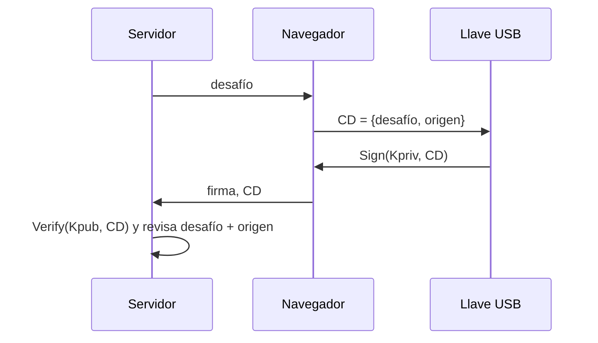

# Autenticación de dos factores: SMS, TOTP y U2F

Un segundo factor refuerza la contraseña: ayuda contra claves débiles o reutilizadas y contra ataques de hombre en el medio (MITM) y phishing. Las tres variantes principales difieren en qué tanto resisten el phishing.

## Comparación

| Variante | Cómo funciona | Ventajas | Desventajas |
|---|---|---|---|
| **SMS** | El servidor manda un código al celular | Fácil de empezar y de recuperar | Se confía en la red y el proveedor; hay que tener cobertura; vulnerable a phishing |
| **TOTP** | Servidor y dispositivo comparten un secreto (por QR); el código es $H(\text{secreto} \| \text{tiempo})$ | Sin red celular ni proveedor | Instalar app y recargar el secreto al cambiar de dispositivo; vulnerable a phishing |
| **U2F** | Una llave USB con par de claves firma un desafío | Resistente a phishing; sin configuración por servidor; un compromiso del servidor no sirve | Requiere software en el computador y llevar la llave |

## U2F paso a paso
La llave guarda (origen, `Kpriv`) y el servidor guarda la clave pública `Kpub`. Se usan dos operaciones: `Sign(Kpriv, m)` y `Verify(Kpub, m, sig)`. El navegador nunca ve `Kpriv`, así que no puede robarla ni estando comprometido.

Versión simplificada: el servidor envía un desafío aleatorio (*nonce*), la llave lo firma y el servidor verifica. **Replay:** si el atacante reenvía una firma grabada, falla, porque el servidor elige un desafío nuevo y la firma era del viejo.

Dos problemas de la versión simple y su solución:
- **Phishing:** `bad.com` pide a `bank.com` un desafío y se lo hace firmar al usuario. Solución: se firma el desafío junto con el **origen** (hash de protocolo, host y puerto); si el sitio es `bad.com`, el origen firmado no coincide con el que espera el banco.
- **Vinculación entre sitios:** si la `Kpub` fuera la misma en todos los sitios, estos podrían saber que el usuario es el mismo. Solución: se genera un par de claves nuevo por sitio al registrarse; `Kpriv` se guarda cifrada con una clave `Kwrap` (la única guardada a largo plazo en la llave), formando un *handle* asociado al origen.

**Otros ataques:** un cliente comprometido puede robar la cookie de sesión después de iniciar sesión o engañar para pulsar el botón; con una llave robada aún falta la contraseña.

## Preguntas de repaso

> [!question]- ¿Por qué TOTP y SMS siguen siendo vulnerables al phishing y U2F no?
> El código de TOTP/SMS lo escribe el usuario y sirve en cualquier sitio que lo reciba; en U2F la firma incluye el origen verdadero, por lo que un sitio falso obtiene una firma inútil para el sitio real.

> [!question]- ¿Para qué sirve el desafío aleatorio en U2F?
> Para impedir el replay: cada inicio de sesión exige firmar un valor nuevo, y una firma capturada antes no verifica.

> [!question]- ¿Por qué se genera un par de claves distinto por sitio?
> Para evitar que los servidores comparen claves públicas y sepan que dos cuentas son de la misma persona (privacidad).
