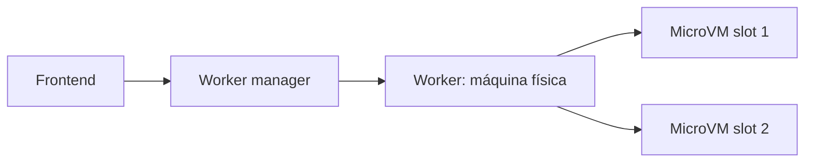

# Firecracker y aislamiento con microVMs

AWS Lambda ejecuta código arbitrario de clientes en máquinas compartidas, y necesita aislamiento fuerte con poco costo: muchas funciones por máquina y arranque rápido. **Firecracker**, un monitor de máquinas virtuales (VMM) minimalista de Amazon, resuelve esa tensión entre seguridad, rendimiento y compatibilidad con binarios Linux.

## Por qué no las opciones simples
- **Procesos Linux:** pensados para compartir de forma granular, no para aislar; demasiado estado compartido.
- **Contenedores (namespaces + cgroups):** comparten el kernel Linux: gran superficie de ataque (300+ syscalls, mucho código en C) y siguen apareciendo errores de escalación local de privilegios. **seccomp-bpf** recorta syscalls, pero rompe código de clientes que usa los poco comunes y no basta (los comunes también tienen errores).
- **VM completas:** superficie menor (solo x86 y dispositivos virtuales) y menos escapes, pero arranque lento, gran memoria por VM y un VMM (QEMU, 1,4 M líneas de C) con errores.

## Diseño de Firecracker
Usa **KVM** (la abstracción de Linux para el soporte de virtualización del hardware: CPU y memoria virtuales) y reemplaza a QEMU por un VMM propio, mínimo:
- Solo dispositivos virtio de red y de bloque, teclado y serie.
- Dispositivo de **bloque** en vez de sistema de archivos: es mucho más simple (bloques de 4 KB numerados, leer y escribir) que archivos, directorios y enlaces, por lo que el borde de aislamiento es más estricto.
- Sin emulación de instrucciones (salvo las necesarias) y **sin BIOS**: carga el kernel y lo ejecuta.
- Escrito en **Rust** (seguro en memoria): 50 000 líneas frente a las de QEMU.

**Defensa en profundidad:** el proceso VMM va "encarcelado" (`chroot`, namespaces, UID propio y seccomp-bpf), así que explotar un error del VMM no da mucho más.

Cada *worker* tiene un número fijo de *slots* de microVM; el código del cliente se carga arrancando una VM en un slot y el frontend envía la solicitud directo al worker elegido.

## Resultados y límites
Overhead de unos 3 MB por VM inactiva y 125 ms de arranque; la CPU rinde como KVM, pero el I/O de disco y red es más lento. KVM sigue en la **TCB** (base de computación confiable), aunque más pequeño que QEMU. Se han hallado errores (verificación de límites, DoS en la red, búfer de consola sin límite) incluso en Rust.

**Alternativa: gVisor.** Intercepta los syscalls y los reimplementa en espacio de usuario (en Go), con seccomp para limitarlo: menos errores de memoria y fuera del kernel, pero a costa de rendimiento (cambios de contexto y copias) y compatibilidad.

> [!tip] Idea clave
> Se busca aislamiento tan fuerte como una VM con el overhead de un contenedor: reducir el código confiable (TCB), usar un lenguaje seguro y sumar capas de defensa.

## Preguntas de repaso

> [!question]- ¿Por qué Firecracker usa un dispositivo de bloque y no un sistema de archivos compartido?
> El sistema de archivos tiene estado y operaciones complejas (directorios, enlaces, renombrar), es decir, más superficie de ataque; el dispositivo de bloque solo lee y escribe bloques numerados.

> [!question]- ¿Qué problema de los contenedores resuelve una microVM y cuál de las VM tradicionales?
> De los contenedores, el kernel compartido con una gran superficie de ataque; de las VM tradicionales, el arranque lento, el uso de memoria y un VMM enorme (QEMU).

> [!question]- ¿Por qué sigue habiendo riesgo aunque Firecracker esté escrito en Rust?
> Porque KVM (código en C del kernel) sigue en la TCB y porque hay errores lógicos (límites, recursos sin tope) que el lenguaje seguro no evita.
