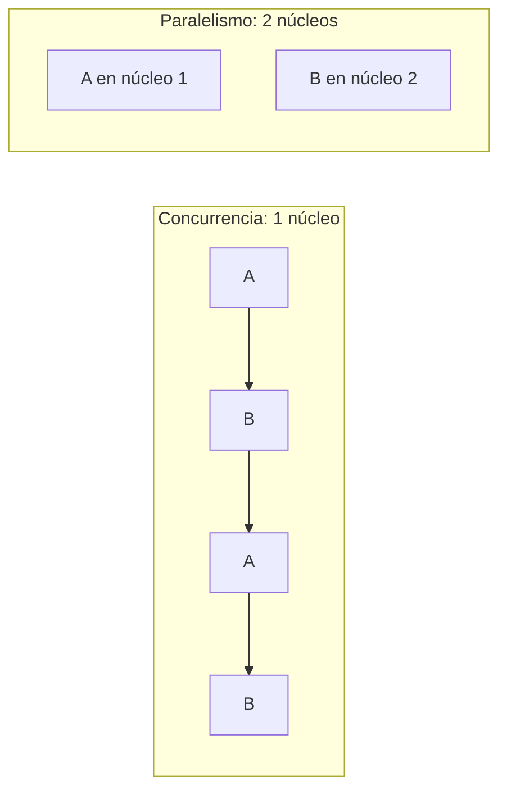

# El nodo, procesos y threads

Antes de coordinar muchos computadores hay que entender cómo trabaja **uno**. Cada máquina de un sistema distribuido, llamada **nodo**, ejecuta varios procesos a la vez, y cada proceso puede tener varios hilos (*threads*). Todo lo que se construye después (sockets, RPC, algoritmos de consenso) corre sobre estas piezas.

## Qué hace un nodo

Un nodo típico de un sistema distribuido:

- Es **cliente y servidor a la vez**: atiende peticiones y también hace peticiones a otros nodos.
- Expone **más de una API** (por ejemplo, una para usuarios y otra para comunicarse con otros nodos).
- Atiende a **muchos clientes simultáneamente**.

Para lograrlo reparte el trabajo entre procesos y threads. El curso los estudia por separado: qué es un **proceso**, qué es un **thread** y cómo se coordinan.

## Combinaciones de procesos y threads

> [!example]- Transcripción de la imagen
> Cuatro cuadrantes; cada rectángulo es un proceso y cada línea ondulada, un thread:
> - Un proceso con un thread.
> - Un proceso con múltiples threads.
> - Múltiples procesos con un thread por proceso.
> - Múltiples procesos con múltiples threads por proceso.

Cada combinación tiene ejemplos reales:

> [!example]- Transcripción de la imagen
> - **Un proceso, un thread:** la pantalla de configuración de la BIOS.
> - **Un proceso, múltiples threads:** el intérprete de Python con varios threads.
> - **Múltiples procesos, un thread por proceso:** Apache (`httpd`) en modo *prefork*, que asigna cada request a un proceso distinto (*request #1* → *process #1*, …).
> - **Múltiples procesos, múltiples threads por proceso:** Google Chrome, que usa un proceso por pestaña y varios threads en cada uno.

## Paralelismo frente a concurrencia

Es una distinción clave (y típica de prueba):

- **Paralelismo:** varias tareas se ejecutan **realmente al mismo tiempo**. Requiere más de un procesador (o núcleo).
- **Concurrencia:** varias tareas avanzan "a la vez" porque se **alternan** tan rápido que parece simultáneo. Funciona incluso con un solo procesador.

> [!tip] Regla para recordar
> Concurrencia es **estructura** (manejar varias cosas a la vez); paralelismo es **ejecución** (hacer varias cosas a la vez). Todo programa paralelo es concurrente, pero no al revés.

> [!warning] En Python, threads no implica paralelismo
> En CPython clásico, el *Global Interpreter Lock* (GIL) deja que un solo thread ejecute bytecode a la vez. Los threads de Python dan concurrencia (útil cuando se espera red o disco), pero para paralelismo real de cálculo se usan procesos (`multiprocessing`).

El detalle de cómo el sistema operativo representa y planifica procesos e hilos está en [[01 - Concepto de proceso y espacio de memoria|Concepto de proceso]] y [[01 - Concepto de hilo y recursos compartidos versus privados|Concepto de hilo]].

## Preguntas de repaso

> [!question]- ¿Por qué un servidor web como Apache en modo prefork usa un proceso por request?
> Porque cada proceso tiene su propia memoria: si una request provoca una falla, solo cae ese proceso y no los que atienden a otros clientes. El costo es que crear y cambiar entre procesos es más caro que hacerlo con threads.

> [!question]- ¿Puede haber concurrencia con un solo núcleo? ¿Y paralelismo?
> Concurrencia sí, porque el sistema operativo alterna rápidamente entre tareas. Paralelismo no, porque requiere que dos tareas se ejecuten en el mismo instante, y eso necesita más de un procesador.

> [!question]- ¿Por qué se dice que un nodo es "cliente y servidor a la vez"?
> Porque además de atender a sus clientes, necesita pedir datos o confirmaciones a otros nodos del sistema. En esa comunicación actúa como cliente de otro servidor.
