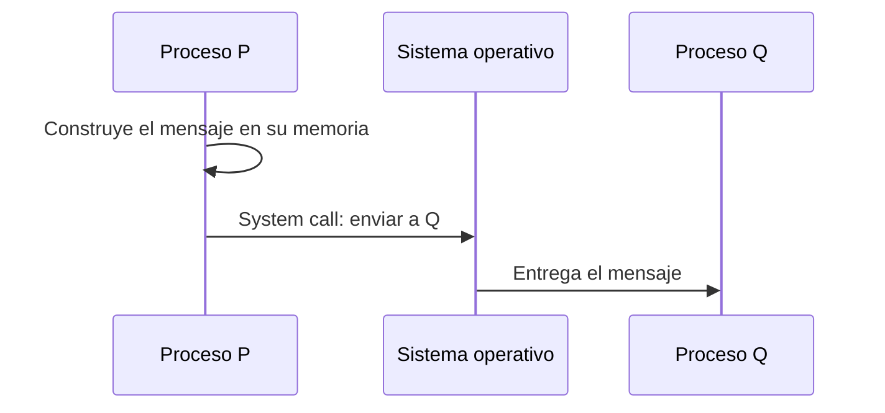

# Procesos y comunicación entre procesos

Un proceso vive aislado en su propio mundo, y eso lo hace robusto: si falla, no arrastra a los demás. Pero el aislamiento tiene un precio: cambiar de proceso es caro y, para colaborar, los procesos deben enviarse mensajes de forma explícita. Esa necesidad de comunicarse y coordinarse es, a escala de muchas máquinas, el problema central de los sistemas distribuidos.

## Qué es un proceso

Un **proceso** es un **programa en ejecución**. Al crearlo, el sistema operativo le asigna su **propio espacio de direcciones** y sus propios recursos, incluso si es el mismo programa ejecutado dos veces. Varios procesos pueden usar un mismo recurso (el disco duro, una impresora) sin estar conscientes de que otro también lo está usando, y por eso pueden pisarse sin saberlo.

## Por qué cambiar de proceso es costoso

El paso de un proceso a otro (**cambio de contexto**) obliga al sistema operativo a hacer varias operaciones para mantener la ilusión de que cada proceso tiene la máquina para él:

- Invalidar componentes como la **TLB**, para que la virtualización de memoria siga siendo correcta.
- Guardar los registros del proceso anterior y cargar los del nuevo.
- Decidir cuál es el siguiente proceso a ejecutar.

Ver el detalle en [[04 - Cambio de contexto y tipos de procesos|Cambio de contexto]]. Aun así, un nodo siempre necesita al menos un proceso para trabajar.

## El problema de coordinar procesos

Ejemplo: un proceso quiere **imprimir** un documento y otro quiere **escanear**, pero solo hay una máquina multifunción. Hay que coordinarlos para que uno se ejecute después del otro, pero cada uno vive en su propio mundo y **no comparte memoria** con el otro. La única salida es que se **envíen mensajes explícitamente**.

## IPC: mecanismos del sistema operativo

La **comunicación entre procesos** (IPC, *Inter-Process Communication*) es una función básica del sistema operativo, que ofrece varios mecanismos:

| Mecanismo | Para qué sirve |
|---|---|
| **Sistema de archivos** | Que cualquier proceso acceda al disco duro |
| **Semáforos** | Controlar el acceso a recursos compartidos |
| **Paso de mensajes** (*message passing*) | Enviar datos a otro proceso |
| **Sockets** | Abrir una vía de comunicación con un proceso de **otro computador** |
| **Memoria compartida** | Que dos o más procesos usen el mismo espacio de memoria para una operación |

Los sockets son el puente hacia los sistemas distribuidos y se estudian en el tema de comunicación directa.

## Paso de mensajes

Con esto los procesos ya pueden hablar, pero falta un **protocolo**: ¿el emisor debe esperar una respuesta o solo envía?, ¿cómo se entera el receptor de que llegó un mensaje?, ¿cómo se interpretan los bytes? Cada mecanismo de comunicación del curso responde estas preguntas a su manera.

> [!tip] Procesos frente a threads
> Los procesos **no** comparten memoria y deben comunicarse por mensajes. Los threads de un mismo proceso **sí** la comparten, así que no lo necesitan, aunque a cambio deben coordinar el acceso a esa memoria.

## Más allá del mensaje: coordinar

Que los procesos se comuniquen no basta. También hay que:

- Ejecutarlos en cierta **secuencia**.
- Decidir qué hacer si un proceso cuya información es vital para otro **falla**: ¿esperarlo?, ¿enviarle otro mensaje?
- Y lo más difícil: hacerlo cuando los procesos están en **distintos computadores**.

Para eso existen los mecanismos de coordinación que recorre el ramo.

> [!example]- Transcripción de la imagen
> Seis recuadros: algoritmos de exclusión mutua distribuida, protocolos de replicación de datos, algoritmos de elección de líder, algoritmos de consenso, sincronizar relojes y protocolos para hacer *commits*.

## Preguntas de repaso

> [!question]- ¿Por qué el cambio de contexto entre procesos es más caro que entre threads del mismo proceso?
> Porque cada proceso tiene su propio espacio de direcciones: al cambiar hay que invalidar la TLB y cambiar las tablas de memoria, además de guardar y cargar registros. Entre threads del mismo proceso la memoria es la misma, así que basta con cambiar registros y pila.

> [!question]- ¿Qué mecanismo de IPC sirve para comunicarse con un proceso de otro computador, y por qué los otros no?
> Los sockets. El sistema de archivos, los semáforos y la memoria compartida dependen de recursos de un mismo sistema operativo; un socket, en cambio, abre un canal sobre la red.

> [!question]- ¿Qué preguntas debe responder un protocolo de paso de mensajes?
> Si el emisor espera respuesta o solo envía, cómo detecta el receptor que llegó un mensaje y cómo se interpretan los bytes recibidos.
