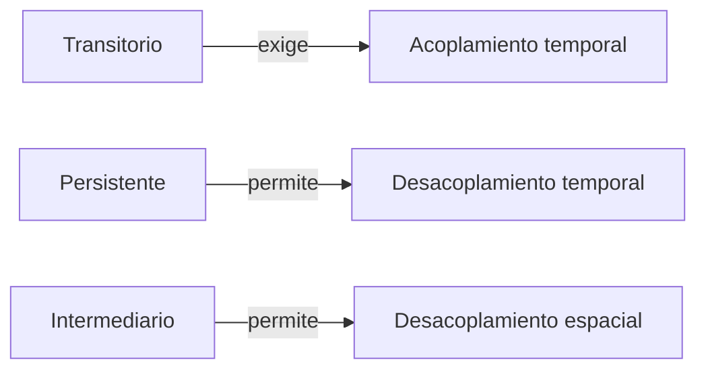

# Persistencia, sincronía y acoplamiento

Antes de elegir una tecnología de comunicación (sockets, colas, RPC) conviene saber describir qué tipo de intercambio se necesita. ¿El mensaje debe sobrevivir si el receptor está apagado? ¿El emisor puede seguir trabajando mientras tanto? ¿Necesita saber quién recibe? Estas tres preguntas definen el vocabulario con que se clasifica cualquier comunicación de red.

## Dos criterios para clasificar mensajes

### Persistencia

- **Transitoria:** el mensaje vive solo mientras las aplicaciones del emisor y del receptor están en ejecución. Si una de las dos cae (o se pierde el buffer), el mensaje se pierde. Ejemplos: una llamada de Google Meet sin grabar, mensajes por sockets de Python.
- **Persistente:** el mensaje se **almacena** en algún lugar durante el tiempo que tome entregarlo. Ejemplos: Outlook, Telegram.

### Sincronía

- **Sincrónica:** el emisor queda **bloqueado** hasta confirmar que el mensaje fue recibido, o incluso hasta tener la respuesta. Ejemplos: abrir una página web, la librería `requests` de Python.
- **Asincrónica:** el emisor **sigue ejecutando** apenas envía, aunque el mensaje todavía no llegue. Ejemplos: Gmail, una transmisión por Zoom.

> [!tip] Sincronía en el código
> En JavaScript las promesas permiten pedir algo a la red sin congelar la página. En Python, una llamada como `requests.get` es sincrónica: la línea siguiente no se ejecuta hasta que llega la respuesta.

## Acoplamiento

Con esos conceptos se caracteriza qué necesita una comunicación para tener éxito. Hay dos tipos de acoplamiento, y cada uno puede estar presente o no.

| | Acoplado | Desacoplado |
|---|---|---|
| **Temporal** | Emisor y receptor deben existir **al mismo tiempo**. Ej.: llamada por Zoom, transmisión en vivo por YouTube o Twitch | Pueden existir en **tiempos distintos**. Ej.: memoria compartida, Gmail |
| **Espacial (referencial)** | El emisor **conoce o necesita conocer** la identidad de los receptores. Ej.: mensaje privado de WhatsApp, correo electrónico | El emisor **no necesita** conocerla; la comunicación pasa por un **intermediario**. Ej.: publicación en Instagram, aviso de Canvas |

Los mensajes **transitorios** exigen acoplamiento temporal, porque si el receptor no está vivo en ese momento el mensaje se pierde. La **persistencia** es lo que permite desacoplar en el tiempo.

## Ejemplo: clasificar un escenario

Un profesor da una conferencia por Zoom que **no se graba**. Zoom actúa como intermediario: recibe la transmisión y la reenvía a todos los asistentes **sin que el profesor conozca sus identidades**.

- **Transitoria:** al no grabarse, quien no está conectado en ese momento se la pierde.
- **Asincrónica:** el profesor sigue hablando sin esperar confirmación de cada asistente.
- **Acoplada temporalmente:** emisor y receptores deben estar al mismo tiempo.
- **Desacoplada espacialmente:** el profesor no sabe quiénes reciben.

Por eso la descripción correcta es "transitoria, asincrónica y acoplada temporalmente". Decir que es persistente es falso (no queda guardada), y decir que está acoplada referencialmente también, porque Zoom oculta a los receptores.

> [!warning] Asincrónico no es lo mismo que desacoplado en el tiempo
> La sincronía habla de si el **emisor espera**; el acoplamiento temporal, de si ambos deben **existir a la vez**. Una transmisión en vivo es asincrónica y, aun así, está acoplada en el tiempo.

## Preguntas de repaso

> [!question]- ¿Por qué un mensaje transitorio obliga a acoplamiento temporal?
> Porque no se guarda en ninguna parte: si el receptor no está ejecutándose cuando llega, el mensaje se pierde. Solo funciona si ambos existen al mismo tiempo.

> [!question]- ¿Qué tipo de acoplamiento elimina un aviso de Canvas, y cómo lo logra?
> El espacial (referencial): el profesor publica el aviso en Canvas, que actúa como intermediario y lo entrega a los inscritos, sin que el profesor tenga que conocer a cada destinatario.

> [!question]- Una llamada con `requests.get` en Python, ¿es sincrónica o asincrónica? ¿Por qué importa en un servidor?
> Sincrónica: el programa se bloquea hasta recibir la respuesta. En un servidor, si esa espera ocurre en el único thread disponible, ningún otro cliente es atendido mientras tanto.
