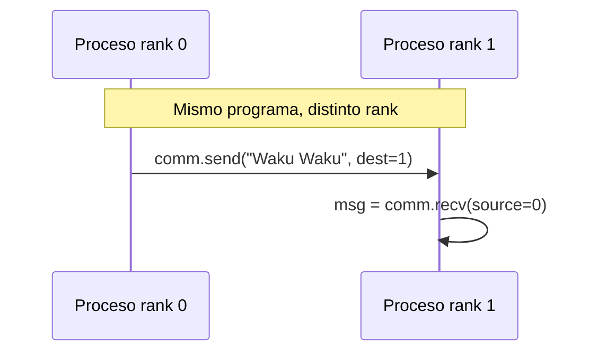

# MPI y el modelo SPMD

Con sockets, cada programa abre conexiones y define su propio protocolo. En la computación de alto rendimiento (clústeres) esto es demasiado trabajo, porque hay cientos de procesos que se comunican todo el tiempo. **MPI** (*Message Passing Interface*) resuelve el problema con un conjunto fijo de llamadas para enviar y recibir mensajes entre procesos. Es una forma antigua, pero aún vigente, de comunicación directa.

## Qué es MPI

- Es un **"estándar"** para la comunicación explícita entre procesos de un sistema distribuido. No es un estándar oficial, pero las implementaciones respetan las mismas reglas.
- Promueve el modelo **SPMD** (*Single Program, Multiple Data*): **todos los procesos ejecutan el mismo código**, cada uno con su propia memoria y un **identificador distinto** (el *rank*). Según su id, cada proceso ejecuta una parte distinta del código.
- Soporta comunicación **punto a punto** (entre dos procesos) y **colectiva** (entre varios nodos).

## Las cuatro clases de llamadas

| Clase | Llamadas |
|---|---|
| Inicializar, administrar y finalizar la comunicación | `MPI_Init`, `MPI_Finalize`, `MPI_Comm_size`, `MPI_Comm_rank` |
| Transferir datos entre un par de procesos | `MPI_Send`, `MPI_Recv` |
| Transferir datos entre varios procesos | `MPI_Barrier`, `MPI_Bcast` |
| Crear tipos de datos definidos por el usuario | `MPI_Type_struct` |

`MPI_Comm_size` dice cuántos procesos hay y `MPI_Comm_rank` qué número es el proceso actual; con eso cada uno decide qué hacer. `MPI_Barrier` hace que todos esperen hasta que el último llegue a ese punto, y `MPI_Bcast` envía un dato de un proceso a todos los demás.

## Ejemplo en Python con mpi4py

```python
from mpi4py import MPI

comm = MPI.COMM_WORLD          # todos los procesos lanzados juntos
rank = comm.Get_rank()         # identificador de este proceso

if rank == 0:
    print("Proceso 0 envía mensaje")
    comm.send("Waku Waku", dest=1)
elif rank == 1:
    msg = comm.recv(source=0)
    print(f"Proceso 1 recibió: {msg}")
```

Se ejecuta lanzando **dos copias del mismo programa**:

```text
$ mpiexec -n 2 python ejemplo.py
Proceso 0 envía mensaje
Proceso 1 recibió: Waku Waku
```



> [!tip] Mismo código, rol distinto
> En SPMD no hay un programa "cliente" y otro "servidor": el `if rank == ...` reparte los roles. Esto simplifica el despliegue en un clúster, donde se copia un único binario a todos los nodos.

> [!warning] `send` y `recv` deben calzar
> Si el proceso 1 espera un mensaje de `source=0` que nunca se envía, se queda bloqueado para siempre. Con muchos procesos, un `send` o `recv` mal emparejado es una causa típica de deadlock.

## Preguntas de repaso

> [!question]- ¿Qué significa SPMD y cómo se reparten las tareas en ese modelo?
> *Single Program, Multiple Data*: todos los procesos ejecutan el mismo programa sobre datos distintos. Las tareas se reparten según el rank de cada proceso, con condiciones del tipo `if rank == 0`.

> [!question]- ¿Por qué MPI se asocia a la computación en clúster y no a servicios web?
> Porque supone un grupo fijo de procesos lanzados juntos que cooperan intensamente en un cálculo paralelo. Un servicio web, en cambio, atiende clientes que llegan y se van, y para eso encajan mejor los sockets o HTTP.

> [!question]- ¿Para qué sirve `MPI_Barrier`?
> Para sincronizar: ningún proceso continúa hasta que todos llegaron a la barrera. Se usa, por ejemplo, para asegurar que una fase del cálculo terminó en todos los nodos antes de empezar la siguiente.
