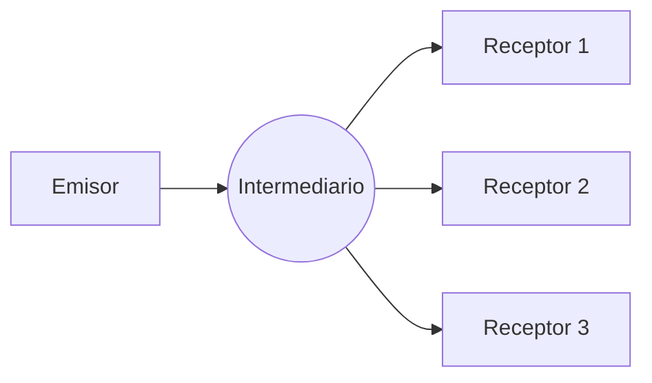

# Comunicación indirecta y sus mecanismos

En la comunicación directa el emisor debe saber a quién habla, y casi siempre ambos deben estar vivos a la vez. La **comunicación indirecta** rompe esas dependencias poniendo un intermediario en medio: el emisor entrega el mensaje y se desentiende, porque el intermediario sabe a quién y cuándo entregarlo.

## Un nivel más de indirección

> [!tip] La frase del tema
> "Podemos resolver cualquier problema introduciendo un nivel adicional de indirección" (Roger Needham, Maurice Wilkes y David Wheeler)... **excepto el problema de tener muchas capas de indirección**.

La primera mitad explica por qué los intermediarios aparecen en todas partes: desacoplan. La segunda advierte su costo: cada capa agrega latencia, complejidad y un punto más que puede fallar.

## Definición

La **comunicación indirecta** es la comunicación entre entidades de un sistema distribuido **a través de un intermediario**, **sin acoplamiento referencial** entre el emisor y los receptores. El emisor no habla directamente con el receptor y no le interesa quién es: asume que el intermediario sabrá entregarlo.

Si además el intermediario **guarda** los mensajes (por ejemplo, en una base de datos), se obtiene **desacoplamiento temporal**: el receptor va a buscar el mensaje cuando quiera, y el emisor no necesita estar conectado en ese momento.

## Los cuatro mecanismos más conocidos

| Mecanismo | Cómo funciona |
|---|---|
| **Grupos** | El emisor envía el mensaje a un "proceso grupo", y este intermediario lo reenvía a todos los procesos miembros |
| **Memoria compartida** | Se define un sector de memoria donde todos los procesos leen y escriben. No hay envío de mensajes: se comparten variables |
| **Colas de mensajes** | El emisor deja el mensaje en una cola y el receptor lo extrae después |
| **Publish-subscribe** | El emisor publica eventos en un sistema que los enruta a múltiples suscriptores según su interés |

El curso se concentra en los dos últimos: [[02 - Colas de mensajes|Colas de mensajes]] y [[03 - Sistemas publish-subscribe|Sistemas publish-subscribe]].

## Qué se gana y qué se paga

- **Se gana:** el emisor no conoce a los receptores (se pueden agregar o quitar sin tocarlo), los receptores pueden estar desconectados (si hay persistencia) y el intermediario puede traducir entre componentes heterogéneos.
- **Se paga:** un salto extra de red (más latencia), un componente más que operar y escalar, y un posible punto único de falla si el intermediario no está replicado.

> [!warning] Indirecto no implica persistente
> Que exista un intermediario elimina el acoplamiento referencial, pero el desacoplamiento temporal depende de que el intermediario **almacene** los mensajes. Un intermediario que solo reenvía en vivo sigue exigiendo que el receptor esté conectado.

## Preguntas de repaso

> [!question]- ¿Qué tipo de acoplamiento elimina siempre la comunicación indirecta, y cuál solo a veces?
> Siempre elimina el referencial, porque el emisor habla con el intermediario y no con el receptor. El temporal solo se elimina si el intermediario guarda los mensajes hasta que el receptor los pida.

> [!question]- ¿Por qué la memoria compartida se considera comunicación indirecta si no hay mensajes?
> Porque emisor y receptor no se comunican directamente: uno escribe en una zona de memoria y el otro la lee después. La memoria actúa como intermediario y ninguno necesita conocer al otro.

> [!question]- ¿Cuál es el "excepto" de la frase sobre la indirección y por qué importa en un sistema distribuido?
> Que agregar capas tiene un límite: cada intermediario suma latencia, complejidad y puntos de falla. Un sistema con demasiadas capas puede ser más lento y frágil que el problema que intentaba resolver.
