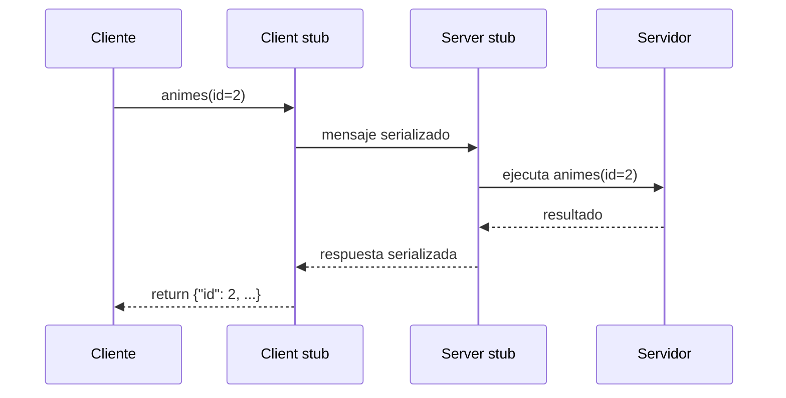

# RPC y stubs

¿Y si llamar a una función de otro computador se viera exactamente igual que llamar a una función local? Esa es la idea de **RPC** (*Remote Procedure Call*): como si se importara el servidor y se usaran sus funciones. Para lograrlo, RPC esconde todo el paso de mensajes detrás de unos componentes llamados **stubs**.

## La meta: transparencia

RPC busca la **transparencia de acceso y de ubicación**: las funciones o procedimientos se llaman de forma **idéntica** a como se llamarían localmente. El programador escribe `s.animes(id=2)` sin saber dónde está la información ni cómo viaja. A diferencia de una API REST, no se piensa en `GET` o `POST`: solo se llama al método.

## Los stubs

RPC agrega un componente nuevo, el **stub**, en cada extremo:

- **Client stub:** convierte la llamada del cliente y sus argumentos en un mensaje para el servidor (*pack*). Cuando llega la respuesta, la interpreta y la convierte en el valor de retorno de la función (*unpack*).
- **Server stub:** interpreta el mensaje del cliente para saber **qué función ejecutar** y con qué argumentos, la ejecuta y genera el mensaje con la respuesta.

La comunicación se hace por **serialización**. Al principio era casi siempre binaria; hoy existen implementaciones con formatos legibles (XML, JSON).

> [!example]- Transcripción de la imagen
> *Remote Procedural Call (RPC) Mechanism in Distributed System*, con una máquina cliente y una servidora, cada una con tres capas (aplicación, stub y *RPC Runtime*):
> 1. El cliente hace *Call*.
> 2. El *Client Stub* empaqueta (*pack*) la llamada.
> 3. El *RPC Runtime* la envía (*Send*) como *Call Packet* y queda esperando (*Wait*).
> 4. Del lado servidor, el runtime la recibe, el *Server Stub* la desempaqueta (*Unpack*) y el servidor la ejecuta (*Call → Execute → Return*); luego el stub empaqueta el resultado.
> 5. El runtime del servidor envía el *Result Packet*.
> 6. El runtime del cliente lo recibe, el stub lo desempaqueta y la llamada retorna (*Return*). Fuente: GeeksforGeeks.

## REST frente a RPC

> [!example]- Transcripción de la imagen
> **REST:** el cliente envía `GET /animes` y recibe `[{"id": 1, …}, {"id": 2, …} …]`; luego `GET /animes/2` y recibe `{"id": 2 …}`. **RPC:** el cliente llama `s.animes()` y recibe la misma lista; luego `s.animes(id=2)` y recibe `{"id": 2 …}`.

Ambos permiten lo mismo; REST se usa mucho más porque se apoya en los estándares de la web. Aun así, RPC sigue vigente: **Git** lo usa por debajo.

Al comunicarse, los stubs pueden usar sockets con sus propias reglas u otros protocolos como HTTP, pero **no necesariamente respetan los estándares de HTTP**:

- El servidor RPC puede **mantener estado** y recordar ejecuciones pasadas.
- Un `GET` puede **modificar** información.
- Un `POST` puede servir solo para **leer** datos.

También se puede agregar un intermediario (comunicación indirecta) para ofrecer funciones adicionales.

| | REST | RPC |
|---|---|---|
| Se piensa en | Recursos (URLs) y métodos HTTP | Funciones y argumentos |
| Estado | Stateless | Puede tener estado |
| Mensajes | Legibles (HTTP + JSON) | Serializados, a menudo binarios |
| Transparencia | Se ve que es una petición HTTP | La llamada parece local |

> [!warning] Lo remoto no es local
> La transparencia de RPC es útil, pero engañosa: una llamada remota puede tardar mucho, fallar por la red o ejecutarse dos veces si se reintenta. Tratarla como una función local es uno de los [[03 - Desafíos de los sistemas distribuidos|pitfalls de diseño]].

## Preguntas de repaso

> [!question]- ¿Qué hace el client stub antes y después de la llamada?
> Antes, convierte la función y sus argumentos en un mensaje serializado y lo envía. Después, recibe la respuesta, la deserializa y la entrega como valor de retorno, de modo que el cliente ve una llamada normal.

> [!question]- ¿Qué tipos de transparencia busca RPC?
> De acceso (la función remota se llama igual que una local) y de ubicación (el cliente no necesita saber en qué máquina está la función).

> [!question]- ¿Por qué un servidor RPC sobre HTTP puede violar los estándares de HTTP?
> Porque usa HTTP solo como transporte: lo que importa es qué función se invoca, no el método HTTP. Así, un `POST` puede leer datos y el servidor puede recordar llamadas anteriores, cosas que REST evita.
