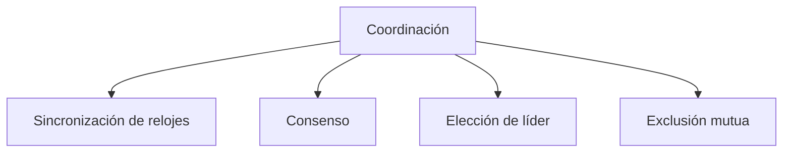

# Coordinación en sistemas distribuidos

Comunicar nodos no basta: además hay que lograr que **cooperen** para cumplir una meta común, sin memoria compartida, sin reloj global y con fallas posibles. Esa es la **coordinación**, y es la unidad más importante del ramo. Este tema y los cuatro siguientes recorren sus algoritmos.

## Qué es coordinar

La **coordinación** se refiere a cómo los procesos cooperan entre sí. Son los mecanismos (pasos y protocolos de interacción) que gestionan las interacciones y dependencias entre actividades de un sistema distribuido para asegurar que una o más tareas se logren con éxito.

En un solo computador esto se resuelve con locks, semáforos y un reloj común. En un sistema distribuido solo hay **mensajes**, y cada mecanismo debe construirse sobre ellos.

## Cuatro tipos de coordinación

Los mecanismos se clasifican según el objetivo que buscan asegurar:

| Tipo | Qué asegura | Tema |
|---|---|---|
| **Sincronización de relojes** | Que los nodos tengan una **noción común del tiempo** | Este tema (relojes físicos) y el siguiente (relojes lógicos) |
| **Consenso** | Que todos los nodos se pongan de acuerdo en **qué operación ejecutar** | Consenso |
| **Elección de líder** | Que todos acepten que un nodo asume un **rol superior** o de coordinación | Elección de líder |
| **Exclusión mutua** | El **acceso único** a un recurso: el equivalente distribuido de un lock | Exclusión mutua distribuida |

## Algoritmos que combinan mecanismos

Los tipos no son compartimentos estancos. Varios algoritmos usan más de uno para cumplir su tarea:

- **Raft** tiene una fase de **elección de líder** y luego una fase de **consenso** sobre la información.
- **Berkeley** primero **elige un líder** y luego **sincroniza los relojes** de todos.

> [!tip] Por qué esta unidad es central
> Casi todo servicio distribuido real necesita al menos uno de estos cuatro mecanismos: ordenar eventos, acordar valores, tener un coordinador o proteger un recurso. Los algoritmos de esta unidad son las piezas con que se construyen las bases de datos replicadas, las colas y los sistemas de archivos distribuidos.

> [!warning] Todo se hace con mensajes
> En un computador, un lock es una instrucción atómica sobre memoria compartida. En un sistema distribuido no existe esa memoria: cada mecanismo de coordinación es un **protocolo de mensajes**, y por eso debe tolerar retrasos, pérdidas y nodos caídos.

## Preguntas de repaso

> [!question]- ¿Por qué no se puede usar un mutex común para la exclusión mutua entre nodos?
> Porque un mutex depende de memoria compartida y de instrucciones atómicas dentro de un mismo computador. Los nodos no comparten memoria, así que solo pueden coordinarse enviándose mensajes.

> [!question]- ¿Qué dos mecanismos de coordinación combina el algoritmo de Berkeley, y en qué orden?
> Primero elige un líder entre los nodos y luego ese líder sincroniza los relojes de todos, calculando una hora promedio.

> [!question]- ¿Qué diferencia hay entre el objetivo del consenso y el de la elección de líder?
> El consenso busca que todos acuerden una operación o valor. La elección de líder busca que todos reconozcan a un mismo nodo como coordinador; ese líder puede luego facilitar el consenso, como ocurre en Raft.
