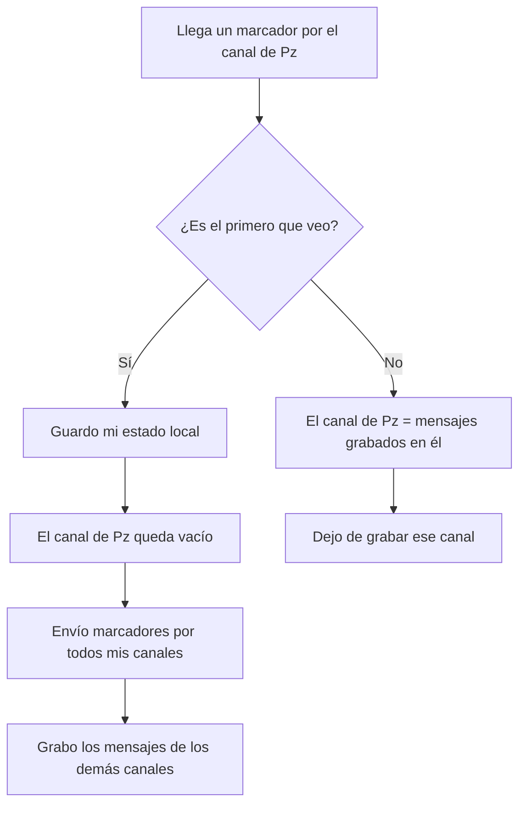

# Algoritmo de Chandy-Lamport

¿Cómo sacar una foto consistente de un sistema distribuido sin detenerlo? Chandy y Lamport propusieron enviar por los canales un mensaje especial, el **marcador** (*marker*), que divide cada canal en "antes de la foto" y "después de la foto". Cada nodo guarda su estado al ver el primer marcador y graba los mensajes que llegan en tránsito hasta ver los demás.

## Idea

> [!example]- Transcripción de la imagen
> Permite capturar un estado global consistente sin detener la ejecución normal. Su mecanismo central es el envío de un mensaje marcador (*marker*): los marcadores viajan por los canales de comunicación y no afectan los mensajes de aplicación, y todo par de nodos tiene un canal para conversar. Tiene 3 fases: inicialización, propagación y finalización.

## Fase 1: inicialización

Un nodo $P_x$ cualquiera inicia el algoritmo:

1. Guarda su **estado local**.
2. Envía un **marcador** por todos sus canales de salida.
3. Comienza a **grabar** todos los mensajes que le lleguen por sus canales de entrada.

## Fase 2: propagación

> [!example]- Transcripción de la imagen
> **Caso 1: el nodo $P_y$ recibe por primera vez un marcador de algún nodo $P_z$.** $P_y$ guarda su estado local y envía un marcador por todos sus canales. El canal $C_{zy}$, entre quien le mandó el primer marcador y este nodo, queda vacío. $P_y$ comienza a grabar los mensajes entrantes en todos los demás canales.
> **Caso 2: $P_y$ recibe un marcador de algún nodo $P_k$ después de haber visto uno.** Guarda el estado del canal $C_{ky}$ como los mensajes recibidos desde que empezó a grabarlo, y deja de escuchar ese canal para fines del algoritmo.

En resumen: el **primer** marcador congela mi estado y vacía el canal por donde llegó; cada marcador **posterior** cierra la grabación de su canal.

## Fase 3: finalización

> [!example]- Transcripción de la imagen
> El algoritmo termina cuando todos los nodos registraron su estado local y el estado de todos sus canales de comunicación. Un nodo "líder" o central puede verificar que todos indiquen haber terminado y pedir los estados guardados para reunirlos en un solo lugar.

## Por qué funciona

Un mensaje enviado **antes** de que el emisor guardara su estado viaja **delante** del marcador por el canal; uno enviado **después** viaja **detrás**. Así, en cada canal:

- lo que llega antes del marcador pertenece al pasado de la foto, y si el receptor ya guardó su estado, es un **mensaje en tránsito** que hay que grabar;
- lo que llega después del marcador pertenece al futuro y no se registra.

Esto produce un [[03 - Estados globales y cortes consistentes|corte consistente]]: nunca se registra una recepción sin su envío.

## Supuestos

| Realistas | No tanto |
|---|---|
| Cualquier nodo puede iniciar el algoritmo | La comunicación es confiable: no hay fallas durante la ejecución |
| La captura no interfiere con la ejecución normal | Existe un canal entre cualquier par de nodos |
| Cada nodo registra su estado y el de sus canales de entrada | Los canales son unidireccionales y entregan en orden **FIFO** |
| El estado global se recolecta de forma distribuida | |

> [!warning] Sin FIFO no funciona
> Si los canales no respetaran el orden FIFO, un marcador enviado **después** de un mensaje podría llegar **antes** que él. Ese mensaje quedaría fuera del estado del canal aunque pertenece al pasado de la foto, y el corte dejaría de ser consistente.

> [!tip] Hoy en día
> **Apache Flink**, una herramienta para procesar flujos de datos grandes y en tiempo real en muchos computadores, usa snapshots asíncronos inspirados en este algoritmo para recordar su estado y recuperarse de fallas.

Un ejemplo completo, paso a paso, está en [[05 - Ejemplo de Chandy-Lamport|Ejemplo de Chandy-Lamport]].

## Preguntas de repaso

> [!question]- ¿Por qué el canal por el que llega el primer marcador queda vacío?
> Porque el emisor envió el marcador justo después de guardar su estado, y por FIFO todo lo que envió antes ya llegó. No puede haber mensajes de ese canal que pertenezcan al pasado y sigan en tránsito.

> [!question]- ¿Qué hace un nodo cuando recibe un segundo marcador por otro canal?
> Cierra la grabación de ese canal: el estado del canal son los mensajes que llegaron por él desde que empezó a grabar hasta ese marcador.

> [!question]- ¿Por qué el algoritmo no necesita detener el sistema?
> Porque los marcadores viajan junto con los mensajes normales y cada nodo guarda su estado en su propio momento. La consistencia la dan el orden de los marcadores en cada canal, no una pausa global.
