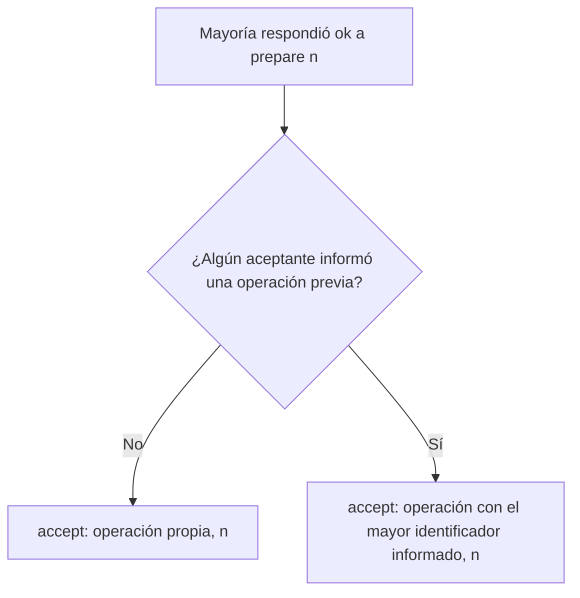

# Paxos: aceptar y aprender

Con la mayoría de "ok" de la fase 1, el proponente ya tiene el turno. Pero no siempre puede proponer lo que quiere: si algún aceptante le contó que ya aceptó una operación, debe **reenviar esa**. Después, los aprendices verifican qué operación tiene mayoría y la consolidan para siempre.

## Fase 2: aceptar

Si **más del 50 %** de todos los nodos respondió "ok", el proponente envía `accept(operación, n)` a los aceptantes. Hay dos casos.

### Caso 1: nadie había aceptado una operación

El proponente envía **la operación que desea**, con el identificador $n$ de su prepare.

> [!example]- Transcripción de la imagen
> A la izquierda, el proponente piensa "Me aceptaron mi prepare(1)": dos aceptantes respondieron "ok" y el tercero está caído. A la derecha piensa "Mando la operación que yo quiera" y envía `accept(A1, 1)` a los dos aceptantes activos.

### Caso 2: algún nodo ya había aceptado una operación

El proponente debe enviar **la operación asociada al identificador más alto** que le informaron, con su propio $n$.

> [!example]- Transcripción de la imagen
> El proponente quería mandar la acción $A_{uwu}$ y envió `prepare(5)`. Piensa "Me aceptaron mi prepare(5)": un aceptante respondió "Ok, pero acepté $A_0$ con n = 0", otro está caído, y otro respondió "Ok, pero acepté $A_4$ con n = 4". Entonces piensa "No puedo mandar lo que quiera" y envía `accept(A4, 5)` a todos.

Un aceptante acepta `accept(op, n)` si no prometió algo mayor a $n$ en el intertanto; si lo hizo, lo rechaza.

> [!tip] Por qué heredar la operación
> Si una operación pudo haber logrado mayoría antes, alguno de los nodos de la nueva mayoría la vio. Reenviar la de mayor identificador garantiza que una operación ya elegida no se reemplace por otra distinta.

## Fase 3: aprender

- Los **aprendices** verifican la operación aceptada por los aceptantes.
- Si **más del 50 %** de los aceptantes activos tiene la **misma** operación, esta se **aprende** (consolida) de forma permanente.
- Si los aprendices no logran verificarlo, **no hay consolidación**.

> [!example]- Transcripción de la imagen
> Tres aceptantes informan `accept(A2, 1)`, `accept(A2, 1)` y `accept(A1, 5)`. El aprendiz (una base de datos con un escudo) dice "Me quedo con `accept(A2, 1)`", porque es la operación que tiene la mayoría.

## Resumen de la fase 2

| Resultado de la fase 1 | Qué hace el proponente |
|---|---|
| 50 % o menos de "ok" (propuesta fallida) | Vuelve a la fase 1 con un identificador mayor |
| Más del 50 % y nadie tenía operación aceptada | Envía la operación que quiera |
| Más del 50 % y alguien tenía operación aceptada | Reenvía la operación del identificador más grande |

Los casos con varios proponentes compitiendo, que muestran por qué estas reglas importan, están en [[04 - Casos borde y garantías de Paxos|Casos borde y garantías de Paxos]].

## Preguntas de repaso

> [!question]- Un proponente quiere enviar $B$, pero un aceptante le informa que aceptó $A_3$ con n = 3 y otro que aceptó $A_7$ con n = 7. ¿Qué envía?
> `accept(A7, n)` con su propio identificador: debe reenviar la operación asociada al identificador más alto informado, no la suya.

> [!question]- ¿Cuándo se considera consolidada una operación en Paxos?
> Cuando los aprendices verifican que más del 50 % de los aceptantes tiene la misma operación aceptada. Que un solo aceptante la haya aceptado no basta.

> [!question]- ¿Por qué un aceptante puede rechazar un `accept(op, n)` aunque antes respondió "ok" a `prepare(n)`?
> Porque entre ambos mensajes pudo recibir un `prepare` con identificador mayor y prometer no aceptar nada menor. Esa promesa nueva tiene prioridad.
