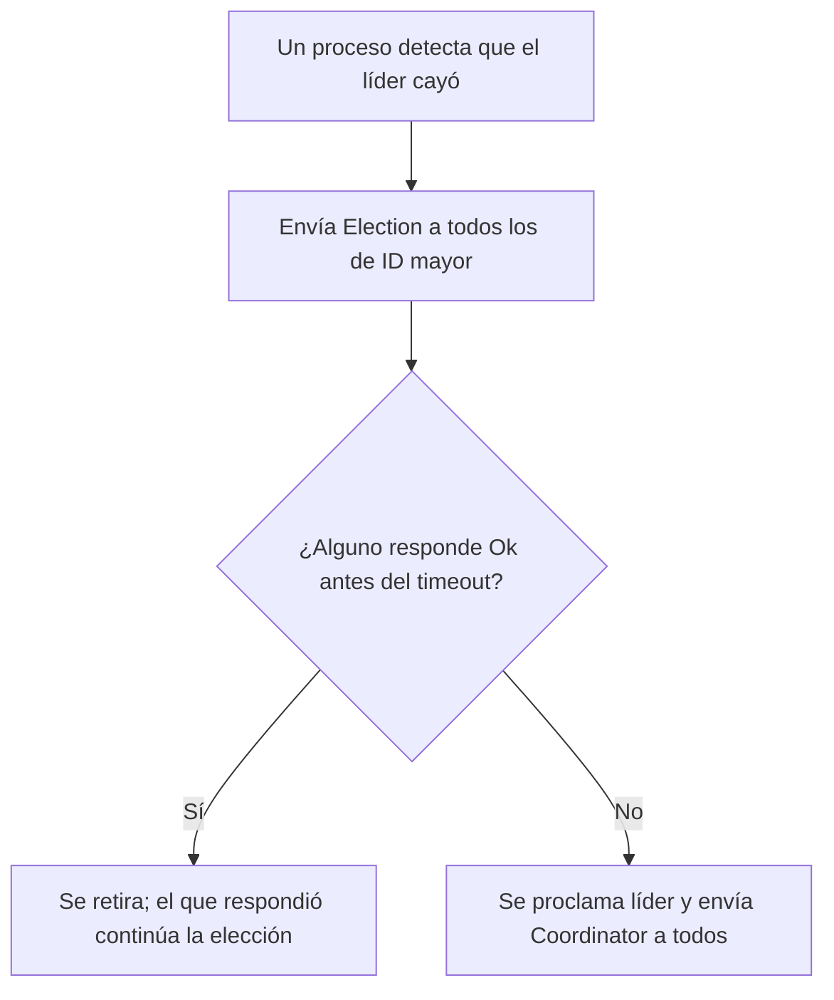

# Elección de líder y algoritmo Bully

Muchos algoritmos distribuidos se simplifican si un nodo asume un rol especial: coordinar, iniciar un protocolo, servir de reloj de referencia (como en Berkeley) o administrar un recurso crítico. Pero ese líder puede caerse, y entonces el resto debe ponerse de acuerdo en quién lo reemplaza. Los **algoritmos de elección de líder** resuelven ese acuerdo; el más antiguo es **Bully**.

## Características de un algoritmo de elección

- Cada proceso $P_x$ tiene un **identificador único**: su PID, un valor dinámico, alguna propiedad o una combinación de valores.
- Cada proceso tiene una variable $elected_x$ con el identificador del líder.

> [!tip] Las dos propiedades
> - **Safety:** cada proceso participante tiene $elected_x$ como "por definir" o como el ID del líder. **Nunca hay dos líderes válidos a la vez.**
> - **Liveness:** todos los procesos participan y finalmente fijan $elected_x$, o fallan. **Siempre habrá un líder elegido eventualmente.**

## Algoritmo Bully ("el matón")

Propuesto por **García-Molina en 1982**. Es un algoritmo **síncrono**: usa **timeouts** para detectar nodos caídos.

- Se fija un retraso máximo de transmisión ($T_{trans}$) y uno de procesamiento ($T_{process}$).
- Si un nodo tarda más de $2 \cdot T_{trans} + T_{process}$ en responder (ida, procesamiento y vuelta), se asume que falló.

**Supuestos:** el identificador de cada nodo es fijo, y cada nodo sabe qué nodos tienen identificadores más altos y puede comunicarse con todos ellos.

**Mensajes:**

| Mensaje | Para qué |
|---|---|
| `Election` | Anunciar una elección |
| `Ok` | Responder a un `Election` para detener la candidatura del que preguntó |
| `Coordinator` | Anunciar la identidad del nuevo líder |

## Funcionamiento

**Caso inicial:** como todos conocen los identificadores, el de **mayor ID** envía `Coordinator` y se proclama líder.

> [!example]- Transcripción de la imagen
> Caso inicial: como todos saben el identificador de cada proceso, aquel con mayor identificador manda `Coordinator` para avisar que será el líder. El nodo 5, con corona, dice "Mi ID es 5, mayor a todos. ¡Obedezcan!" a los nodos 1, 2, 3 y 4.

**Cuando el líder cae**, el nodo que lo detecta inicia una elección:

> [!example]- Transcripción de la imagen
> El nodo 1 envía `Election` a los nodos 2, 3, 4 y 5 (el 5, el líder caído, está tachado): se manda a todos los de ID superior, incluido el caído.

> [!example]- Transcripción de la imagen
> Los nodos 2, 3 y 4 responden "Ok" al nodo 1, para que sepa que existe un nodo vivo con mayor ID. El 5 sigue caído.

Los que respondieron `Ok` inician su propia elección hacia los de ID mayor, y así sucesivamente, hasta que el mayor vivo no recibe respuesta de nadie:

> [!example]- Transcripción de la imagen
> No hay respuesta de nadie, así que el nodo 4 manda `Coordinator` a 1, 2 y 3, con corona: "Mi ID es el siguiente mayor vivo. ¡Obedezcan!"

> [!tip] Resumen
> El proceso con **mayor identificador vivo** siempre termina siendo el líder: de ahí el nombre "matón". Quien inicia la elección solo contacta a los de ID superior.

## Costo

En el peor caso, quien detecta la caída es el de **menor ID**: envía $N-1$ mensajes `Election`, el siguiente envía $N-2$, y así hasta el segundo mejor, que envía 1. En total hay $\frac{N(N-1)}{2}$ mensajes `Election`, es decir, $O(N^2)$ (con $N = 5$, 10 mensajes, verificado en Python). En una red grande esto puede ser demasiado lento.

> [!warning] Depende de los timeouts
> Si la red es más lenta de lo previsto, un nodo vivo puede parecer caído y dos nodos podrían proclamarse líder. Bully supone un sistema síncrono con retrasos acotados, algo que las redes reales no garantizan.

## Preguntas de repaso

> [!question]- ¿Por qué Bully envía `Election` también al líder que se cree caído?
> Porque quizás no está caído, sino lento. Si responde `Ok` antes del timeout, la elección se detiene y sigue siendo el líder.

> [!question]- ¿De dónde sale el timeout de $2 \cdot T_{trans} + T_{process}$?
> Es el tiempo máximo para que un mensaje llegue ($T_{trans}$), se procese ($T_{process}$) y vuelva la respuesta ($T_{trans}$). Si no hay respuesta en ese plazo, se asume la falla.

> [!question]- ¿Qué propiedad de las dos se pone en riesgo si los timeouts están mal calibrados?
> Safety: un nodo lento puede ser declarado caído y otro asumir el liderazgo mientras el primero sigue creyéndose líder, con lo que habría dos líderes a la vez.
