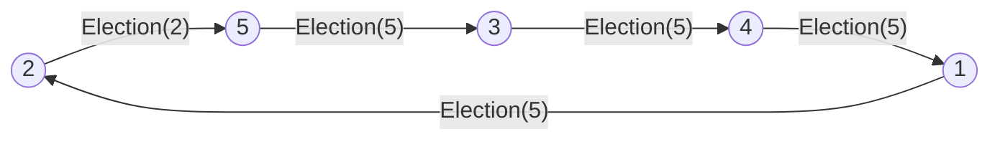

# Algoritmo Ring-based

Bully exige que cada nodo conozca y pueda contactar a todos los de ID mayor. ¿Y si cada nodo solo conoce a su **vecino**? El algoritmo **Ring-based** organiza los procesos en un anillo y hace circular un mensaje de elección que va quedándose con el ID más grande que encuentra. Cuando el mensaje vuelve a su dueño, ese es el líder.

## Supuestos

- Propuesto por **Chang y Roberts en 1979**.
- Los procesos forman un **anillo**: cada $P_i$ se comunica con el siguiente, $P_{(i+1) \bmod N}$, y solo conoce a ese vecino, no toda la red.
- Es **asíncrono** y, por defecto, **no tolera fallos**.
- El identificador de cada proceso es fijo, y ningún proceso conoce los identificadores de los demás.

**Mensajes:** `Election` (anunciar una elección) y `Elected` (anunciar la identidad del elegido).

## Funcionamiento

1. Cualquier proceso $P_i$ se **autopropone** como líder y envía `Election(ID_i)` a su vecino.
2. Cuando $P_x$ recibe `Election(ID_i)`:
   - si $ID_i < ID_x$, **reemplaza** el ID por el suyo y envía `Election(ID_x)`;
   - si $ID_i > ID_x$, **reenvía** el mensaje sin cambios;
   - si $ID_i = ID_x$, el mensaje dio una **vuelta completa**: $P_x$ es el líder.
3. El líder envía `Elected(ID_x)`, que da otra vuelta completa para que todos fijen $elected$.

> [!example]- Transcripción de la imagen
> Cinco procesos en anillo (1 a 5). El mensaje `Election(ID=5)` recorre el anillo; el nodo 1 piensa "Su ID es más grande que el mío, lo reenvío". Cuando el mensaje vuelve al nodo 5, este dice "¡Ese es mi ID! ¡Soy el líder, obedezcan!".

En el ejemplo de las slides, el proceso 2 inicia con `Election(ID=2)`. El 5 lo recibe, piensa "qué pequeño… mejor soy yo el líder" y lo cambia por `Election(ID=5)`. Los demás lo reenvían, porque 5 es mayor que su propio ID. Al volver al 5, este envía `Elected(ID=5)` y todos saludan al nuevo líder.

El diagrama es solo ilustrativo: el orden real de los nodos depende del anillo.

## Costo

En el peor caso, el proceso de mayor ID está **justo antes** de quien inicia la elección:

- el `Election` del iniciador recorre $N - 1$ saltos hasta llegar al mayor;
- el `Election` con el ID mayor da una vuelta completa: $N$ saltos;
- el `Elected` da otra vuelta: $N$ saltos.

Total: $3N - 1$ mensajes, es decir, $O(N)$. Una simulación en Python con $N = 5$ dio 14 mensajes. Bully, en cambio, puede llegar a $O(N^2)$.

> [!warning] Un nodo caído rompe el anillo
> Como cada nodo solo conoce a su vecino, si uno cae el mensaje no puede avanzar. Por eso la versión básica no tolera fallos.

> [!tip] Variaciones
> - Comunicación **bidireccional**.
> - **Timeouts** para volverlo síncrono.
> - Conocer al **"vecino del vecino"** para saltarse un nodo caído.
> - Agregar **respuestas** al mensaje `Election`.

| | Bully | Ring-based |
|---|---|---|
| Conocimiento de la red | Todos los de ID mayor | Solo el vecino |
| Sincronía | Síncrono (timeouts) | Asíncrono |
| Mensajes en el peor caso | $O(N^2)$ | $3N - 1$ |
| Tolerancia a fallos | Sí, vía timeouts | No, en su versión básica |

## Preguntas de repaso

> [!question]- ¿Cómo sabe un proceso que ganó la elección en Ring-based?
> Porque recibe un `Election` con su propio ID: significa que el mensaje dio una vuelta completa sin encontrar un ID mayor.

> [!question]- ¿Por qué se necesita el mensaje `Elected` si el líder ya sabe que ganó?
> Porque los demás procesos no saben que la elección terminó ni quién ganó; `Elected` recorre el anillo para que todos fijen su variable $elected$.

> [!question]- ¿En qué caso Ring-based usa más mensajes y cuántos?
> Cuando el proceso de mayor ID está justo antes del que inicia: se envían $N - 1$ mensajes hasta llegar a él, $N$ en la vuelta de su `Election` y $N$ en la de `Elected`, es decir, $3N - 1$.
