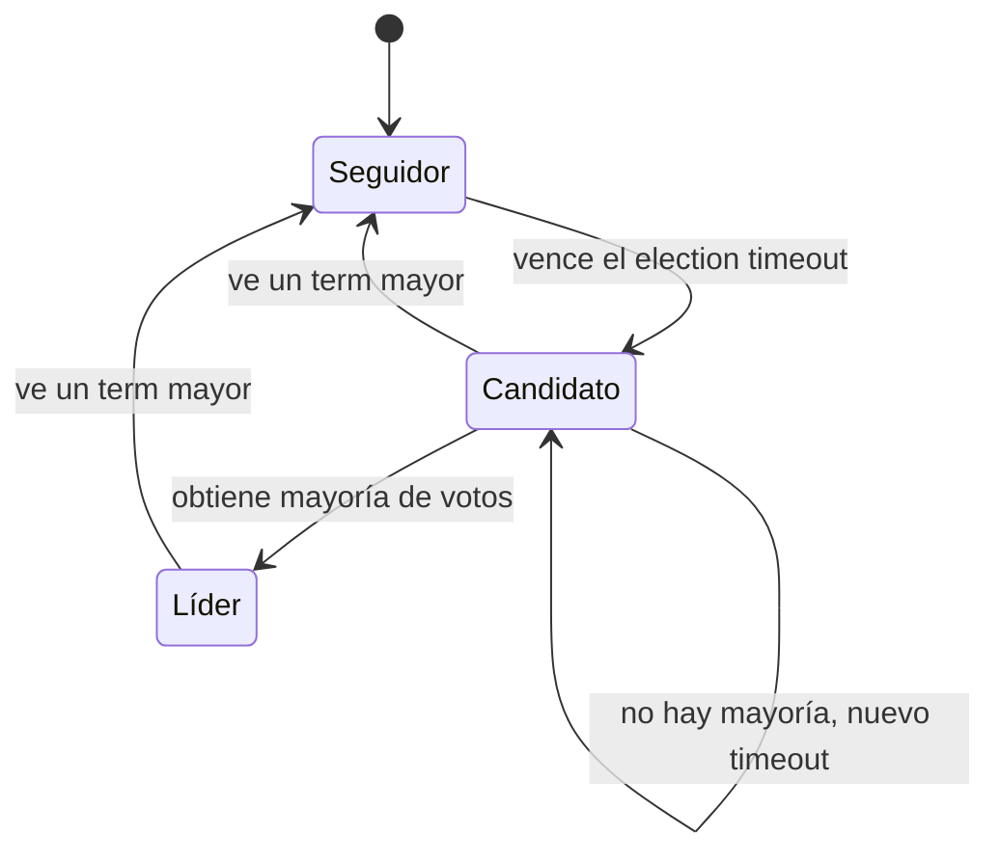

# Raft: estados y elección del líder

Paxos funciona, pero es famoso por lo difícil de entender, y en su forma original acuerda una sola acción. **Raft** (Diego Ongaro y John Ousterhout, 2014) logra el consenso sobre una secuencia de acciones eligiendo **democráticamente** a un líder, que luego replica las acciones a los demás. Sus autores lo describen así en *In Search of an Understandable Consensus Algorithm*: produce un resultado equivalente a (multi-)Paxos, es igual de eficiente, pero su estructura es distinta y por eso es más entendible.

## Estados y fases

| Estado | Rol |
|---|---|
| **Seguidor** (*follower*) | Estado por defecto; solo responde peticiones |
| **Candidato** (*candidate*) | Busca votos para ser líder |
| **Líder** (*leader*) | Replica las acciones a los seguidores para consolidarlas |

El algoritmo tiene dos fases: **elección de líder** y [[05 - Raft: replicación y consolidación de logs|replicación de logs]].

## El term (mandato)

El **term** es el periodo de mandato de un líder. Es un número que **solo crece**, y cada nodo registra el term más alto que conoce. Sirve como reloj lógico: cuando un nodo ve un term mayor que el suyo, sabe que se perdió algo.

## Postulación

> [!example]- Transcripción de la imagen
> Cada nodo tiene un *election timeout*, un número aleatorio entre 150 y 300 milisegundos, para intentar que cada nodo tenga uno distinto. **Postulación:** cuando se acaba el election timeout, el nodo se postula como candidato: (a) aumenta el term; (b) vota por sí mismo; (c) pide a todos los demás que voten por él; (d) si logra mayoría, se vuelve líder; (e) si no, espera a que se reinicie su election timeout y vuelve al paso (a).

El timeout aleatorio evita que todos se postulen a la vez y se dividan los votos: casi siempre uno despierta primero y gana.

## Votación

> [!example]- Transcripción de la imagen
> Todo nodo que reciba una solicitud de voto debe responder:
> 1. Si ya votó en el term actual, o si el term del candidato es menor al del votante, **vota rechazo**.
> 2. Si el votante no tiene logs todavía, **vota a favor**.
> 3. Si no, compara los logs del votante y del candidato: (a) si el último log del candidato es de un term **mayor**, vota a favor; (b) si es del **mismo** term, solo acepta si el log del candidato es igual o más largo; (c) si es de un term **menor**, vota rechazo.

> [!tip] La idea detrás de las reglas
> Un nodo solo vota por un candidato **al menos tan actualizado como él**. Así, el líder elegido siempre tiene todas las acciones que ya estaban consolidadas. En caso de empate, se acepta al candidato. Cada nodo vota **una sola vez por term**.

Los cuatro casos de votación, paso a paso, están en [[04 - Casos de votación en Raft|Casos de votación en Raft]].

## Conservar el liderazgo

- **Heartbeats (latidos):** el líder envía mensajes constantemente a todos los seguidores para **reiniciar su election timeout**. Mientras lleguen, nadie se postula.
- **Volver tras una desconexión:** al iniciar una votación el term aumenta. Cualquier nodo que vea un term **mayor** que el suyo se vuelve **seguidor de inmediato** y actualiza su term. Así, un líder antiguo que vuelve a la red se entera de que ya no lo es.

## Preguntas de repaso

> [!question]- ¿Por qué el election timeout es aleatorio y no igual para todos?
> Para que los nodos no se postulen al mismo tiempo. Si todos lo hicieran a la vez, cada uno votaría por sí mismo y nadie lograría mayoría.

> [!question]- ¿Qué impide que se elija como líder a un nodo al que le faltan acciones consolidadas?
> Las reglas de votación: un nodo rechaza a un candidato cuyo último log es de un term menor que el suyo, o del mismo term pero más corto. Como una acción consolidada está en la mayoría, el candidato necesita votos de al menos uno de esos nodos, y ese nodo lo rechazaría.

> [!question]- Un líder se desconecta y vuelve cuando ya hay un líder nuevo. ¿Qué pasa?
> Al recibir mensajes con un term mayor que el suyo, se convierte de inmediato en seguidor y actualiza su term. No puede seguir actuando como líder.
