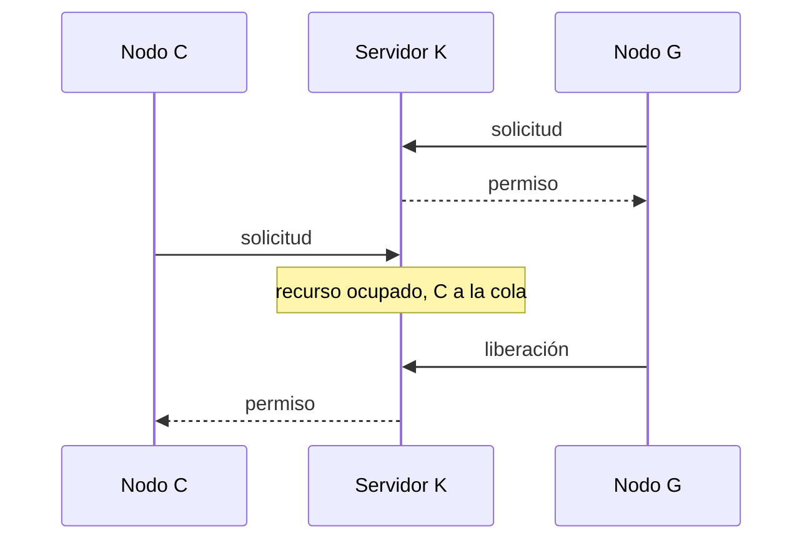

# Exclusión mutua distribuida y servidor central

Cuando varios procesos usan un recurso compartido (una impresora, un archivo, una alarma), hay que impedir que dos lo modifiquen a la vez. En un computador se resuelve con locks y semáforos sobre memoria compartida. En un sistema distribuido, el recurso y los procesos están en máquinas distintas y **solo pueden coordinarse con mensajes**. El primer algoritmo, y el más simple, es poner a un nodo a repartir los permisos.

## El problema

La exclusión mutua evita interferencias y mantiene la consistencia cuando varios procesos acceden a recursos compartidos. Ver la versión local en [[01 - Condiciones de carrera y el problema de la sección crítica|el problema de la sección crítica]].

Los algoritmos distribuidos se clasifican en dos familias:

- **Basados en permiso:** un nodo entra cuando otro u otros se lo autorizan (servidor central, Ricart y Agrawala).
- **Basados en token:** entra quien tiene un mensaje especial, el token (Token Ring).

## Requisitos

> [!tip] Safety, liveness y ordering
> - **Safety:** como máximo **un** nodo accede al recurso crítico a la vez.
> - **Liveness:** las solicitudes para entrar y salir de la sección crítica **finalmente tienen éxito**. Implica que no hay deadlock ni **inanición** (el aplazamiento indefinido de un nodo que pidió entrar).
> - **Ordering:** si una solicitud ocurrió **antes** que otra, el acceso se concede en ese orden.
>
> Las dos primeras son críticas; la tercera es deseable.

## Algoritmo 1: servidor central

> [!example]- Transcripción de la imagen
> El nodo K tiene el rol de servidor y una cola de peticiones "Fin [C G H] Inicio" (H está al inicio, marcado como atendido). Paso 1: el nodo C dice "Necesito recurso crítico". Paso 2: el nodo H dice "Ya terminé de usar recurso crítico". Paso 3: el servidor le dice al nodo G "Tu turno de acceder al recurso crítico". El nodo V no participa.

1. El nodo que quiere el recurso envía una **solicitud** al servidor. Si el recurso está libre, el servidor responde con un **permiso**; si está ocupado, encola la solicitud.
2. El nodo espera la respuesta del servidor antes de entrar.
3. Al salir, envía un mensaje de **liberación** para que el servidor lo saque de la cola y dé el permiso al siguiente.
4. Si el nodo que tiene el acceso se cae, el servidor puede detectarlo y tratarlo como una liberación.

## Características

- Un solo nodo otorga permisos, y una **cola** registra las solicitudes por orden de **llegada**.
- Se pueden agregar mecanismos para que el servidor detecte caídas de nodos y pase el permiso al siguiente.
- Si el servidor no falla, garantiza **safety** y **liveness**, pero **no ordering**.

> [!warning] Por qué no garantiza ordering
> La cola respeta el orden en que las solicitudes **llegan** al servidor, no el orden en que se **enviaron**. Si la solicitud de un nodo tarda mucho en la red, otra enviada después puede llegar antes y ganarle el turno.

## Desventajas

- **Punto único de falla:** si el servidor cae, todo el sistema puede detenerse.
- Un cliente no puede distinguir entre un servidor caído y una espera porque otro nodo tiene el recurso.
- **Cuello de botella:** en sistemas grandes o con mucha concurrencia, todas las peticiones van a un solo nodo.

Es, en el fondo, volver a **centralizar** en vez de distribuir. A cambio es simple y usa solo 3 mensajes por acceso (solicitud, permiso y liberación).

## Preguntas de repaso

> [!question]- ¿Qué diferencia hay entre liveness e inanición?
> La inanición es justamente lo que liveness prohíbe: que un nodo que pidió el recurso quede esperando indefinidamente. Liveness exige que toda solicitud termine por concederse.

> [!question]- Si la red entregara siempre los mensajes con el mismo retraso, ¿el servidor central garantizaría ordering?
> Sí: con retrasos iguales, el orden de llegada coincide con el de envío, y la cola atiende en el orden en que se pidió.

> [!question]- ¿Cuál es el principal riesgo del servidor central y por qué?
> Que es un punto único de falla: si cae, nadie puede obtener permisos, y además los clientes no pueden distinguir esa caída de una espera normal.
