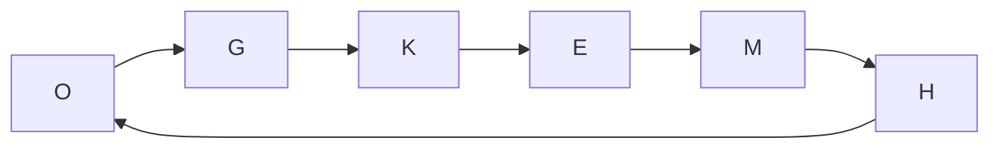

# Algoritmo Token Ring

En vez de pedir permiso a un servidor, los nodos pueden turnarse un objeto único: un **token**. Quien lo tiene puede usar el recurso; cuando termina, lo pasa al vecino. Como el token es uno solo, nunca hay dos nodos dentro a la vez, y no hace falta un coordinador.

## Funcionamiento

> [!example]- Transcripción de la imagen
> Seis nodos en anillo (O, G, K, E, M y H); el token (una llave) circula en un solo sentido. G, que tiene el token, dice "Cuando termine de usar el recurso crítico, entregaré el token para que el siguiente pueda acceder", y la flecha apunta a K. M piensa "No necesito el recurso crítico. Si me llega el token, lo pasaré de inmediato".

1. El token circula en **una única dirección** alrededor del anillo.
2. Si un nodo recibe el token y **no** necesita la sección crítica, lo **reenvía de inmediato** a su vecino.
3. Si un nodo necesita la sección crítica, **espera** el token y lo **retiene** mientras la usa.
4. Al salir de la sección crítica, envía el token a su vecino.

## Características

- Cada nodo solo necesita conocer a su **vecino**, no toda la red.
- La exclusión se otorga con la entrega de un mensaje especial, el token.
- **No hay cuello de botella** en un único nodo.
- Si no hay fallas, garantiza **safety** (hay un solo token) y **liveness** (el token pasa por todos), pero **no ordering**.

> [!warning] Por qué no garantiza ordering
> El turno depende de la **posición** en el anillo, no del momento en que se pidió el recurso. Si un nodo acaba de soltar el token y vuelve a necesitarlo, debe esperar la vuelta completa, aunque haya pedido antes que otros que están más adelante en el anillo.

## Desventajas

- **Perder el token es grave:** recrearlo y asegurar que siga siendo único requiere un procesamiento distribuido complejo.
- Requiere que los nodos **no fallen**; si uno cae, hay que rehacer el anillo.
- El tiempo de respuesta puede ser largo: el token puede tener que dar una vuelta completa, hasta $N - 1$ mensajes.

> [!tip] Mensajes por acceso
> No hay solicitudes ni permisos: solo pasa el token. Si muchos nodos quieren el recurso, cada acceso cuesta pocos mensajes. Si nadie lo quiere, el token sigue circulando igual y consume mensajes sin que nadie lo use.

| | Servidor central | Token Ring |
|---|---|---|
| Tipo | Basado en permiso | Basado en token |
| Conocimiento de la red | Todos conocen al servidor | Cada nodo conoce a su vecino |
| Punto único de falla | El servidor | Cualquier nodo y el token |
| Ordering | No (orden de llegada) | No (orden del anillo) |
| Espera máxima | Depende de la cola | Hasta $N - 1$ saltos del token |

## Preguntas de repaso

> [!question]- ¿Cómo garantiza Token Ring que solo un nodo esté en la sección crítica?
> Porque existe un único token y solo quien lo tiene puede entrar. Mientras el token no se duplique, es imposible que dos nodos estén dentro a la vez.

> [!question]- ¿Por qué perder el token es un problema difícil?
> Porque hay que detectar que se perdió (y no que solo está tardando) y generar uno nuevo asegurando que no aparezcan dos. Eso requiere coordinación distribuida, como una elección.

> [!question]- Un nodo pide el recurso justo después de pasar el token. ¿Cuánto espera en el peor caso?
> Lo que tarda el token en dar la vuelta completa al anillo, pasando por los otros $N - 1$ nodos (y por las secciones críticas de los que lo necesiten).
