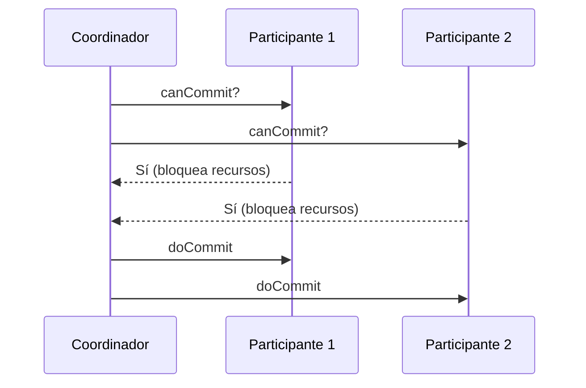

# Commit de dos fases

¿Cómo logran varios servidores aplicar una transacción **todos o ninguno**? Una forma es la replicación pasiva: todo pasa por un primario que distribuye. Los protocolos de commit evitan depender de que una sola réplica haga todo el trabajo: primero se **pregunta** a todos si pueden y, solo si todos dicen que sí, se **ordena** consolidar. Es el **commit de dos fases** (2PC).

## Analogía: ir al cine

> [!example]- Transcripción de la imagen
> Paso 1: el organizador pregunta "¿Vamos al cine? Cuesta 7k y es este domingo". Tres amigos responden "Sí" y piensan "Reservar 7k y marcar ocupado el domingo". Paso 2: "Todos confirmaron. Nos vemos el domingo y lleven 7k".

> [!example]- Transcripción de la imagen
> Los tres amigos respondieron "Sí" y reservaron el domingo. Luego alguien le pregunta a uno: "¿Vamos a beber este domingo, pero pagas tú?", y este responde "No, el domingo lo tengo reservado".

Quien votó "sí" **reserva** sus recursos (la plata y el domingo) y no puede comprometerlos en otra cosa hasta saber la decisión. En la variante en que alguien responde "no", el plan se cancela y todos liberan lo reservado.

## Roles

- **Coordinador:** inicia y gestiona el protocolo de commit.
- **Participantes:** los nodos involucrados; cada uno verifica que la transacción sea válida en su nodo (recursos disponibles, sin inconsistencias).

Cualquier participante puede **abortar** la transacción.

## Fase 1: votación (*prepare*)

1. El coordinador envía `canCommit?` a todos los participantes.
2. Cada participante valida que la transacción no genere conflictos ni use recursos bloqueados, y responde **Sí** o **No**.
3. Si vota **Sí**, **bloquea** los recursos involucrados (total o parcialmente), para que ninguna otra transacción los tome mientras espera la fase 2.
4. Si vota **No**, aborta la transacción en su réplica sin bloquear nada: para ese nodo, la transacción no existe.

## Fase 2: consolidación (*commit*)

1. El coordinador reúne todos los votos (incluido el suyo, si también participa).
2. Si **todos** votaron Sí, envía `doCommit`.
3. Si alguno votó No (o falló), envía `doAbort`.
4. Cada participante aplica la decisión y **libera** los recursos bloqueados.

Una simulación en Python reprodujo los tres escenarios: todos votan sí (todos hacen commit), uno vota no (todos abortan) y el coordinador cae después de la votación (todos quedan bloqueados en estado incierto).

## El problema: el coordinador cae

> [!warning] Estado incierto
> Si el coordinador falla **después de la fase 1**, un participante que votó Sí queda en estado **incierto**. No puede decidir por su cuenta (quizás otro votó No) ni liberar sus recursos (quizás es solo un retraso). Queda bloqueado, y las demás transacciones que necesitan esos recursos se retrasan.

Por eso 2PC es un protocolo **bloqueante**, y para eso se diseñó el [[04 - Commit de tres fases|commit de tres fases]].

## Preguntas de repaso

> [!question]- ¿Por qué un participante que vota Sí debe bloquear sus recursos?
> Porque se comprometió a poder aplicar la transacción si el coordinador lo ordena. Si liberara los recursos y otra transacción los tomara, después no podría cumplir con el `doCommit`.

> [!question]- ¿Qué pasa si un solo participante vota No?
> El coordinador envía `doAbort` a todos y cada uno deshace la transacción y libera sus recursos: se mantiene la atomicidad.

> [!question]- ¿Por qué un participante en estado incierto no puede abortar por su cuenta?
> Porque el coordinador pudo haber decidido commit (si todos votaron Sí) y otros participantes podrían haberlo aplicado ya. Abortar por su cuenta rompería la atomicidad.
