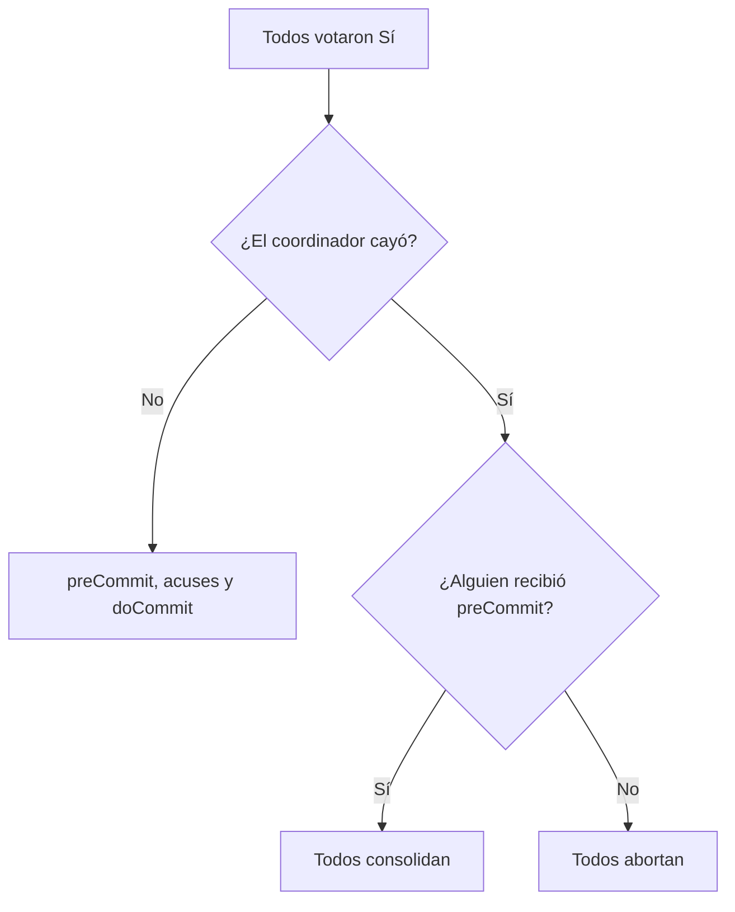

# Commit de tres fases

El commit de dos fases deja a los participantes bloqueados si el coordinador cae después de la votación. El **commit de tres fases** (3PC) agrega una fase intermedia de **aviso** sin compromiso, y permite que los participantes **conversen entre ellos** para decidir si el coordinador desaparece. Así nadie queda esperando indefinidamente.

## Analogía

> [!example]- Transcripción de la imagen
> Paso 1: "¿Vamos al cine? Cuesta 7k y es este domingo"; los tres responden "Sí" y reservan 7k y el domingo. Paso 2: "Por si acaso, les aviso que todos me confirmaron, pero necesito otra confirmación a este mensaje"; los tres responden "Ok". En el paso 3 (siguiente slide), el organizador confirma: "Ya, ahora sí confirmadísimo. Nos vemos el domingo".

## Las tres fases

Mantiene los roles de coordinador y participantes.

1. **Vote request:** idéntica a la fase 1 de 2PC. El coordinador envía `canCommit?`; los participantes votan y, si votan Sí, reservan recursos.
2. **Pre-commit:** si todos votaron Sí, el coordinador envía `preCommit` a todos. Los participantes acusan recibo, pero **todavía no consolidan**.
   - Si el coordinador no envía el pre-commit, los participantes que votaron Sí revisan entre ellos:
   - si **al menos uno** recibió el pre-commit, se entiende que todos votaron Sí: se avisan entre todos y **consolidan**;
   - si **nadie** lo recibió, asumen que algo salió mal y **abortan**.
3. **Do-commit:** con todos los acuses del pre-commit, el coordinador envía `doCommit` y los participantes consolidan. Si el coordinador cae antes, los participantes conversan, y como al menos uno tiene el pre-commit, acuerdan consolidar.

La simulación en Python dio: si el coordinador cae antes del pre-commit, todos abortan; si cae después de enviar el pre-commit a uno solo, todos consolidan. Nadie queda bloqueado.

## Comparación con 2PC

| | 2PC | 3PC |
|---|---|---|
| Fases | Votación y consolidación | Votación, pre-commit y do-commit |
| Si cae el coordinador tras votar | Los participantes quedan bloqueados | Los participantes deciden entre ellos |
| Comunicación entre participantes | No | Sí, para resolver la incertidumbre |
| Mensajes sin fallas (n participantes, con acuses) | $4n$ | $6n$ |

> [!tip] La idea clave
> En 2PC, cuando el coordinador junta todos los Sí, pasa directo a consolidar. En 3PC primero **avisa** que todos dijeron Sí, sin comprometer a nadie; ese aviso es la evidencia que los participantes usan para decidir solos.

> [!warning] Su costo
> La principal desventaja es el número de mensajes y de rondas, incluso cuando no hay fallas. Además, la garantía depende de los supuestos del protocolo: con una **partición de red**, dos grupos podrían tomar decisiones distintas (uno con pre-commit y otro sin él).

En el curso se afirma que 3PC garantiza la atomicidad y reduce el riesgo de bloqueo a cambio de más mensajes. En cambio, el bloqueo de 2PC no viola el aislamiento: solo retrasa a otras transacciones.

## Preguntas de repaso

> [!question]- ¿Qué información aporta el pre-commit que no existe en 2PC?
> Que todos los participantes votaron Sí. Si un participante la tiene, el resto puede consolidar sin el coordinador; si nadie la tiene, es seguro abortar.

> [!question]- ¿Por qué es seguro abortar si ningún participante recibió el pre-commit?
> Porque el coordinador envía el pre-commit antes de cualquier commit. Si nadie lo recibió, nadie consolidó, así que abortar no deja a ningún nodo con la transacción aplicada.

> [!question]- ¿Cuántos mensajes más usa 3PC que 2PC con 4 participantes, sin fallas?
> Con acuses de recibo, 2PC usa $4 \cdot 4 = 16$ y 3PC $6 \cdot 4 = 24$: 8 mensajes más, por el preCommit y sus acuses.
