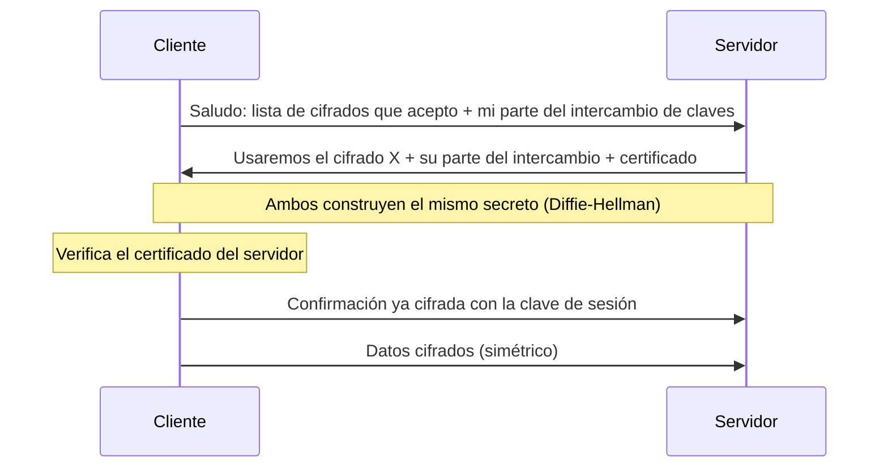

# Protocolos híbridos y TLS 1.3

El cifrado simétrico es rápido pero no sabe repartir claves; el asimétrico reparte claves y autentica, pero es lento. Los **protocolos híbridos** usan cada uno para lo que hace bien: el asimétrico para **acordar** una clave al inicio, y el simétrico para **toda** la conversación. TLS, el protocolo detrás de HTTPS, funciona así.

## Funcionamiento

1. **Establecimiento de sesión:** las partes usan criptografía de clave pública para intercambiar de forma segura una **clave de sesión** secreta. Es lento, pero se hace una sola vez por sesión. La clave es **efímera**: se genera para esa sesión y luego se descarta, lo que aumenta la seguridad.
2. **Comunicación de datos:** todo lo que sigue (el grueso de los datos) se cifra con esa clave **simétrica**.

## TLS 1.3

**TLS** (*Transport Layer Security*) es el protocolo estándar para asegurar comunicaciones en red: da confidencialidad, integridad y autenticación. La versión 1.3 (2018) es la más reciente y segura: mejora el rendimiento y la privacidad, corrige vulnerabilidades, elimina características inseguras de TLS 1.2 y tiene amplio soporte en navegadores.

> [!example]- Transcripción de la imagen
> "Cliente confirma todo ya utilizando llave secreta": el cliente envía una respuesta cifrada, "Certificado verificado. Y con eso también estoy listo ✅". Abajo, cliente y servidor "construyen el secreto" combinando una llave propia con la que recibieron (llegan al mismo resultado), y el cliente "verifica el certificado".

El **certificado** es lo que resuelve el man-in-the-middle de Diffie-Hellman: prueba que la llave pública del servidor pertenece realmente a ese servidor. Después, toda la comunicación viaja cifrada con la clave simétrica.

> [!tip] Lo mejor de ambos mundos
> El asimétrico (y el certificado) se usa una vez para autenticar y acordar la clave; el simétrico, rápido, cifra todos los datos.

La vista de TLS desde la web está en [[06 - Capas de la web, TCP, UDP y TLS|Capas de la web, TCP, UDP y TLS]].

## Pregunta de aplicación

De estas afirmaciones, solo la II es correcta:

- I. "El no repudio asegura que el receptor no pueda negar haber recibido el mensaje": **falsa**, el no repudio es del **emisor**.
- II. "Diffie-Hellman es vulnerable a ataques de intermediario porque no autentica a las partes": **correcta**.
- III. "El cifrado simétrico resuelve la distribución de claves con un par de llaves pública y privada": **falsa**, eso es el cifrado asimétrico.

## Recursos

- CryptoHack: desafíos prácticos de criptografía.
- VisuAlgo: visualizaciones de funciones hash.
- CryptoZombies: curso gamificado de criptografía y contratos inteligentes en Ethereum.

## Preguntas de repaso

> [!question]- ¿Por qué TLS no cifra toda la comunicación con criptografía asimétrica?
> Porque es entre 100 y 1000 veces más lenta. Se usa solo al inicio, para autenticar y acordar una clave simétrica, que es la que cifra los datos.

> [!question]- ¿Qué aporta el certificado del servidor en el handshake?
> Prueba la identidad del servidor (que su llave pública le pertenece), lo que impide que un intermediario se haga pasar por él durante el intercambio de claves.

> [!question]- ¿Qué ventaja tiene que la clave de sesión sea efímera?
> Si un atacante obtiene una clave de sesión, solo compromete esa sesión. Las demás usan claves distintas que ya fueron descartadas.
