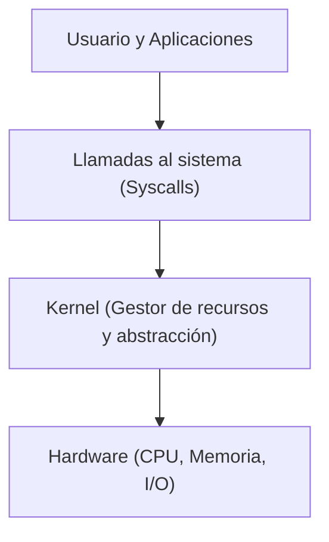

# Qué es un sistema operativo

Un sistema operativo es el software fundamental que actúa como intermediario entre el usuario, las aplicaciones y el hardware de la máquina, proporcionando abstracción de recursos y administración controlada.

## CLASE 1 (mis apuntes)
12 / 8 / 2024

### Sistema Operativo:
- Es mas facil que nos proporcione, a que tengamos que ir a buscarlo
- tiene como trabajo proporcionan los programas del usuario un modelo de uso de recursos mas simple y ademas de administrar los recursos
- Nace de la necesidad de Abstraerse del Hardware
- Prender Cpu, verificar que este bien, etc etc
- El Programa 1 que empieza en el computador → Es un Daemon → Va corriendo todo el tiempo, todo falla si el falla (SystemD = System Daemon) → probee funcionalidades basicas

> [!warning] Posible error (registrado en `_meta/Sistemas Operativos y Redes/DUDAS.md`)
> En la frase sobre el primer programa, Systemd es el init daemon (PID 1) estándar en GNU/Linux moderno. Históricamente UNIX utilizaba SysV init. La errata menor "probee" corresponde a "provee".

> [!example]- Transcripción de la imagen
> Diagrama de división del sistema computacional:
> - **User space:** Arriba se ubican las aplicaciones (Navegador, Editor, Reproductor, Compilador, Mensajería). En la frontera se encuentran la Interfaz de usuario (*user interface*) y las llamadas al sistema (*syscalls*).
> - **Kernel space:** Contiene los subsistemas centrales del sistema operativo: Manejo de errores, Comunicación de procesos (IPC), Manejo de memoria, Sistemas de archivos, Contabilidad y *logging*, Administración de procesos, Protección y seguridad, Control de I/O, Controladores (*drivers*), y Scheduling.
> - **Hardware:** Capa física inferior (CPU, memoria, buses y periféricos) conectada bidireccionalmente con el espacio de kernel.

- Schedulling: Eligir quien va a estar en la RAM
- Manejo de memoria: Donde se guardan las descargas
- Control I/O : Maneja teclados, mouse, etc

KERNELL
Programa que siempre se ejecuta, funciones mínimas necesarias de un computador
El típico pantallazo azul, viene de que el kernell detecto un error en memoria o disco

ROL
- Para el Usuario: Les permite usar recursos de hardware (Memoria/Cpu)
- Sistema: ADMIN: Selecciona y Provee Recursos (Ningun juego o programa nos pregunta a nosotros, por debajo le pide recursos al administrador del sistema)

SO
- Nos abstrae del hardware
- Nos permite compartir Recursos
- Puede Contener ≠ Arquitecturas

> [!example]- Transcripción de la imagen
> Figura 1-1 (Tanenbaum): Ubicación del sistema operativo dentro del software y hardware:
> - **Software:**
>   - **User mode:** Aplicaciones de usuario (Web browser, E-mail reader, Music player) sobre programas de interfaz de usuario (*User interface program*).
>   - **Kernel mode:** El sistema operativo (*Operating system*).
> - **Hardware:** Base física sobre la que corre el sistema operativo.

> [!tip] Complemento (slides "Contenido 1: Introducción a Sistemas Operativos")
> Un sistema operativo cumple dos roles fundamentales:
> 1. **Gestor de recursos (Resource Manager):** Multiplexa en el tiempo (CPU scheduling) y en el espacio (Memoria RAM) los recursos físicos entre múltiples programas en ejecución concurrentes.
> 2. **Máquina extendida / Abstracción (Extended Machine):** Oculta la complejidad física del hardware (registros, interrupciones, temporizadores, sectores de disco) y expone primitivas limpias como archivos, directorios, sockets y procesos.
>
> **Kernel vs Sistema Operativo completo:** El *kernel* (núcleo) es el programa residente en memoria que corre en modo privilegiado. El sistema operativo incluye el kernel más utilitarios esenciales, bibliotecas estándar (`libc`), daemons de sistema y el intérprete de comandos (*shell*).

## Preguntas de repaso

1. ¿Cuáles son los dos objetivos primordiales de un sistema operativo?
> [!question]- Respuesta
> Proporcionar abstracciones limpias del hardware (máquina extendida) y administrar de forma segura y eficiente los recursos físicos compartidos (gestor de recursos).

2. ¿Qué diferencia al kernel del resto de los programas del sistema operativo?
> [!question]- Respuesta
> El kernel es el programa que siempre permanece en ejecución en memoria principal y opera en modo privilegiado (kernel mode), teniendo acceso directo sin restricciones a las instrucciones del hardware.

3. ¿Por qué una aplicación de usuario no interactúa directamente con los controladores de hardware?
> [!question]- Respuesta
> Para evitar que un programa con errores o malicioso corrompa la memoria de otros programas, monopolice la CPU o destruya datos en disco; el kernel actúa como árbitro centralizado de protección.

4. ¿Qué es Systemd y qué rol cumple en el arranque del sistema?
> [!question]- Respuesta
> Es el primer proceso demonio que se ejecuta en el espacio de usuario (PID 1) en Linux, encargado de levantar los servicios del sistema, gestionar dependencias y monitorear los daemons en segundo plano.

