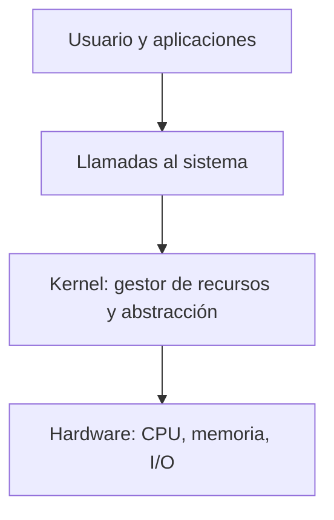

# Qué es un sistema operativo

Un computador actual tiene uno o más procesadores, memoria principal, discos, teclado, pantalla, interfaces de red y muchos otros dispositivos. Si cada programador tuviera que entender y administrar todos esos componentes en detalle, nunca llegaría a programar su aplicación. Por eso existe una capa de software intermedia: el **sistema operativo** (SO).

## Definición: abstraer y administrar

> [!tip] Definición
> El sistema operativo tiene como trabajo **proporcionar a los programas de usuario un modelo de computador más simple y limpio**, y **administrar todos los recursos** del hardware.

El SO nace de la necesidad de **abstraerse del hardware**. La idea es que sea más fácil que el sistema *nos proporcione* los recursos a que cada programa tenga que ir a buscarlos y controlarlos por su cuenta. Concretamente, el SO:

- **Nos abstrae del hardware:** el programa trabaja con archivos, procesos y sockets, no con sectores de disco, registros ni interrupciones.
- **Nos permite compartir recursos:** varios programas usan la misma CPU y la misma memoria sin pisarse.
- **Nos ofrece servicios** que hacen más cómodo el uso del hardware.
- **Puede correr en distintas arquitecturas** (un solo núcleo, varios núcleos, distintos procesadores).

Ejemplos: Windows, Linux, FreeBSD, macOS.

## Los roles del sistema operativo

| Para… | Rol |
|---|---|
| **El usuario** | Le permite usar los recursos del computador (CPU, memoria, archivos) para ejecutar programas y hacer cálculos. |
| **El sistema, como administrador** | Selecciona y provee los recursos que cada programa necesita, y hace que se usen de manera eficiente. Ningún juego le pregunta al usuario cuánta memoria tomar: se la pide al SO. |
| **El sistema, como programa de control** | Evita el uso indebido: que un programa "bote" a otros en ejecución, que sobrescriba por error al propio SO o que un usuario tome control de la máquina. |

Visto de otro modo, el SO es a la vez un **gestor de recursos** (*resource manager*), que reparte la CPU en el tiempo y la memoria en el espacio entre los programas, y una **máquina extendida** (*extended machine*), que oculta la complejidad física tras abstracciones limpias.

## Kernel y programas del sistema

Un sistema operativo se compone de **kernel + programas del sistema**:

- El **kernel** (núcleo) es el programa que **siempre se está ejecutando**. Provee la funcionalidad mínima del computador (acceso a CPU, memoria y dispositivos) y es el único que corre en modo privilegiado (ver [[02 - Modos de operación y anillos de protección|modos de operación]]). Cuando detecta un error del que no puede recuperarse, como una falla de memoria o de disco, detiene la máquina. El típico **pantallazo azul** de Windows es eso.
- Los **programas del sistema** extienden las funciones del kernel: bibliotecas (`libc`), el intérprete de comandos (*shell*) y los **daemons**, procesos que corren permanentemente en segundo plano.

En Linux, el primer programa de usuario que lanza el kernel es un daemon, `systemd` (*system daemon*, el proceso PID 1). Provee funcionalidades básicas como levantar los servicios, y de él descienden todos los demás procesos, por eso si falla, falla todo el sistema. Los UNIX más antiguos usaban en su lugar el `init` de System V (SysV init). Cómo se llega hasta él (encender la CPU, verificar el hardware, cargar el kernel) se ve en [[06 - Arranque del sistema computacional|arranque del sistema]].

## Dónde vive el SO

> [!example]- Transcripción de la imagen
> Figura 1-1 de Tanenbaum, "Where the operating system fits in". Sobre el **hardware** está el **software**, dividido en dos modos. En **user mode** corren las aplicaciones (*web browser*, *e-mail reader*, *music player*) sobre el programa de interfaz de usuario (*user interface program*). En **kernel mode** corre el sistema operativo (*operating system*).

> [!example]- Transcripción de la imagen
> Arriba, en **user space**, las aplicaciones: Navegador, Editor, Reproductor, Compilador y Mensajería. En la frontera con el **kernel space** están la *interfaz de usuario* y las *llamadas al sistema* (*syscalls*). Dentro del kernel: manejo de errores, comunicación de procesos (IPC), manejo de memoria, sistemas de archivos, contabilidad y *logging*, administración de procesos, protección y seguridad, control de I/O, controladores (*drivers*) y *scheduling*. Abajo, el **hardware**, conectado con el kernel mediante flechas bidireccionales.

Los programas piden servicios al kernel mediante [[05 - Llamadas al sistema|llamadas al sistema]]:

Algunos subsistemas del kernel, en una línea:

- **Scheduling:** decide qué procesos se admiten en memoria y cuál de ellos usa la CPU en cada momento (ver [[01 - Niveles de planificación y ciclo de ráfagas CPU-IO|niveles de planificación]]).
- **Manejo de memoria:** decide en qué parte de la RAM vive cada programa y protege la memoria de uno frente a los otros.
- **Control de I/O:** maneja los dispositivos de entrada y salida, como teclado y mouse.

## Preguntas de repaso

> [!question]- ¿Cuáles son los dos objetivos fundamentales de un sistema operativo?
> Darles a los programas un modelo de computador más simple, abstrayendo el hardware, y administrar los recursos físicos compartidos de forma eficiente y segura.

> [!question]- ¿Qué diferencia al kernel de los programas del sistema?
> El kernel siempre está en ejecución, provee la funcionalidad mínima (CPU, memoria, dispositivos) y corre en modo privilegiado. Los programas del sistema (`libc`, shell, daemons) corren en modo usuario y extienden esas funciones.

> [!question]- ¿Por qué una aplicación no accede directamente al hardware?
> Porque el SO actúa como programa de control: si cada aplicación manejara el hardware, un programa con errores o malicioso podría botar a otros, sobrescribir al propio SO o tomar control de la máquina. Por eso la aplicación pide los recursos al kernel mediante syscalls.

> [!question]- ¿Qué es `systemd` y por qué su falla afecta a todo el sistema?
> Es el daemon que el kernel lanza como primer proceso de usuario (PID 1) en Linux. Levanta los servicios básicos y de él descienden los demás procesos, así que si falla, el sistema completo deja de funcionar.
