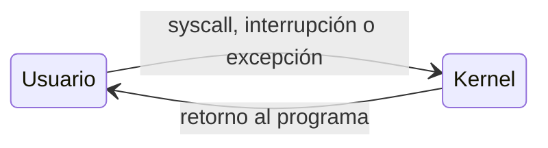

# Modos de operación y anillos de protección

Si cualquier programa pudiera escribir en cualquier dirección de memoria o hablar directamente con el disco, un solo error bastaría para corromper a los demás programas o al propio sistema operativo. Para evitarlo, el **hardware** distingue niveles de privilegio, y solo el kernel corre en el más alto.

## Dos modos de ejecución

La CPU tiene al menos dos **modos de protección**:

| Modo | Qué puede hacer | Quién corre ahí |
|---|---|---|
| **Kernel mode** (privilegiado o *supervisor mode*) | Acceso completo al hardware y a todas las instrucciones | El kernel |
| **User mode** | Solo un conjunto restringido de instrucciones | Las aplicaciones |

El modo vigente lo indica un **bit de modo** (*mode bit*) del procesador. En la convención habitual de los textos, 0 significa kernel y 1 significa usuario. Si un programa en modo usuario intenta ejecutar una instrucción privilegiada, el hardware **genera una interrupción** (*protection fault*) **o ignora la instrucción**. En ningún caso la ejecuta.

Por eso un programa no puede, por ejemplo, sobrescribir memoria ajena ni leer el disco por su cuenta: **se comunica primero con el SO**, que es quien tiene el acceso directo al hardware y decide si concede el permiso.

> [!tip] Mnemotecnia: arriba y abajo
> Imagina el sistema en capas. **Arriba** están las aplicaciones: menos privilegios y menos poder, por lo que deben **pedir permiso** a las capas de abajo para todo, y eso cuesta tiempo (*overhead*). **Abajo** está el kernel: todo el poder, sin pedirle permiso a nadie, y por eso es más rápido. Un programa poco importante, como uno para copiar un CD, no necesita más que privilegios mínimos: para leer el disco le pide la operación de I/O al SO.

## Instrucciones privilegiadas

Estas son algunas instrucciones que solo se ejecutan en el nivel más privilegiado (*ring 0*), tomadas del set de instrucciones Intel 64:

- Modificar el vector de interrupciones o habilitarlas y deshabilitarlas (`CLI`, `IRET`).
- Acceder a dispositivos de I/O.
- Modificar el *timer* del computador.
- Detener el computador (`HLT`).
- Cambiar el modo de protección (de usuario a kernel o viceversa).
- Modificar las tablas de acceso a memoria (tabla de páginas, `INVLPG`).
- Almacenar el estado de la máquina (`SMSW`).

Todas comparten una razón: si un programa cualquiera pudiera ejecutarlas, podría desactivar las interrupciones y monopolizar la CPU, saltarse la protección de memoria o apagar la máquina.

## Anillos de protección

El hardware moderno ofrece **4 o más** niveles, llamados **anillos** (*rings*). Intel 64 tiene 4 niveles. Tener más de dos anillos permite, entre otras cosas, implementar **virtualización**.

> [!example]- Transcripción de la imagen
> Cuatro círculos concéntricos, "Anillo de privilegios". En el centro, **Ring 0**, marcado *kernel*. Hacia afuera, **Ring 1** y **Ring 2**. En el anillo exterior, **Ring 3**, marcado *Aplicaciones*.

Los anillos 1 y 2 se pensaron históricamente para drivers y servicios intermedios, pero en la práctica los sistemas operativos usan sobre todo el anillo 0 (kernel) y el anillo 3 (aplicaciones).

## El costo y el beneficio

- **Costo:** en modo usuario hay más tiempo de espera, porque cada operación sobre el hardware pasa por el kernel. Cambiar de modo exige guardar el estado del programa y validar la petición.
- **Beneficio:** si un programa de usuario falla, no pasa nada grave. Como nunca tocó el hardware directamente, basta con cerrarlo y volver a abrirlo; el resto del sistema sigue intacto.

El SO no actúa por iniciativa propia: mientras nadie lo llame, no hace nada. El cambio a modo kernel ocurre solo por mecanismos controlados por el hardware, como una [[05 - Llamadas al sistema|llamada al sistema]] o una [[04 - Interrupciones y excepciones|interrupción o excepción]], y al terminar el kernel ejecuta una instrucción especial de retorno (como `iret` o `sysret` en x86) que vuelve a modo usuario.

## Preguntas de repaso

> [!question]- ¿Qué pasa si un programa en modo usuario intenta ejecutar una instrucción privilegiada?
> El hardware no la ejecuta: genera una interrupción (*protection fault*) que pasa el control al kernel, o bien ignora la instrucción.

> [!question]- ¿Por qué cambiar el modo de protección es en sí una instrucción privilegiada?
> Porque si un programa de usuario pudiera pasar por su cuenta a modo kernel, toda la protección sería inútil. Solo se entra al kernel por puntos controlados (syscalls, interrupciones, excepciones).

> [!question]- ¿Por qué el modo usuario tiene *overhead* y por qué vale la pena pagarlo?
> Porque cada acceso al hardware debe pedirse al SO, lo que implica cambiar de modo y validar la petición. A cambio, un programa defectuoso o malicioso no puede dañar a otros ni al SO, y si falla basta con reiniciarlo.

> [!question]- ¿Qué diferencia hay entre el anillo 0 y el anillo 3 en x86?
> El anillo 0 tiene todos los privilegios y es donde corre el kernel. El anillo 3 es el menos privilegiado y es donde corren las aplicaciones. Los anillos intermedios existen en el hardware, pero los SO comunes casi no los usan.
