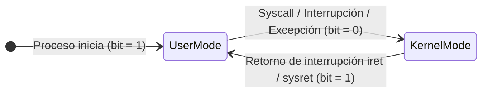

# Modos de operación y anillos de protección

Para garantizar la integridad y estabilidad del sistema, el procesador implementa soporte de hardware para múltiples niveles de privilegios (*dual mode* y anillos de protección), aislando el código del usuario del núcleo del sistema operativo.

## Dónde vive el sistema operativo (mis apuntes)
DONDE VIVE?
+Arriba : - Privilegios, menos poder → Programas muy arriba tendran que pedir permiso a abajo → OVERHEAD
+Abajo : + Poder → Son los mas Rápidos, no tienen que pedir permiso (Permiso Admin)
Ej: Programa de copiar un cd, poco importante → Poco privilegio:
No tiene permisos para hacer todo (ej: Pedir permiso para lectura de I/O del disco)

COMUNICACION S.O y HARDWARE
El Programa se comunica primero con el S.O antes que con el hardware, no se puede sobreescribir memoria directamente
El el S.O el que maneja los permisos directos al hardware, no se puede si no atravez de el

MODO DE EJECUCION
- MODO USUARIO (Overhead → Mayor tiempo de espera en pedir permisos)
- MODO KERNELL (Todos los permisos → Sin tiempo de espera)
- El modo usuario → No puede leer ni escribir directamente, tiene que pedir permisos
- Si el programa de usuario falla → No pasa nada, porque como no tiene acceso al hardware, podemos cerrarlo y abrirlo sin problemas

ANILLOS DE PRIVILEGIOS

> [!example]- Transcripción de la imagen
> Anillos concéntricos de privilegios de arquitectura x86:
> - **Ring 0 (Centro, kernel):** Máximo nivel de privilegio, reservado exclusivamente para el código central del kernel del sistema operativo.
> - **Ring 1 y Ring 2 (Niveles intermedios):** Históricamente pensados para controladores de dispositivos o servicios de middleware (raramente usados por sistemas operativos modernos).
> - **Ring 3 (Anillo exterior, aplicaciones):** Menor nivel de privilegio, donde se ejecutan los procesos de espacio de usuario y aplicaciones normales.

> [!tip] Complemento (slides "Contenido 1: Dual Mode")
> La CPU incluye un bit de modo (*mode bit*) en el registro de estado del procesador:
> - **0 = Kernel Mode (Modo privilegiado / Supervisor mode):** La CPU puede ejecutar cualquier instrucción de máquina (instrucciones privilegiadas como deshabilitar interrupciones, modificar la tabla de páginas o acceder a registros de control del hardware).
> - **1 = User Mode (Modo no privilegiado):** La ejecución de instrucciones privilegiadas genera inmediatamente un *trap* o excepción por violación de privilegios, abortando el proceso sin comprometer al resto de la máquina.
>
> **Cambio de modo (*Mode Switch*):** Ocurre de forma segura únicamente mediante mecanismos de hardware:
> 1. Una llamada al sistema ([[05 - Llamadas al sistema|syscall]]), interrupción de hardware o excepción cambia el bit a `0` y salta a una dirección fija en memoria controlada por el kernel.
> 2. Al completar la tarea, el kernel ejecuta una instrucción especial de retorno (como `sysret` o `iret`) que restaura el bit a `1` y devuelve el control al programa de usuario.

## Preguntas de repaso

1. ¿Qué es el *mode bit* y cómo protege al sistema computacional?
> [!question]- Respuesta
> Es un bit en el hardware del procesador que indica si la instrucción actual corre en modo usuario (1) o modo kernel (0). Impide que las aplicaciones comunes ejecuten instrucciones privilegiadas que puedan alterar el hardware o la memoria ajena.

2. ¿Qué ocurre si un proceso en espacio de usuario intenta ejecutar directamente una instrucción de entrada/salida o deshabilitar interrupciones?
> [!question]- Respuesta
> El procesador detecta que el *mode bit* es 1, no ejecuta la instrucción y lanza una excepción por violación de privilegios, transfiriendo el control al kernel para sancionar o terminar el proceso infractor.

3. ¿Por qué existe un costo de *overhead* al transicionar entre User Mode y Kernel Mode?
> [!question]- Respuesta
> Porque el procesador debe guardar los registros del proceso actual, cambiar a la pila de kernel, validar los permisos del invocador y cargar el contexto correspondiente del controlador de interrupción o syscall.

4. ¿Cuál es la diferencia entre Ring 0 y Ring 3 en la arquitectura x86?
> [!question]- Respuesta
> Ring 0 tiene privilegios totales de ejecución y acceso al hardware para el kernel; Ring 3 tiene privilegios restringidos y está reservado para aplicaciones de usuario comunes.

