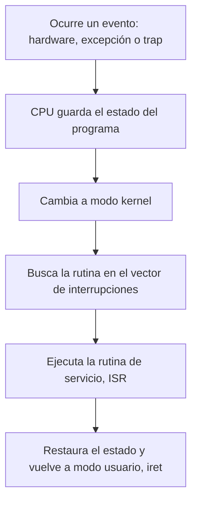

# Interrupciones y excepciones

El sistema operativo **no hace nada por sí solo**: su trabajo es brindar servicios, así que espera a que alguien se los pida. Ese "alguien" se manifiesta como una **interrupción**, un evento que detiene lo que está haciendo la CPU y le entrega el control al kernel. Por eso se dice que el SO está **conducido por eventos** (*event-driven*).

## El SO responde, no actúa

Si el usuario no hace nada, no se generan interrupciones de su parte y el SO solo mantiene los servicios básicos, como la gestión de batería. Cuando un programa necesita algo que requiere privilegios (leer un archivo, usar la red), **le pregunta al SO**, y el kernel responde solo si el programa cumple los permisos. Esta consulta tiene un costo en tiempo (*overhead*): es el precio de la protección vista en [[02 - Modos de operación y anillos de protección|modos de operación]].

El flujo cuando un programa de usuario pide un servicio tiene cuatro pasos:

1. El programa genera un **trap** (trampa), que es una interrupción generada por software.
2. El control pasa al sistema operativo, en *kernel space*.
3. El SO ejecuta el servicio solicitado. Mientras tanto, el programa queda en espera.
4. Terminado el servicio, el SO devuelve el control al programa de usuario.

> [!example]- Transcripción de la imagen
> Línea de tiempo con dos franjas, *User space* arriba y *Kernel space* abajo. El "Programa de usuario" corre en *user space* hasta que una flecha roja marcada **INTERRUPCION** baja al "Servicio de *kernel*". Mientras el servicio corre, el programa aparece "en espera" (línea punteada). Al terminar el servicio, otra flecha devuelve la ejecución al programa de usuario.

## Tipos de eventos

| Tipo | Origen | Relación con la instrucción actual | Ejemplos |
|---|---|---|---|
| **Interrupción de hardware** | Un dispositivo externo a la CPU | **Asíncrona**: llega en cualquier momento | Teclado o mouse, llegada de un paquete a la tarjeta de red, el *timer* |
| **Excepción** | La propia CPU, al fallar una instrucción | **Síncrona**: la causa la instrucción en curso | División por cero, acceso inválido a memoria (*segmentation fault*), fallo de página |
| **Trap** (interrupción de software) | El programa, deliberadamente | **Síncrona** | Una [[05 - Llamadas al sistema\|llamada al sistema]] (instrucciones `syscall`/`sysenter`, o `int 0x80` en Linux x86 antiguo) |

La interrupción del **timer** merece mención aparte: llega periódicamente y le devuelve el control al kernel aunque ningún programa lo pida. Así el SO puede quitarle la CPU a un proceso que no la suelta, que es la base de la planificación expropiativa.

## Cómo encuentra el kernel qué ejecutar

Cada tipo de interrupción tiene un número. El **vector de interrupciones** es una tabla que el SO configura en el hardware (en el x86 original era la IVT, *Interrupt Vector Table*; en modo protegido es la IDT, *Interrupt Descriptor Table*), donde cada número apunta al código del kernel que la atiende, la **rutina de servicio** (ISR, *Interrupt Service Routine*). Modificar esa tabla es una instrucción privilegiada: si un programa pudiera cambiarla, podría hacer que el kernel ejecutara su código.

## Preguntas de repaso

> [!question]- ¿Por qué se dice que el sistema operativo es conducido por eventos?
> Porque no hace nada por iniciativa propia: actúa solo cuando una interrupción, sea del hardware, una excepción o un trap de un programa, le transfiere el control. Sin eventos, solo mantiene los servicios básicos.

> [!question]- ¿En qué se diferencia una interrupción de hardware de una excepción?
> La interrupción de hardware es asíncrona: la genera un dispositivo externo en cualquier momento. La excepción es síncrona: la provoca la instrucción que la CPU está ejecutando, como una división por cero.

> [!question]- ¿Qué es un trap y cuándo lo usa un programa?
> Es una interrupción generada por software a propósito. El programa la usa para pedirle un servicio al SO (una syscall), pasando de modo usuario a modo kernel por un punto de entrada controlado.

> [!question]- ¿Por qué el timer es esencial para el SO?
> Porque garantiza que el kernel recupere el control periódicamente, aunque un proceso nunca haga syscalls. Sin él, un programa en un ciclo infinito monopolizaría la CPU.

> [!question]- ¿Por qué modificar el vector de interrupciones debe ser privilegiado?
> Porque el vector decide qué código se ejecuta en modo kernel ante cada evento. Si un programa de usuario pudiera cambiarlo, ejecutaría su propio código con todos los privilegios.
