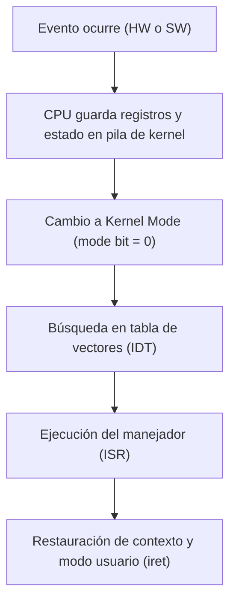

# Interrupciones y excepciones

Un sistema operativo es esencialmente un sistema conducido por eventos (*event-driven*): permanece en reposo hasta que una interrupción de hardware o una trampa/excepción de software solicita la intervención del procesador.

## CLASE 2 (mis apuntes)
14 / 08 / 2024

Estos son INTERRUPCIONES, el Kernell es quien le responde al usuario si cumple con los permisos anteriores,

### INTERRUPCIONES
- El programa le pregunta al S.O si tenemos permisos → Esto quita tiempo (OVERHEAD)
- El sistema operativo no hace nada por si solo, porque brinda servicios
- Si yo no hago nada, no genero interrupciones, esperará a que yo le pida algo
- Solo correra lo basico → bateria, etc
- Si nosotros no hacemos nada, solo dara servicios basicos

> [!example]- Transcripción de la imagen
> Diagrama temporal del flujo de una interrupción:
> 1. Un **Programa de usuario** se ejecuta en *User space*.
> 2. Ocurre un evento o solicitud que dispara una **INTERRUPCIÓN**, forzando un salto a *Kernel space*.
> 3. El programa de usuario entra en estado de espera mientras se ejecuta el **Servicio de kernel** (rutina de atención de la interrupción / ISR).
> 4. Concluida la atención del evento, el kernel restablece el contexto del procesador y retorna el control al programa en *User space* a través de una instrucción de retorno (`iret`).

> [!tip] Complemento (slides "Contenido 1: Interrupciones y Excepciones")
> En la arquitectura computacional moderna se distinguen dos clases de eventos:
> - **Interrupciones de hardware (asíncronas):** Señales eléctricas generadas por dispositivos periféricos externos a la CPU (un clic del mouse, llegada de un paquete de red por la tarjeta NIC, pulso periódico del reloj / *timer interrupt*). No están sincronizadas con la instrucción actual de la CPU.
> - **Trampas / Excepciones (síncronas):** Eventos generados por la propia CPU durante la ejecución de una instrucción:
>   - **Excepciones de error:** División por cero, desbordamiento aritmético, violación de segmento (*segmentation fault*), fallo de página (*page fault*).
>   - **Trampas de software / Syscalls:** Instrucciones deliberadas de software (`int 0x80`, `syscall`, `sysenter`) para solicitar servicios al kernel.
>
> **Tabla de vectores de interrupción (IVT / IDT):** Una tabla fija en memoria administrada por el kernel donde cada índice de interrupción apunta a la dirección de memoria de su manejador correspondiente (*Interrupt Service Routine* - ISR).

## Preguntas de repaso

1. ¿Por qué se dice que el sistema operativo es un sistema guiado por eventos (*event-driven*)?
> [!question]- Respuesta
> Porque no consume ciclos de CPU en bucles activos esperando tareas; si no hay eventos pendientes ni procesos listos, la CPU pasa a un estado de bajo consumo hasta que una interrupción la despierta.

2. ¿Cuál es la diferencia fundamental entre una interrupción de hardware y una excepción?
> [!question]- Respuesta
> La interrupción de hardware es asíncrona y proviene de un dispositivo externo a la CPU (como el teclado o el reloj); la excepción es síncrona y es causada directamente por la instrucción que la CPU está ejecutando (como una división por cero o una llamada al sistema).

3. ¿Qué rol juega el temporizador (*timer interrupt*) en los sistemas operativos con multitasking?
> [!question]- Respuesta
> Envía interrupciones periódicas a intervalos fijos de tiempo para que el kernel retome el control de la CPU, impidiendo que un proceso de usuario monopolice el procesador y permitiendo la planificación equitativa (*preemption*).

4. ¿Qué es la Tabla de Descriptores de Interrupción (IDT)?
> [!question]- Respuesta
> Es una estructura de datos en memoria cargada durante el arranque que asocia cada número de interrupción con la dirección de memoria de la rutina de servicio del kernel (ISR) encargada de procesarlo.

