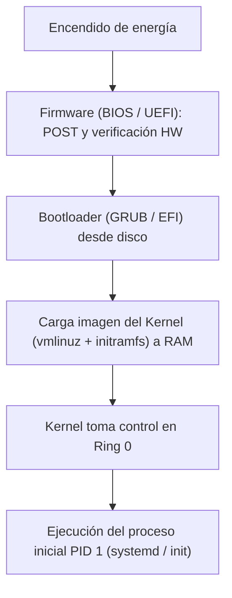

# Arranque del sistema computacional

El proceso de arranque (*bootstrapping*) es la secuencia ordenada de pasos mediante la cual el hardware físico inicializa sus componentes y transfiere el control al cargador de arranque para montar el núcleo del sistema operativo en modo privilegiado.

## Booteo del computador (mis apuntes)
BOOTEO DEL COMPUTADOR
Al iniciar un computador (f11)
- BIOS: Basic Input/Output system
- UEFI: Unified Extensible Firmware Interface
UEFI es la nueva → Bios es la vieja
- Aqui podemos elegir que particion iniciar → Podemos elegir el sistema operativo que queremos → Linux, Windows, etc…

Este codio tiene dos misions fundamentales
- Inicializar/Identificar el hardware
- Ubicar y arrancar mediante un bootloader el kernell en modo Privilegiado (kernell)
→ El Kernell es el unico software que funciona en modo Privilegiado

> [!warning] Posible error (registrado en `_meta/Sistemas Operativos y Redes/DUDAS.md`)
> En la frase "Este codio tiene dos misions fundamentales", se preservaron las erratas de tipeo del original ("codio" por "código" y "misions" por "misiones").

> [!tip] Complemento (slides "Contenido 1: Secuencia de Boot")
> La secuencia de encendido completa se divide en cuatro fases principales:
> 1. **Firmware (BIOS / UEFI):** Al encender la máquina, el Program Counter (PC) apunta a una dirección de memoria fija en ROM/NVRAM. Se ejecuta el **POST** (*Power-On Self-Test*) para verificar memoria RAM, CPU y buses.
> 2. **Particionamiento y Bootloader:**
>    - En sistemas tradicionales BIOS: busca el sector 0 del disco de arranque (MBR - *Master Boot Record*, 512 bytes), que contiene el cargador de primera etapa.
>    - En sistemas modernos UEFI: lee la partición EFI System Partition (ESP) con formato FAT32 y carga directamente ejecutables EFI (como `grubx64.efi`).
> 3. **Cargador de arranque (*Bootloader*, ej. GRUB, systemd-boot):** Presenta el menú de selección de sistema operativo, carga la imagen comprimida del kernel (`vmlinuz`) y el sistema de archivos temporal en RAM (`initramfs`) a memoria principal.
> 4. **Inicialización del Kernel:** Descomprime el código del kernel, inicializa estructuras de datos y tablas de páginas, toma el control en Ring 0 y finalmente ejecuta el primer proceso en espacio de usuario (PID 1: `systemd` o `init`).

## Preguntas de repaso

1. ¿Cuáles son las dos misiones fundamentales del firmware (BIOS/UEFI) durante el arranque?
> [!question]- Respuesta
> 1) Detectar, inicializar y verificar el correcto funcionamiento del hardware físico (POST). 2) Localizar un dispositivo de almacenamiento de arranque y transferir la ejecución al cargador de arranque (*bootloader*).

2. ¿Qué ventajas ofrece UEFI frente a la BIOS tradicional?
> [!question]- Respuesta
> Soporta discos de más de 2 TB con particiones GPT (GUID Partition Table), provee arranque seguro (*Secure Boot*) para verificar firmas digitales del software, y carga ejecutables modulares de 64 bits en lugar de depender del sector de 512 bytes del MBR.

3. ¿Qué rol desempeña el cargador de arranque (*bootloader*, como GRUB)?
> [!question]- Respuesta
> Permite elegir el sistema operativo o versión del kernel a iniciar, carga los parámetros de arranque, y lee la imagen del kernel desde el disco a la memoria RAM antes de saltar a su punto de entrada.

4. ¿Cuál es el primer proceso de espacio de usuario creado tras el inicio del kernel en Linux?
> [!question]- Respuesta
> El proceso de inicialización del sistema con PID 1 (comúnmente `systemd`), a partir del cual se desprenden todos los demás servicios y procesos del usuario.

