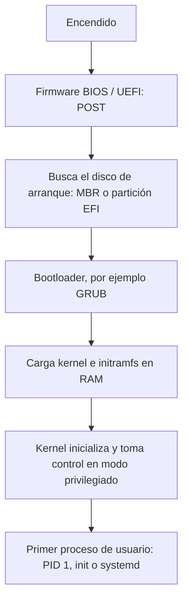

# Arranque del sistema computacional

Al encender el computador la memoria RAM está vacía: todavía no hay sistema operativo que ejecutar. El **arranque** (*booting* o *bootstrapping*) es la cadena de programas, cada uno más capaz que el anterior, que lleva la máquina desde ese estado hasta tener el kernel corriendo en modo privilegiado.

## El firmware: BIOS y UEFI

Al recibir energía, la CPU inicializa su contador de programa (**PC**, *Program Counter*) en una dirección fija que apunta a código grabado en memoria no volátil de la tarjeta madre (ROM/NVRAM): el **firmware**. Hay dos generaciones:

- **BIOS** (*Basic Input/Output System*): el esquema antiguo.
- **UEFI** (*Unified Extensible Firmware Interface*): su reemplazo moderno.

Sea cual sea, el firmware tiene **dos misiones fundamentales**:

1. **Inicializar e identificar el hardware**: verificar que CPU, memoria y dispositivos respondan. Esta autoprueba se llama **POST** (*Power-On Self-Test*).
2. **Ubicar y arrancar el kernel** mediante un **cargador de arranque** (*bootloader*), dejándolo en **modo privilegiado** (*ring 0* en x86).

> [!tip] Idea clave
> El kernel es el **único software que funciona en modo privilegiado**. Todo el arranque existe para entregarle el control en ese modo; desde ahí, el resto del software corre en modo usuario (ver [[02 - Modos de operación y anillos de protección|modos de operación]]).

Al encender, el firmware suele ofrecer un **menú de arranque** con una tecla que depende del fabricante (por ejemplo F11). Ahí se elige desde qué disco o partición iniciar, lo que en un equipo con varios sistemas instalados equivale a elegir entre Linux, Windows u otro.

## La cadena completa de arranque

Cada etapa resuelve una limitación de la anterior:

| Etapa | Qué hace | Por qué hace falta |
|---|---|---|
| Firmware | POST y búsqueda del dispositivo de arranque | Es lo único que existe al encender: está en la tarjeta madre, no en el disco |
| Bootloader | Presenta el menú de sistemas, carga en RAM la imagen comprimida del kernel (`vmlinuz` en Linux) y el `initramfs`, un sistema de archivos temporal con lo mínimo para montar el disco real | El firmware no sabe leer el formato del kernel ni del sistema de archivos del SO |
| Kernel | Inicializa sus estructuras (memoria, dispositivos) y lanza el primer proceso | Es quien administrará la máquina en adelante |
| PID 1 (`init` / `systemd`) | Levanta los servicios y la sesión de usuario | El kernel no inicia servicios por sí mismo; delega en este proceso, del que descienden todos los demás |

## BIOS frente a UEFI

La diferencia práctica está en cómo encuentran el bootloader:

- **BIOS** lee el primer sector del disco, el **MBR** (*Master Boot Record*), de **512 bytes**. Ahí cabe solo un cargador mínimo, que a su vez carga el resto.
- **UEFI** lee una partición dedicada, la **ESP** (*EFI System Partition*, normalmente en FAT32), y ejecuta directamente un programa EFI, como el de GRUB (`grubx64.efi`).

UEFI se asocia a discos con tabla de particiones **GPT** (*GUID Partition Table*), que supera el límite de 2 TB de MBR, y agrega **Secure Boot**, que verifica la firma digital del bootloader antes de ejecutarlo. Los esquemas de particionamiento se ven en detalle en [[03 - Niveles de formateo y esquemas de particionamiento (MBR y GPT)|MBR y GPT]].

> [!warning] Firmware no es sistema operativo
> BIOS y UEFI no administran procesos ni memoria para los programas. Su trabajo termina cuando le entregan el control al bootloader.

## Preguntas de repaso

> [!question]- ¿Cuáles son las dos misiones fundamentales del firmware durante el arranque?
> Inicializar e identificar el hardware (el POST), y ubicar el cargador de arranque para que este cargue el kernel y lo deje ejecutando en modo privilegiado.

> [!question]- ¿Por qué hace falta un bootloader si el firmware ya sabe leer el disco?
> Porque el firmware solo sabe encontrar un punto de partida fijo (el MBR o la partición EFI). No conoce el formato del kernel ni del sistema de archivos del SO. El bootloader sí: carga el kernel y sus parámetros en RAM, y además permite elegir qué sistema iniciar.

> [!question]- ¿Qué ventajas tiene UEFI frente a BIOS?
> Arranca desde una partición EFI en lugar del sector de 512 bytes del MBR, se usa con discos GPT de más de 2 TB y ofrece Secure Boot para verificar la firma del software de arranque.

> [!question]- ¿Qué significa que el kernel sea el único software en modo privilegiado, y cómo se relaciona con el arranque?
> Solo el kernel puede ejecutar instrucciones privilegiadas y acceder directamente al hardware. La cadena de arranque existe para entregarle el control en ese modo; todo lo que se ejecuta después, empezando por PID 1, corre en modo usuario.
