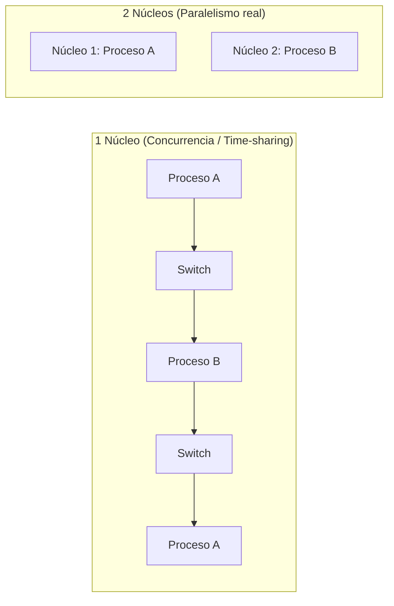

# Multitasking y fundamentos de multiprocesamiento

El multitasking permite que múltiples procesos compartan el uso de la CPU mediante alternancia rápida en el tiempo (*time-sharing*), ofreciendo la percepción de ejecución simultánea aun en sistemas de un único núcleo.

## Procesos y recursos (mis apuntes)
PROCESOS → Tarea 0
(Codigo) + (Recursos)
[python.py](http://python.py) → CPU
Se van poniendo en una cola
Recursos: CPU, Memoria, Archivos

DISTINTAS CPU´S
- 1 CPU: 1 Proceso en el mismo instante
- 2 CPU: 2 Procesos en el mismo instante
PREGUNTA DE PRUEBA: Lo que pasa es que estan todos en una cola, nunca se ejecutan mas de una a la vez, esto es MULTITASKING:
MULTITASKING
Los procesos entran y salen de la CPU, haciendo creer al usuario que ejecutan varios procesos a la vez

> [!tip] Complemento (slides "Contenido 1: Concurrencia y Paralelismo")
> - **Concurrencia vs Paralelismo:**
>   - **Concurrencia (*Concurrency*):** Gestionar múltiples tareas que progresan durante el mismo intervalo de tiempo. En una sola CPU se logra mediante multiplexación en el tiempo (*time slicing*).
>   - **Paralelismo (*Parallelism*):** Ejecutar físicamente dos o más instrucciones exactamente en el mismo instante de tiempo sobre diferentes núcleos o procesadores físicos (*multicore / multiprocessor*).
> - **Multiprogramación vs Tiempo compartido:**
>   - **Multiprogramación:** Mantiene varios procesos en memoria para que, cuando uno se bloquee esperando I/O, la CPU pase de inmediato a otro, maximizando el aprovechamiento del hardware.
>   - **Tiempo compartido (*Time-sharing / Multitasking*):** Cambia rápidamente entre procesos mediante interrupciones del temporizador (cuantos de tiempo de decenas de milisegundos), permitiendo interactividad directa con el usuario.

## Preguntas de repaso

1. ¿Cuál es la diferencia fundamental entre concurrencia y paralelismo?
> [!question]- Respuesta
> La concurrencia es la capacidad de estructurar y alternar múltiples tareas en avance intercalado (posible incluso en 1 solo núcleo); el paralelismo requiere hardware con múltiples núcleos físicos ejecutando instrucciones en simultáneo.

2. ¿Cómo logra un procesador monocore la ilusión de que decenas de programas corren al mismo tiempo?
> [!question]- Respuesta
> Mediante la técnica de tiempo compartido (*time-sharing*), asignando a cada proceso una pequeña fracción de tiempo de CPU (*quantum*) y rotando velozmente entre ellos asistido por el temporizador del sistema.

3. ¿Qué compone esencialmente a un proceso en un sistema operativo?
> [!question]- Respuesta
> El código del programa en ejecución más los recursos asociados asignados por el kernel (espacio de memoria con stack y heap, registros de CPU, descriptores de archivos abiertos y credenciales).

4. ¿Qué ventaja aporta la multiprogramación al rendimiento global de la computadora?
> [!question]- Respuesta
> Evita que la CPU permanezca ociosa cuando un proceso espera que termine una operación lenta de entrada/salida (disco o red), conmutando inmediatamente a otro proceso listo para ejecutar.

