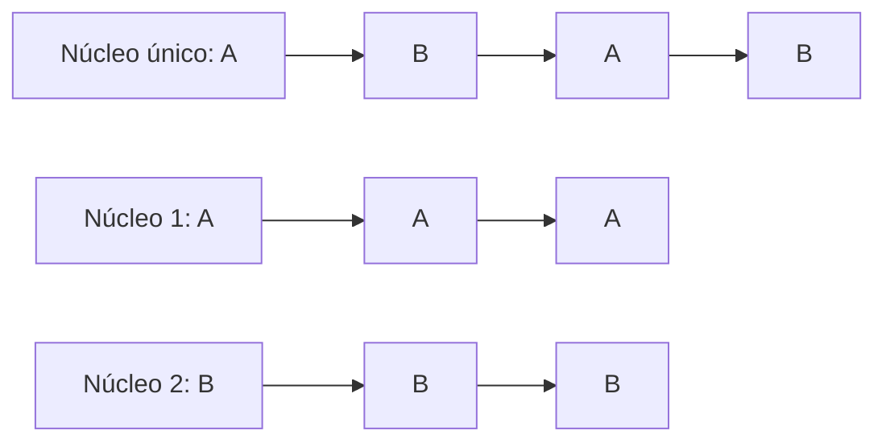

# Multitasking y fundamentos de multiprocesamiento

En un computador hay decenas de programas "abiertos" al mismo tiempo, aunque tenga pocos núcleos. Lo que lo hace posible no es que todos corran literalmente a la vez, sino que el sistema operativo los **alterna** tan rápido que el usuario no lo nota. Esta nota presenta los conceptos que se usan en todo el curso: proceso, multiprogramación, multitasking y paralelismo.

## Proceso: código + recursos

Un **proceso** es un programa en ejecución:

$$\text{Proceso} = \text{Código (programa)} + \text{Recursos}$$

Los recursos son CPU, memoria y archivos, además de sockets, dispositivos de I/O y bibliotecas. Por ejemplo, al ejecutar `python script.py` el SO crea un proceso con ese código y le asigna memoria y archivos abiertos. Luego el proceso espera en una **cola** su turno de usar la CPU. El detalle está en [[01 - Concepto de proceso y espacio de memoria|concepto de proceso]].

## Una CPU, un proceso a la vez

Un núcleo atiende **un solo proceso en un instante dado**:

- Con 1 CPU, 1 proceso se ejecuta en cada instante.
- Con 2 CPU, 2 procesos se ejecutan en el mismo instante.

¿Cómo parecen correr muchos a la vez con una sola CPU? Los procesos están en una cola y nunca se ejecuta más de uno al mismo tiempo en ese núcleo, pero **entran y salen de la CPU** cada pocos milisegundos. Eso es el **multitasking**: hacerle creer al usuario que varios procesos se ejecutan a la vez.

> [!tip] Multiprogramación frente a multitasking
> - **Multiprogramación:** mantener **varios procesos en memoria** al mismo tiempo. Si uno se bloquea esperando I/O, la CPU pasa a otro y no queda ociosa.
> - **Multitasking:** **repartir el tiempo de CPU** entre esos procesos, alternándolos tan rápido que parecen simultáneos.
>
> La multiprogramación pone a los candidatos en memoria; el multitasking los turna en la CPU.

## Cómo se alternan

El SO solo actúa tras una [[04 - Interrupciones y excepciones|interrupción]]: una syscall, el *timer* o algún evento. En ese momento puede sacar al proceso actual y poner otro, lo que se llama **cambio de contexto**:

1. El SO guarda el estado de los registros del proceso P1 en su PCB. P1 queda "en pausa".
2. Restaura el estado de los registros de P2 desde su PCB.
3. P2 continúa su ejecución como si nunca se hubiera detenido.

Elegir cuál de los procesos listos corre a continuación es el trabajo del **scheduler** (planificador). Gracias a la interrupción periódica del *timer*, ningún proceso puede quedarse con la CPU indefinidamente.

## Concurrencia y paralelismo

| | Concurrencia | Paralelismo |
|---|---|---|
| Idea | Varias tareas **progresan** en el mismo intervalo de tiempo | Varias tareas se ejecutan **en el mismo instante** |
| Hardware | Basta un núcleo, que alterna entre ellas | Requiere varios núcleos o procesadores |
| Mecanismo | Multitasking (tiempo compartido) | Multiprocesamiento (*multicore*) |

En la primera fila, A y B son concurrentes pero nunca paralelos: se turnan el núcleo. En las dos filas siguientes, con dos núcleos, A y B avanzan en paralelo.

## Preguntas de repaso

> [!question]- Con una sola CPU, ¿cuántos procesos se ejecutan en un instante? ¿Por qué parecen más?
> Uno solo. Parecen más porque el SO los saca y mete en la CPU cada pocos milisegundos (multitasking), lo que crea la ilusión de simultaneidad.

> [!question]- ¿Qué diferencia hay entre multiprogramación y multitasking?
> La multiprogramación mantiene varios procesos en memoria para que la CPU tenga a quién atender si uno se bloquea. El multitasking reparte el tiempo de CPU entre esos procesos, alternándolos rápidamente.

> [!question]- ¿Qué es concurrencia sin paralelismo?
> Es cuando varias tareas progresan en el mismo intervalo, pero turnándose un único núcleo: en ningún instante se ejecutan dos a la vez.

> [!question]- ¿Qué hace el SO en un cambio de contexto y qué lo dispara?
> Lo dispara una interrupción (syscall, *timer* u otro evento). El SO guarda los registros del proceso actual en su PCB, restaura los del siguiente desde el suyo y lo deja continuar.
