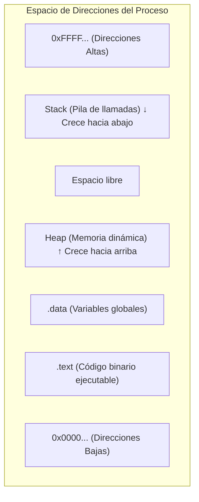

# Concepto de proceso y espacio de memoria

Un proceso es una instancia de un programa en ejecución que combina código binario con recursos del sistema operativo y un espacio de memoria virtual estructurado en texto, datos, heap dinámico y stack.

## CLASE 3 (PROCESOS) (mis apuntes)
19/08/2024

### Proceso
- Proceso = Codigo(programa) + Recursos
- Un proceso es un Programa de ejecucion
¿Que recursos?
Multiprogramacion pemite mantener multiples procesos en la memoria (mediante schedulers)
“En el mismo instante, un core solo atiende un proceso”
Otros
- CODIGO
- DATOS
- HEAP → Memoria dinamica (durante la ejecucion)
- STACK → Cada item del stack representa un llamado a funcion (call frame) y contiene:
  - Parametros
  - Variables locales
  - Lugar de retorno (PC (donde estaba antes))
  - Stack base pointer (SBP) punto de inicio del stack
  - Stack pointer limite inferior del stacj, de donde se sacan las direcciones

Pregunta Prueba: El proceso esta compuesto por codigo heap y stack → Es verdadero aunque falte una ….. Pero si inventan algo → es falso

ESQUEMA

> [!example]- Transcripción de la imagen
> Mapa de memoria virtual de un proceso típico en ejecución:
> - **Direcciones bajas (desde 0x000):**
>   - `Program (.text)`: Contiene el código binario de instrucciones máquina; apuntado por el Program Counter (PC), es de solo lectura y compartido si hay varias instancias.
>   - `.data`: Variables globales y estáticas inicializadas (ejemplo: `int m[100]`).
>   - `heap`: Almacenamiento dinámico gestionado mediante `malloc()`, `brk()`, `mmap()` y `free()`. Crece hacia direcciones altas de memoria.
> - **Zona intermedia:** Espacio libre contiguo para crecimiento mutuo de heap y stack.
> - **Direcciones altas (hacia 0x400 / 0xFFF):**
>   - `stack`: Pila de ejecución de llamadas a funciones, argumentos locales y direcciones de retorno de marcos de llamada (*stack frames*). Crece hacia abajo, apuntado por el Stack Pointer (SP) y el Stack Base Pointer (SBP).
> - **Espacio superior:** Mapeo reservado para el núcleo del sistema operativo.

> [!tip] Complemento (slides "Contenido 2: Procesos")
> **Programa vs Proceso:**
> - Un **programa** es una entidad pasiva: un archivo binario ejecutable almacenado en el disco secundario (por ejemplo, `/bin/ls` o `a.out`).
> - Un **proceso** es una entidad activa: una instancia viva cargada en memoria que cuenta con un Program Counter (PC), registros de CPU asignados, descriptores de archivos abiertos y un espacio de direcciones privado.
>
> **Aislamiento de memoria:** Dos procesos que ejecutan el mismo programa (por ejemplo, dos terminales corriendo `bash`) comparten el segmento `.text` en modo solo lectura, pero cada uno posee copias totalmente independientes de `.data`, `heap` y `stack`.

## Preguntas de repaso

1. ¿Cuál es la diferencia conceptual entre un programa y un proceso?
> [!question]- Respuesta
> Un programa es un archivo estático pasivo guardado en disco; un proceso es una instancia dinámica activa en memoria que posee un contador de programa, registros de CPU y recursos asignados.

2. ¿Por qué el segmento de texto (`.text`) se configura habitualmente como de solo lectura?
> [!question]- Respuesta
> Para prevenir que el propio programa o un ataque malicioso modifique las instrucciones en ejecución, y para permitir que múltiples procesos compartan el mismo código físico en RAM sin duplicarlo.

3. ¿En qué direcciones de memoria y hacia dónde crecen el *heap* y el *stack*?
> [!question]- Respuesta
> El *heap* se ubica justo sobre el segmento de datos e incrementa sus direcciones hacia arriba (hacia direcciones más altas); el *stack* nace en la cima del espacio de direcciones de usuario y desciende hacia abajo.

4. ¿Qué información reside dentro del *stack frame* de una función?
> [!question]- Respuesta
> Las variables locales declaradas dentro de la función, los argumentos pasados a la llamada, el puntero al marco de pila anterior (SBP) y la dirección de retorno de la instrucción que debe ejecutarse al finalizar.

