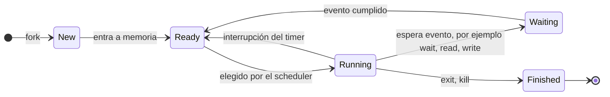

# Estados de un proceso y ciclo de vida

Un proceso no está siempre ejecutándose: a veces espera turno, a veces espera un dato del disco o del usuario. El sistema operativo registra en el PCB **en qué estado** está cada proceso, y así sabe a cuáles puede darles la CPU y a cuáles no tiene sentido dársela todavía.

## Los cinco estados

| Estado | Significado | Clave para recordarlo |
|---|---|---|
| **New** | En creación (tras `fork`) | Aún no entra a memoria |
| **Ready** | Listo para ejecutar; espera que le asignen CPU | **Tiene todo** lo que necesita, solo le falta turno |
| **Running** | Ejecutándose en un núcleo (*core*) de la CPU | Hay a lo más uno por núcleo |
| **Waiting** | Esperando un evento: I/O, una señal, un dato | **Le falta algo** para poder correr |
| **Finished** | Ejecución terminada (*terminated*, *killed*) | Su PCB espera a que el padre lo recoja |

La distinción central es entre **Ready** y **Waiting**. Imagina un proceso que copia archivos y necesita que el usuario indique en qué carpeta buscar: mientras el usuario no responda, el proceso está en **Waiting**, porque aunque la CPU estuviera libre no podría avanzar. Cuando recibe lo que le faltaba (la carpeta, o el archivo leído a memoria), pasa a **Ready** y vuelve a la fila.

## Transiciones

> [!example]- Transcripción de la imagen
> "Un proceso en ejecución puede cambiar de estado". **New** (`fork`) → *Entra a memoria* → **Ready** → *Elegido para ejecutar (scheduler)* → **Running**. Desde Running hay tres salidas: *Interrupción (timer)* de vuelta a Ready; *Espera por evento (ej: I/O)* `wait, read, write, …` hacia **Waiting** (*blocked, sleeping, etc.*); y *Término* `exit, kill` hacia **Finished** (*terminated, killed*). Desde Waiting, *Evento cumplido* lleva de vuelta a Ready.

> [!warning] Waiting nunca salta directo a Running
> Cuando el evento se cumple, el proceso vuelve a **Ready**, no a Running: la CPU puede estar ocupada con otro, y es el scheduler quien decide a quién le toca.

## Quién decide: el scheduler

Elegir qué proceso de la cola entra a la CPU es el trabajo del **scheduler** (planificador):

- **Ready es una cola** de procesos.
- Hay **distintos tipos** de scheduler según el criterio con que eligen al siguiente de la cola Ready.
- El más simple es **FIFO** o **FCFS** (*First-In, First-Out* / *First-Come, First-Served*, dos nombres para la misma política): el primero que entra es el primero en ejecutarse.
- Otros **asignan un tiempo** a cada proceso. Si se le acaba (digamos un intervalo fijo; en la práctica son milisegundos) y no ha terminado, el *timer* lo interrumpe y el proceso vuelve a la cola Ready a esperar su próximo turno.

Las políticas se estudian en [[02 - Clasificación de planificadores y métricas de rendimiento|clasificación de planificadores]].

## Estados suspendidos

Cuando falta memoria, el scheduler de mediano plazo puede llevar procesos completos al disco (*swap*). Por eso el modelo de 7 estados agrega dos a los 5 anteriores: **Ready suspendido** (*ready suspended*: listo, pero con su memoria en disco) y **bloqueado suspendido** (*blocked suspended*: esperando un evento y además en disco).

## Preguntas de repaso

> [!question]- ¿Qué diferencia a un proceso en Ready de uno en Waiting?
> El de Ready tiene todo lo necesario y solo espera turno de CPU. El de Waiting no podría ejecutar aunque la CPU estuviera libre, porque le falta un evento (I/O, un input, una señal).

> [!question]- ¿Por qué un proceso que termina su I/O pasa a Ready y no a Running?
> Porque la CPU puede estar ocupada y la decisión de quién corre la toma el scheduler. El proceso se pone en la cola y espera a ser elegido.

> [!question]- ¿Qué provoca la transición de Running a Ready?
> Una interrupción del *timer*: al proceso se le acabó el tiempo asignado, el SO lo saca de la CPU y lo devuelve a la cola Ready sin que haya terminado.

> [!question]- Un proceso llama a `read()` sobre un archivo en disco. ¿Qué transiciones recorre?
> Running → Waiting mientras el disco entrega los datos; al completarse la lectura, Waiting → Ready; y cuando el scheduler lo elige, Ready → Running.
