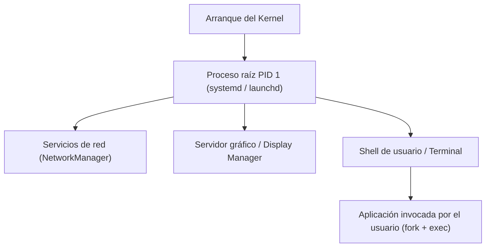

# Jerarquía y creación de procesos con fork

En los sistemas operativos modernos, los procesos se organizan en una estructura jerárquica de árbol en la que cada proceso es engendrado por un proceso padre, remontándose todos a un proceso raíz inicial de PID 1.

## Creación de procesos y jerarquía (mis apuntes)
CREACION DE PROCESOS
Exiten Daemons → procesos que correr
Creación de procesos: ¿el huevo o la gallina?
- ¿Quién crea un proceso?... otro proceso
- ¿Quién crea ese otro proceso? otro proceso
Durante la inicialización del kernel se crea un proceso "raíz", con id=1
- ¿Quién crea ese otro proceso? otro proceso. . .
Proceso Papa de todos los otros → Echa a correr todos los demas procesos
- ej: Prender el monitor
- ej: Prender algo
- ej: Tenia abierto google antes de cerrar
En los S.O
- Linux: systemd, init, upstart
- macOS: launch-d →
- Windows: InitialSystemProcess, System
Todos estos son DAEMONS con el ID: 1

COMO CREARLOS
Un proceso (parent) crea a otro proceso hijo (child)

> [!example]- Transcripción de la imagen
> Creación de procesos mediante la llamada `fork()`:
> - El proceso padre **P1 (parent)** se ejecuta a lo largo del eje temporal en *User space*.
> - Al ejecutar la llamada al sistema `fork()`, el kernel crea una copia exacta denominada proceso hijo **P2 (child)**.
> - A partir de ese punto de bifurcación, ambos procesos (P1 y P2) progresan independientemente en el tiempo dentro de sus respectivos espacios de memoria.

> [!tip] Complemento (slides "Contenido 2: Mecánica de fork()")
> La llamada al sistema `pid_t fork(void)` clona el proceso llamador de forma casi idéntica:
> - **Valores de retorno:**
>   - En el proceso hijo: retorna `0`.
>   - En el proceso padre: retorna el PID del proceso hijo recién creado (un entero positivo).
>   - En caso de fallo (por falta de memoria o límite de procesos alcanzado): retorna `-1`.
> - **Copy-On-Write (COW):** Para evitar la costosa duplicación física de megabytes de RAM durante `fork()`, los sistemas operativos modernos no copian la memoria de inmediato; marcan las páginas de memoria como compartidas y de solo lectura. Solo cuando el padre o el hijo intenta escribir en una página, la MMU genera un fallo de protección y el kernel crea una copia física exclusiva de esa página específica.

## Preguntas de repaso

1. ¿Cómo se resuelve el dilema de "el huevo o la gallina" en la creación de procesos?
> [!question]- Respuesta
> Durante la secuencia de arranque, el propio kernel crea de manera manual y directa el proceso raíz inicial con PID 1 (`systemd` o `init`), a partir del cual todos los demás procesos son creados mediante llamadas `fork()`.

2. ¿Qué retorna la llamada `fork()` en el proceso padre y qué retorna en el proceso hijo?
> [!question]- Respuesta
> En el proceso padre retorna el PID positivo del hijo recién creado; en el proceso hijo retorna `0`. Si ocurre un error, retorna `-1` en el padre.

3. ¿Qué optimización aporta el mecanismo *Copy-On-Write* (COW) a la llamada `fork()`?
> [!question]- Respuesta
> Evita duplicar innecesariamente todo el espacio de memoria RAM del padre al crear el hijo. Ambos comparten las páginas de memoria en modo lectura hasta que alguno escribe sobre ellas, momento en que se clona únicamente la página modificada.

4. ¿Qué nombres recibe el proceso de PID 1 en Linux, macOS y Windows?
> [!question]- Respuesta
> En Linux se denomina comúnmente `systemd` (o históricamente `init`), en macOS `launchd`, y en Windows equivale conceptualmente al proceso de sistema inicial (*System*).

