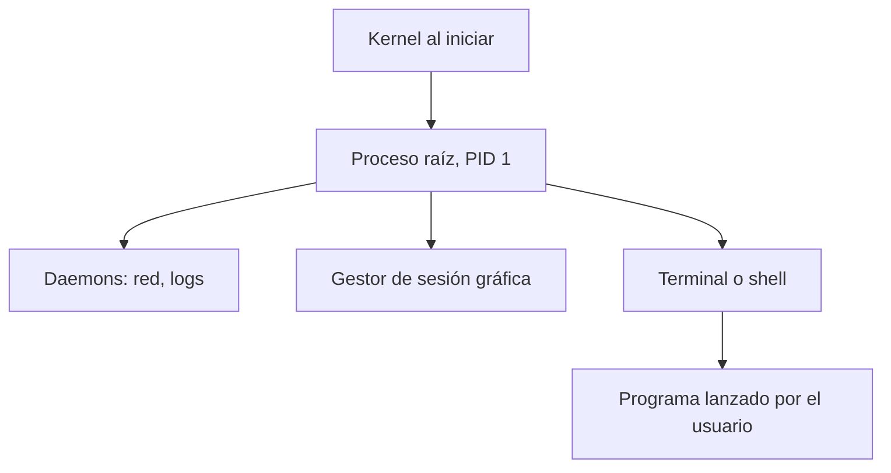

# Jerarquía y creación de procesos con fork

En UNIX, un proceso nuevo siempre lo crea otro proceso. Esa relación padre-hijo ordena a todos los procesos del sistema en un **árbol**, y la herramienta para crear un hijo es la llamada `fork()`.

## ¿El huevo o la gallina?

¿Quién crea un proceso? Otro proceso. ¿Y quién crea a ese otro? Otro proceso más… La cadena tiene que empezar en algún lado: **durante la inicialización del kernel se crea un proceso "raíz", con PID = 1**. Es el padre de todos los demás y echa a correr el resto del sistema: lo que hace falta para encender la pantalla, los servicios de fondo y, a veces, incluso volver a abrir las aplicaciones que el usuario tenía abiertas antes de apagar.

Este proceso raíz es un **daemon**, un proceso que corre permanentemente en segundo plano. Según el material del curso, en cada sistema se llama:

| Sistema | Proceso raíz |
|---|---|
| Linux | `systemd` (antes `init` o `upstart`) |
| macOS | `launchd` |
| Windows | `InitialSystemProcess`, `System` |

Como cada proceso tiene un padre, la relación de creación forma un **árbol de procesos**:



## Cómo se crea un hijo: fork

Un proceso (*parent*) crea a otro, su hijo (*child*), con `pid_t fork(void)`. Las reglas son:

- **El hijo es un duplicado casi exacto del padre**, pero es un proceso nuevo, con otro PID y su propio espacio de direcciones: copia la memoria del padre a su nuevo espacio.
- **Ambos continúan ejecutando desde la misma instrucción**, el retorno de `fork()`, y lo hacen de forma concurrente. Cuál de los dos sigue primero en *running* depende de la implementación.
- **El valor de retorno los distingue**: el padre recibe el PID del hijo, el hijo recibe 0, y si falla (por ejemplo, por falta de memoria o por el límite de procesos) retorna `-1`.


> [!example]- Transcripción de la imagen
> Eje de tiempo vertical hacia abajo. La barra de **P1 (parent)** recorre todo el eje. A mitad de camino, una flecha marcada `fork()` crea **P2 (child)**, que desde ahí avanza en paralelo con P1 hasta el final.

```c
#include <stdio.h>
#include <sys/wait.h>
#include <unistd.h>

int main(void) {
    printf("antes del fork: soy %d, mi padre es %d\n", getpid(), getppid());
    fflush(stdout);                 /* vaciar el buffer antes de duplicar el proceso */
    pid_t pid = fork();
    if (pid == 0)
        printf("hijo:  soy %d, mi padre es %d\n", getpid(), getppid());
    else {
        printf("padre: soy %d, mi hijo es %d\n", getpid(), pid);
        wait(NULL);
    }
    return 0;
}
```

> [!warning] El hijo copia también los buffers
> Si se omite el `fflush` y la salida va a un archivo o a un pipe, "antes del fork" aparece **dos veces**: el texto seguía en el buffer de `printf` cuando se copió la memoria, así que el hijo hereda una copia y también la imprime.

**Copy-on-write (COW).** Copiar toda la memoria del padre en cada `fork` sería caro. Los sistemas modernos no copian de inmediato: padre e hijo comparten las páginas marcadas como solo lectura, y solo cuando alguno intenta escribir en una página, la MMU genera un fallo de protección y el kernel crea una copia de esa página en particular.

## Preguntas de repaso

> [!question]- ¿Cómo se resuelve el problema del huevo o la gallina en la creación de procesos?
> El kernel crea directamente, durante su inicialización, el proceso raíz con PID 1. A partir de él, todos los demás procesos se crean con `fork()`.

> [!question]- ¿Qué devuelve `fork()` y por qué hace falta que devuelva cosas distintas?
> Devuelve el PID del hijo en el padre, 0 en el hijo y `-1` si falla. Como ambos continúan desde la misma instrucción con el mismo código, el valor de retorno es la única forma de que cada uno sepa quién es.

> [!question]- ¿En qué se parecen y en qué se diferencian el padre y el hijo justo después de `fork()`?
> El hijo tiene una copia de la memoria del padre y sigue desde la misma instrucción. Pero es otro proceso: tiene otro PID y su propio espacio de direcciones, así que los cambios de uno no afectan al otro.

> [!question]- ¿Qué ahorra *copy-on-write*?
> Evita copiar toda la memoria del padre al crear el hijo. Las páginas se comparten hasta que alguien escribe, y solo entonces se duplica la página modificada.
