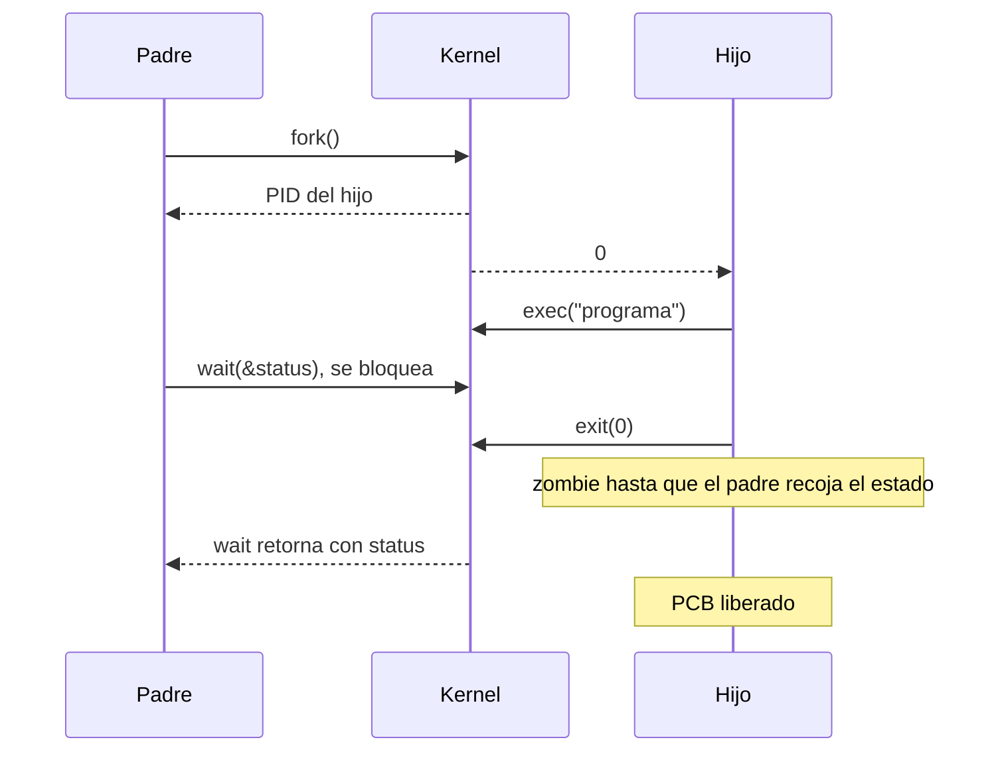

# Control de procesos con wait, exec y terminación

Crear un proceso con `fork()` es solo el comienzo. El padre también necesita poder lanzar otro programa, esperar a que el hijo termine y enterarse de cómo terminó, y el sistema tiene que limpiar lo que queda cuando un proceso muere. Cuatro syscalls cubren ese ciclo.

## Las syscalls del ciclo de vida

| Syscall | Qué hace |
|---|---|
| `fork()` | **Clona** el proceso: crea un hijo, copia del padre |
| `exec()` (`execl`, `execv`, `execve`, `execvp`…) | **Reemplaza** el programa del proceso por otro ejecutable |
| `wait()` / `waitpid()` | **Espera** a que un hijo termine y recibe su código de salida |
| `exit()` | **Termina** el proceso con un código de retorno |
| `kill()` | **Envía una señal** a otro proceso; por defecto `SIGTERM`, que le pide terminar |

Dos detalles clave:

- **Tras `fork()`, el hijo empieza a ejecutar desde la línea en que se hizo el `fork`**, es decir, desde su retorno, y no desde el inicio del programa.
- **`exec()` no crea un proceso**: sobrescribe el código, los datos, el heap y el stack del proceso actual con el nuevo binario, y **el PID se mantiene**. Por eso el patrón típico para lanzar un programa es *`fork()` y luego `exec()` en el hijo*.

## Terminación y código de retorno

Todo proceso, al terminar, ejecuta `exit()` y **le entrega un código de retorno a su padre**. El SO recupera los recursos asignados al proceso. Por convención:

- **0** significa que terminó bien;
- **distinto de 0** indica un error o una situación especial, y la documentación del programa debería explicar qué significa cada código.

El padre recibe ese valor con `wait()`, que lo bloquea hasta que un hijo termina. Con las macros `WIFEXITED(status)` y `WEXITSTATUS(status)` revisa si el hijo terminó normalmente y con qué código.

## Zombies y huérfanos

> [!warning] Proceso zombie
> Cuando un hijo termina y **su padre todavía no ha hecho `wait()`**, el proceso no se borra de inmediato de la tabla de procesos, aunque tampoco ejecuta: queda como **zombie** hasta que el padre hace `wait()` y recoge su código de salida. No consume CPU, pero ocupa una entrada de la tabla y un PID. Si se acumulan muchos, pueden agotar los PID disponibles.

> [!tip] Proceso huérfano
> Si el **padre termina antes que el hijo**, el hijo queda **huérfano**. Linux permite que siga viviendo: pasa a ser hijo de **`init`** (el proceso raíz, PID 1, que en Linux moderno es `systemd`), que hace `wait()` periódicamente por sus hijos y así evita que queden zombies para siempre.

Ojo: al cerrar una terminal puede *parecer* que los hijos mueren con el padre. Eso no es porque los hijos dependan del padre, sino porque normalmente reciben una señal de término.

> [!example]- Al margen: NAS
> Un **NAS** (*Network Attached Storage*) es una técnica para tener más espacio de almacenamiento: discos conectados directamente a la red, a los que los equipos acceden como si fueran un disco compartido.

## Preguntas de repaso

> [!question]- ¿Desde dónde empieza a ejecutar el hijo después de `fork()`?
> Desde el retorno de `fork()`, la misma instrucción en que estaba el padre, porque hereda una copia de su estado, incluido el PC.

> [!question]- ¿Qué pasa con la memoria y el PID cuando un proceso llama a `exec()`?
> Su memoria (código, datos, heap y stack) se reemplaza por la del nuevo ejecutable, pero el PID sigue siendo el mismo: es el mismo proceso corriendo otro programa.

> [!question]- ¿Qué es un zombie y cómo deja de serlo?
> Es un proceso que ya terminó, pero cuyo padre no ha llamado a `wait()`: su entrada en la tabla de procesos sigue ocupada. Deja de serlo cuando el padre hace `wait()`, o cuando muere el padre y lo adopta `init`, que sí hace `wait()`.

> [!question]- ¿Qué indica un código de retorno distinto de 0?
> Que el programa terminó con un error o en una situación especial. Por convención, 0 significa éxito, y el significado de cada otro código debería estar en la documentación del programa.
