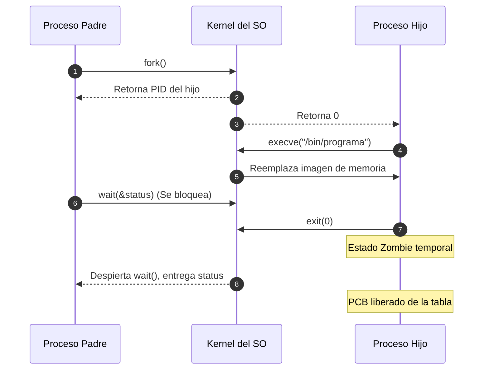

# Control de procesos con wait, exec y terminación

El ciclo de vida de los procesos se gestiona mediante la combinación fundamental de llamadas al sistema `fork()`, `exec()`, `wait()` y `exit()`, que coordinan la ejecución de nuevos programas y la recolección de su estado de salida para evitar procesos zombies y huérfanos.

## Syscalls de procesos y ciclo de terminación (mis apuntes)
SYSCALLS
- FORK: Clona el procesos
- WAIT: Espera que el proceso termine
- EXECV: Reemplaza el proceso (Ejecucion)
- KILL: Termina el Proceso
NAS: Tecnica para usar mas espacio → Mas discos que están conectados directo a la red
→ Investigar sobre servidores y estas cosas

CLASE 4
21/08/2024
IMPORTANTE
PREGUNTA: Empieza a ejecutar desde la linea en que se hace fork
FORK: Crea un proceso hijo (copia del padre)
Cuando un proceso termina, le retorna al padre
Si no se le retorna al padre → Se genera un Proceso Zombie
Si retorna 0 → Termina bien
Si retorna otro → Error
WAIT: Espera que el proceso hijo termine

> [!warning] Posible error (registrado en `_meta/Sistemas Operativos y Redes/DUDAS.md`)
> En la frase "Si no se le retorna al padre → Se genera un Proceso Zombie", la precisión técnica es que el proceso hijo ya terminó y envió su código de salida, pero se convierte en *Zombie* cuando su proceso padre aún no ha ejecutado `wait()` para recolectar dicha información, ocupando una ranura en la tabla de procesos.

> [!tip] Complemento (slides "Contenido 2: Control de Procesos")
> - **Familia `exec` (`execve`, `execl`, `execvp`):** Reemplaza completamente el espacio de memoria (código, datos, stack y heap) del proceso actual por el nuevo archivo ejecutable binario. El PID del proceso **se mantiene intacto**; no se crea un nuevo proceso, sino que se transforma el existente.
> - **Llamada `wait()` / `waitpid()`:**
>   - Bloquea al proceso padre hasta que alguno de sus hijos termine.
>   - Extrae el código de terminación mediante macros como `WIFEXITED(status)` y `WEXITSTATUS(status)`.
>   - Libera formalmente el PCB del hijo de la tabla de procesos del kernel.
> - **Procesos Huérfanos (*Orphan processes*):** Si el padre termina antes que el hijo, el hijo queda huérfano. El sistema operativo lo adopta automáticamente asignándole como nuevo padre al proceso `systemd` (PID 1), que se encarga de ejecutar `wait()` cuando el hijo finalice.

## Preguntas de repaso

1. ¿Qué ocurre exactamente con la memoria y el PID de un proceso cuando ejecuta `execve()`?
> [!question]- Respuesta
> La imagen de memoria (código, variables, heap y stack) se sobreescribe por completo con el nuevo binario ejecutable, pero el PID del proceso sigue siendo exactamente el mismo.

2. ¿Qué es un proceso *Zombie* y qué consecuencias tiene en el sistema operativo?
> [!question]- Respuesta
> Es un proceso que ya terminó su ejecución mediante `exit()`, pero cuyo padre no ha llamado a `wait()` para leer su estado. No consume CPU ni RAM, pero ocupa una entrada en la tabla de procesos del kernel; si se acumulan demasiados, pueden agotar los PIDs disponibles.

3. ¿Qué es un proceso *Huérfano* y cómo lo maneja el kernel?
> [!question]- Respuesta
> Es un proceso en ejecución cuyo padre murió antes de que él terminara. El kernel lo reasigna automáticamente al proceso raíz (PID 1, `systemd`), el cual adopta al huérfano y ejecuta `wait()` cuando termine.

4. ¿Desde qué instrucción comienza a ejecutar el proceso hijo tras la llamada a `fork()`?
> [!question]- Respuesta
> Ejecuta exactamente desde la instrucción inmediatamente posterior a la llamada `fork()`, ya que hereda el Program Counter (PC) en el mismo punto de ejecución del padre.

