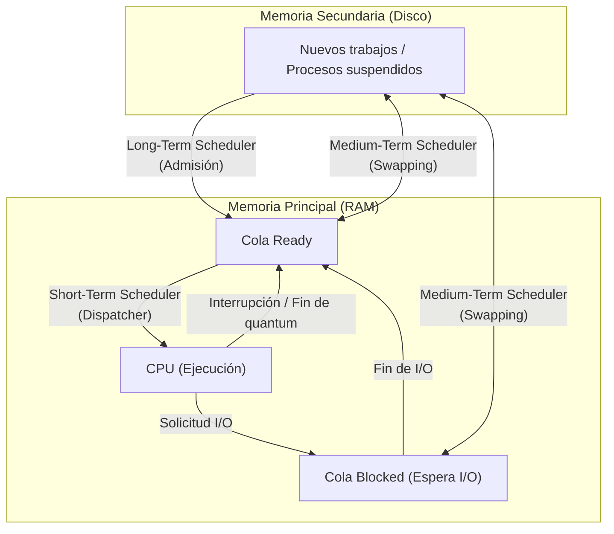

# Niveles de planificación y ciclo de ráfagas CPU-I/O

La **planificación de CPU** (*CPU Scheduling*) es el mecanismo del sistema operativo encargado de seleccionar qué proceso en estado listo (*ready*) debe pasar a ejecutarse en la CPU y por cuánto tiempo, permitiendo la multiprogramación y la ilusión de concurrencia.

---

## SCHEDULERS (mis apuntes)

> Regals para elegir que proceso entra en la CPU (Nucleo)
> Depende del tipo de schedule → Es como se elige quien llega a la cola de Ready
> → Quien es el mejor dato para entrar en la CPU
> Existen 3 que siempre funcionan dentro de un computador → corto, mediano y largo plazo
> SHORT-Term
> - ELIGE quien se ejecuta en la cola READY
> - Ejecuta el CAMBIO de Contexto
> Medium-Term
> - Modifica temporalmente el grado de multiprogramacion
> - (Hace SWAP) → Copiando memoria RAM a disco y de Disco a Ram
> - SACA los procesos
> Long-Term
> - Admite procesos en la cola READY
> - Determina el grado de multiprogramacion (ctd de procesos en memoria)
> - PONE procesos en la cola READY
> 
> 
> 
> RAM → LA memoria principal → Ahi esta la cola READY
> Disco: Memoria secundaria
> 
> 
> 
> Al final el que saca lo que no se usa, es el de mediano plazo

> [!warning] Posible error en apuntes
> * *"Regals"*: errata por "Reglas".
> * *"schedule"*: se refiere a *scheduler* (planificador).
> * *"quien llega a la cola de Ready"*: el planificador a corto plazo no decide quién llega a la cola *Ready* (eso lo hace el de largo plazo o los eventos de I/O), sino quién **sale** de la cola *Ready* para tomar la CPU.

---

> [!example]- Transcripción de la imagen: Niveles de scheduling y colas del sistema operativo.png
> **Esquema de niveles de planificación:**
> * **Incoming jobs:** Trabajos entrantes pasan por el **Long term scheduling** para ingresar a la **Ready queue** en memoria principal.
> * **Ready queue $\to$ CPU:** El **Short term scheduling** selecciona el proceso a ejecutar; al ocurrir un *timeout* (fin de quantum), el proceso regresa a la cola *Ready*.
> * **Blocked queue:** Procesos que esperan eventos de I/O van a la cola de bloqueados; al completarse el evento, regresan a *Ready*.
> * **Medium term scheduling:** Controla la memoria moviendo procesos entre *Ready* / *Blocked* y las colas suspendidas en disco (*Ready, suspend queue* y *Blocked, suspend queue*) mediante *swapping*.
> * **Release:** Al terminar la ejecución, el proceso libera los recursos del sistema.

> [!example]- Transcripción de la imagen: Alternancia entre ráfagas de CPU y de entrada y salida.png
> **Modelo de ejecución por ráfagas (CPU-burst y I/O-burst):**
> * Los procesos alternan ciclos de procesamiento intensivo en CPU (*CPU burst*) y esperas por dispositivos periféricos (*Waiting for I/O*).
> * Procesos **CPU-bound:** Presentan *Long CPU burst* y muy pocas solicitudes de I/O (ej. cómputo científico, renderizado).
> * Procesos **I/O-bound:** Presentan *Short CPU burst* seguidos de frecuentes operaciones de entrada/salida (ej. editores de texto, navegadores web, servidores de bases de datos).

---

> [!tip] Complemento: Niveles del planificador y sobrecarga del sistema
> 1. **Planificador a largo plazo (*Long-Term Scheduler* o *Job Scheduler*):**
>    - Frecuencia baja (segundos a minutos).
>    - Controla el **grado de multiprogramación**: cuántos procesos residen simultáneamente en memoria principal para evitar sobrecargar la memoria.
> 2. **Planificador a mediano plazo (*Medium-Term Scheduler*):**
>    - Realiza **Swapping**: traslada procesos inactivos o bloqueados de RAM al espacio de intercambio (*swap*) en disco para liberar memoria física y evitar el colapso (*thrashing*).
> 3. **Planificador a corto plazo (*Short-Term Scheduler* o *Dispatcher*):**
>    - Frecuencia extremadamente alta (cada 10 a 100 milisegundos).
>    - Selecciona el siguiente proceso de la cola de listos y efectúa el [[04 - Cambio de contexto y tipos de procesos|cambio de contexto]]. Debe ser ultrarrápido para minimizar el *overhead*.
> 4. **Utilización de CPU en presencia de I/O:**
>    - Si $p$ es la fracción promedio de tiempo que un proceso pasa esperando I/O, la probabilidad de que $n$ procesos independientes estén todos esperando I/O simultáneamente es $p^n$.
>    - La utilización efectiva de CPU se modela probabilísticamente como:
>      $$\text{Utilización CPU} = 1 - p^n$$

---

## Preguntas de repaso

> [!question]- ¿Cuál es la diferencia principal entre el planificador a largo, mediano y corto plazo?
> El planificador a **largo plazo** decide qué procesos entran al sistema determinando el grado de multiprogramación; el de **mediano plazo** mitiga la presión de memoria moviendo procesos temporalmente entre RAM y disco (*swapping*); y el de **corto plazo** (*dispatcher*) selecciona qué proceso listo toma la CPU en cada instante y ejecuta el cambio de contexto.

> [!question]- ¿Qué distingue a un proceso CPU-bound de uno I/O-bound?
> Un proceso **CPU-bound** pasa la mayor parte de su tiempo realizando cómputo numérico intensivo con ráfagas largas de CPU (*long CPU burst*), mientras que un proceso **I/O-bound** realiza ráfagas cortas de CPU seguidas constantemente por esperas de lectura/escritura en periféricos o red (*waiting for I/O*).

> [!question]- ¿Por qué el cambio de contexto y el short-term scheduler se consideran "puro overhead"?
> Porque durante el cambio de contexto y la ejecución del algoritmo de selección, la CPU gasta ciclos de reloj administrando el sistema operativo en lugar de avanzar el trabajo útil de los programas de usuario. Si se planifica con demasiada frecuencia, el costo administrativo degrada el rendimiento global.
