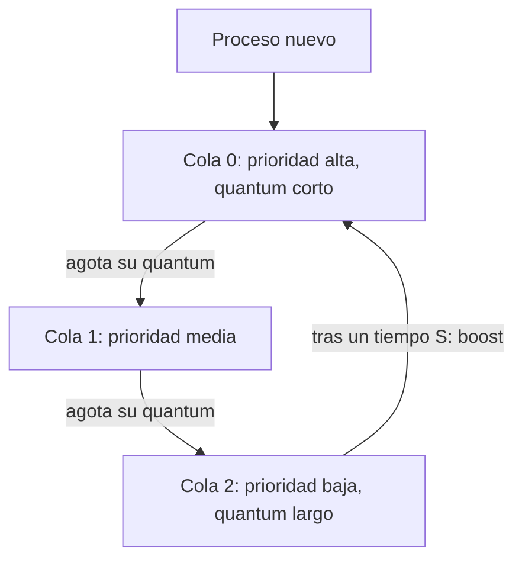

# Planificación por prioridad y colas multinivel (MLFQ)

SJF minimiza el turnaround, pero exige conocer el futuro; Round Robin da buena respuesta, pero alarga el turnaround. Los schedulers reales combinan ambas ideas usando **prioridades**, y el diseño más influyente es la **cola multinivel con retroalimentación** (MLFQ), que aprende la prioridad de cada proceso observando cómo se comporta.

## Priority scheduling

Cada proceso tiene asociada una **prioridad**, y se atienden por orden de prioridad.

- **Empates:** entre procesos de igual prioridad se usa FCFS o RR.
- **SJF es un caso particular:** basta definir la prioridad como inversa a la duración $\tau$ de la ráfaga ($p = 1/\tau$), de modo que el más corto sea el más prioritario.
- Las prioridades pueden ser **estáticas** (fijas) o **dinámicas** (cambian con el tiempo o el comportamiento).
- En UNIX un proceso puede **reducir su propia prioridad** aumentando su **niceness** (comando `nice`): se vuelve más "amable" con los demás.

> [!warning] Inanición y aging
> Los procesos de baja prioridad pueden sufrir **starvation**: si siempre llega alguien más importante, nadie los toma en cuenta. La solución es el **aging** (envejecimiento): combinar la prioridad con el tiempo de vida en espera. A medida que pasa el tiempo, el proceso acumula *aging* y su prioridad sube, hasta que inevitablemente le toca.

> [!example]- Transcripción de la imagen
> "Cada proceso tiene asociada una **prioridad**": se atienden por orden de prioridad · prioridades iguales: FCFS ó RR · SJF es un caso particular de este algoritmo (¿por qué?) · prioridades pueden ser estáticas o dinámicas · **Starvation** de procesos con baja prioridad · **Aging**: incrementar prioridad de procesos que llevan más tiempo. "Permite reducir la prioridad de un proceso (incrementa su niceness)".

## Colas multinivel con retroalimentación (MLFQ)

La meta de MLFQ es **optimizar el turnaround como SJF y, a la vez, minimizar el tiempo de respuesta como RR**, sin conocer la duración de los procesos. Se usó en CTSS (1962) y Multics (1965), y es la base de los schedulers de Windows y macOS.

Hay **varias colas, cada una con distinta prioridad** (piensa en colas A, B y C). A un proceso lo atienden cuando es el más importante entre todas las colas, y **va cambiando de cola** según cómo se comporte. Las reglas son:

| Regla | Enunciado | Para qué |
|---|---|---|
| **R1** | Si prioridad(A) > prioridad(B), ejecutar A | Respetar la prioridad |
| **R2** | Si prioridad(A) = prioridad(B), ejecutar A y B con RR | Repartir con justicia dentro de una cola |
| **R3** | Los procesos nuevos entran en la cola de mayor prioridad | Suponer que todo proceso es corto hasta que demuestre lo contrario |
| **R4** | Si un proceso usa su quantum (acumulado en todos sus turnos), baja de prioridad | Detectar procesos CPU-bound. Al contar el acumulado, no sirve ceder la CPU justo antes de agotarlo para quedarse arriba |
| **R5** | Después de un tiempo $S$, todos los procesos se mueven a la cola de mayor prioridad | Evitar la inanición y dar otra oportunidad a quien cambió de comportamiento |

El resultado: **los cortos salen más rápido y los largos descienden a colas de menor prioridad**. Las colas altas usan un quantum más corto (ideal para procesos interactivos) y las bajas uno más largo (los CPU-bound hacen menos cambios de contexto).

> [!example]- Transcripción de la imagen
> Tres colas apiladas, numeradas 0, 1 y 2, con una flecha "Higher priority" hacia arriba. La cola 0 (*Shorter quantum*) tiene P9, P7, P3 y P1, y P0 está ejecutando. Cuando P0 es *preempted*, una flecha lo baja a la cola 1, que tiene varios procesos P. Una segunda flecha *preempted* baja de la cola 1 a la cola 2 (*Longer quantum*), donde están P3 y P1.

Otros schedulers que aparecen en el curso: **Lottery** (1994, los procesos reciben "boletos" y se sortea la CPU), **Fair Share** (1988, reparte el tiempo entre grupos de procesos o usuarios), **O(1)** (dos colas, activos y expirados; Linux 2.6 antes de 2.6.23) y **BFS** (2009).

## Preguntas de repaso

> [!question]- ¿Por qué SJF es un caso particular de priority scheduling?
> Porque basta asignar como prioridad el inverso de la duración de la ráfaga: el proceso más corto queda con la prioridad más alta y se atiende primero.

> [!question]- ¿Qué problema resuelve el aging y cómo?
> Resuelve la inanición de los procesos de baja prioridad: su prioridad sube con el tiempo que llevan esperando, hasta que les toca la CPU.

> [!question]- ¿Cómo distingue MLFQ entre procesos interactivos y CPU-bound sin conocerlos de antemano?
> Todos entran arriba (R3). El que usa poca CPU y se bloquea pronto nunca agota su quantum y se queda arriba. El que consume su quantum completo baja (R4). Así, el comportamiento observado revela el tipo de proceso.

> [!question]- ¿Por qué R4 cuenta el quantum acumulado y para qué existe R5?
> Si solo se contara el turno actual, un proceso podría ceder la CPU justo antes de agotar su quantum y quedarse siempre en la cola alta. R5 sube a todos periódicamente para que los procesos largos no sufran inanición y para que uno que se volvió interactivo recupere prioridad.
