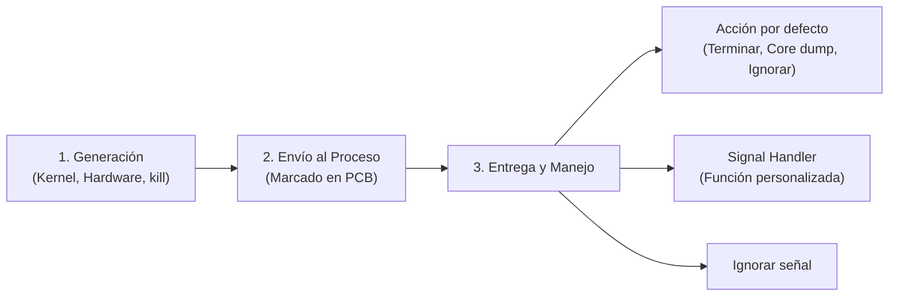

# Concepto de señal y ciclo de vida de señales POSIX

Una **señal** (*signal*) es una notificación asíncrona enviada a un proceso por el núcleo del sistema operativo o por otro proceso para informarle de la ocurrencia de un evento excepcional o solicitar una acción específica. Se consideran **interrupciones por software**.

---

## Signals (mis apuntes)

> Señales
> Sigterm
> Sigkill
> SigStopy
> SigInt

> [!warning] Posible error en apuntes
> * *"SigStopy"*: errata por `SIGSTOP` o `SIGTSTP` (señal para detener/suspender temporalmente un proceso).

---

> [!tip] Complemento: Ciclo de vida y características de las señales
> 1. **Naturaleza asíncrona:** Una señal puede interrumpir el flujo normal de ejecución de un proceso en cualquier instrucción de máquina.
> 2. **Fases del ciclo de una señal:**
>    - **Generación:** Un evento (error de hardware como división por cero, combinación de teclado como `Ctrl+C`, o llamada `kill()`) genera la señal.
>    - **Pendiente (*Pending*):** La señal se registra en el PCB del proceso destino mediante una máscara de bits hasta que el planificador le asigne CPU.
>    - **Entrega (*Delivery*):** Al reanudar el proceso o retornar de modo kernel a modo usuario, el sistema ejecuta la acción correspondiente.
> 3. **Llamadas al sistema y utilidades de terminal:**
>    - `kill(pid_t pid, int sig)`: Syscall en C para despachar una señal `sig` al proceso con identificador `pid`.
>    - `kill -l`: Comando de consola en sistemas UNIX/Linux que lista las 64 señales POSIX disponibles.
>    - `killall <nombre>`: Comando que despacha una señal a todos los procesos que coincidan con un nombre de ejecutable.
> 4. **Comportamientos posibles al recibir una señal:**
>    - **Terminar (*Terminate*):** El proceso finaliza su ejecución.
>    - **Terminar con volcado de memoria (*Core Dump*):** El proceso aborta y escribe su estado de memoria en disco para depuración (ej. `SIGSEGV`).
>    - **Ignorar (*Ignore*):** El proceso descarta la señal sin realizar acción alguna.
>    - **Detener (*Stop*):** El proceso pasa a estado detenido (*stopped / suspended*).
>    - **Capturar (*Catch*):** El proceso ejecuta un manejador de señal (*signal handler*) definido por el usuario.

---

## Preguntas de repaso

> [!question]- ¿Por qué se define a una señal como una "interrupción por software"?
> Porque emula el mecanismo de las interrupciones de hardware a nivel de aplicación: altera el flujo secuencial de instrucciones de un programa en ejecución y salta inmediatamente a una rutina de servicio específica (manejador de señal), retornando al flujo original al finalizar.

> [!question]- ¿Qué ocurre internamente entre que una señal se genera y se entrega?
> La señal queda en estado pendiente (*pending*), almacenada en una máscara de bits dentro del [[02 - Bloque de control de procesos y tabla de procesos|PCB]] del proceso destino. El núcleo la entrega cuando el proceso vuelve a ganar la CPU o realiza una transición desde modo kernel hacia modo usuario.

> [!question]- ¿Qué llamada al sistema se utiliza para despachar señales en C y qué parámetro recibe por defecto el comando kill?
> Se utiliza la syscall `kill(pid, sig)`. En la terminal, el comando `kill <pid>` sin argumentos adicionales envía por defecto la señal `SIGTERM` (código numérico 15).

