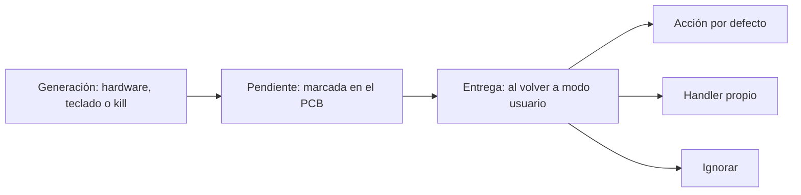

# Concepto de señal y ciclo de vida de señales POSIX

¿Cómo se le avisa a un proceso que el usuario presionó `Ctrl+C`, que dividió por cero o que alguien quiere terminarlo? Mediante una **señal** (*signal*): una notificación **asíncrona** que el kernel u otro proceso le envía a un proceso para informarle de un evento o pedirle una acción. Por su efecto se las considera **interrupciones por software**: cortan el flujo normal del proceso en cualquier instrucción.

## Las señales más usadas

| Señal | Significado | ¿Se puede capturar o ignorar? |
|---|---|---|
| `SIGTERM` | Pide al proceso que **termine** (es la que manda `kill` por defecto) | Sí: el proceso puede limpiar antes de salir |
| `SIGKILL` | **Elimina** al proceso de la tabla de procesos, "sin piedad" | No |
| `SIGSTOP` / `SIGTSTP` | **Detiene** (suspende) el proceso; `SIGTSTP` es la de `Ctrl+Z` | `SIGSTOP` no; `SIGTSTP` sí |
| `SIGINT` | **Interrupción** desde el teclado (`Ctrl+C`) | Sí |

El detalle de cada una y cómo controlarlas está en [[02 - Señales comunes y mecanismos de control SIGTERM, SIGKILL y SIGINT|señales comunes]].

## Ciclo de vida de una señal



1. **Generación.** Un evento produce la señal: un error de hardware (división por cero, acceso inválido a memoria), una combinación de teclas (`Ctrl+C`) o la syscall `kill()` desde otro proceso.
2. **Pendiente** (*pending*). La señal queda registrada en el [[02 - Bloque de control de procesos y tabla de procesos|PCB]] del proceso destino, como un bit en una máscara, hasta que se pueda entregar.
3. **Entrega** (*delivery*). Cuando el proceso vuelve a ejecutar, al pasar de modo kernel a modo usuario, el sistema aplica la acción que corresponde.

Al recibir una señal, un proceso puede:

- **Terminar**, que es la acción por defecto de la mayoría;
- **terminar con *core dump***, escribiendo su memoria a disco para depurarlo (por ejemplo, `SIGSEGV` ante un acceso inválido);
- **ignorarla**;
- **detenerse** (quedar suspendido);
- **capturarla** (*catch*), ejecutando un **manejador** (*signal handler*) escrito por el programador.

## Enviar señales

- Desde C: `kill(pid_t pid, int sig)` envía la señal `sig` al proceso `pid`.
- Desde la terminal: `kill <pid>` envía `SIGTERM` (número 15); `kill -l` lista las señales disponibles; `killall <nombre>` envía una señal a un grupo de procesos con ese nombre.

```c
#include <signal.h>
#include <stdio.h>
#include <sys/wait.h>
#include <unistd.h>

int main(void) {
    pid_t hijo = fork();
    if (hijo == 0) {
        while (1) pause();                     /* el hijo espera señales para siempre */
    }
    sleep(1);
    kill(hijo, SIGTERM);                       /* equivalente a: kill <pid> en la terminal */
    int status;
    waitpid(hijo, &status, 0);
    if (WIFSIGNALED(status))                   /* ¿terminó por una señal? ¿cuál? */
        printf("el hijo murió por la señal %d\n", WTERMSIG(status));   /* imprime 15 */
    return 0;
}
```

## Preguntas de repaso

> [!question]- ¿Por qué se dice que una señal es una interrupción por software?
> Porque, igual que una interrupción de hardware, corta el flujo normal del proceso en cualquier punto y lo desvía a una acción (la por defecto o un manejador), para después, si corresponde, retomar donde estaba.

> [!question]- ¿Qué pasa con una señal entre que se genera y se entrega?
> Queda pendiente, marcada como un bit en el PCB del proceso destino. Se entrega cuando el proceso vuelve a ejecutar, en la transición de modo kernel a modo usuario.

> [!question]- ¿Qué diferencia práctica hay entre `SIGTERM` y `SIGKILL`?
> `SIGTERM` le pide al proceso que termine y este puede capturarla para cerrar archivos o liberar recursos. `SIGKILL` no se puede capturar ni ignorar: el kernel elimina el proceso de inmediato.

> [!question]- ¿Cómo sabe un padre que su hijo murió por una señal y no por `exit()`?
> Con `waitpid` y la macro `WIFSIGNALED(status)`. `WTERMSIG(status)` indica qué señal lo terminó.
