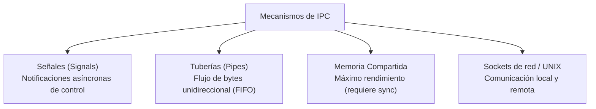

# Comunicación entre procesos y manejo de señales en C

La comunicación entre procesos (**IPC**, *Inter-Process Communication*) comprende los mecanismos provistos por el núcleo del sistema operativo para permitir que procesos con espacios de memoria completamente aislados intercambien datos y señales de control.

---

## Mecanismos principales de IPC



---

> [!tip] Complemento: Manejo de señales en C (`signal` y `sigaction`)
> En lenguaje C, un proceso puede interceptar señales registrando una función de retorno (*handler*):
> 
> ```c
> #include <stdio.h>
> #include <signal.h>
> #include <unistd.h>
> 
> void manejador_sigint(int sig) {
>     printf("\n[Handler] Señal SIGINT (%d) capturada. Saliendo de forma ordenada...\n", sig);
> }
> 
> int main() {
>     // Registrar el manejador para SIGINT (Ctrl+C)
>     signal(SIGINT, manejador_sigint);
> 
>     // Ignorar SIGTERM deliberadamente
>     signal(SIGTERM, SIG_IGN);
> 
>     printf("Proceso PID %d en ejecucion. Presiona Ctrl+C...\n", getpid());
>     while (1) {
>         sleep(1);
>     }
>     return 0;
> }
> ```
> 
> * **Acciones especiales:**
>   - `SIG_DFL`: Restaura el comportamiento predeterminado del sistema operativo.
>   - `SIG_IGN`: Descarta e ignora la señal recibida (no funciona con `SIGKILL` ni `SIGSTOP`).
> * **`sigaction()`:** Reemplaza a `signal()` en aplicaciones POSIX robustas porque evita condiciones de carrera durante la entrega de múltiples señales simultáneas y permite especificar máscaras de bloqueo.

---

> [!tip] Complemento: Tuberías anónimas (*Pipes*) en C
> Un *pipe* es un canal de comunicación unidireccional gestionado por el kernel mediante un búfer en memoria física:
> 
> ```c
> int fd[2];
> pipe(fd); // fd[0] para lectura, fd[1] para escritura
> 
> if (fork() == 0) {
>     // Proceso Hijo: Escribe en la tubería
>     close(fd[0]); // Cierra extremo no utilizado
>     write(fd[1], "Hola Padre", 10);
>     close(fd[1]);
> } else {
>     // Proceso Padre: Lee de la tubería
>     close(fd[1]);
>     char buffer[32];
>     read(fd[0], buffer, sizeof(buffer));
>     printf("Mensaje recibido: %s\n", buffer);
>     close(fd[0]);
> }
> ```

---

## Preguntas de repaso

> [!question]- ¿Qué ocurre si un proceso intenta ignorar o interceptar SIGKILL mediante signal(SIGKILL, SIG_IGN)?
> La llamada `signal()` fallará retornando `SIG_ERR` y asignando el error `EINVAL` en `errno`. El estándar POSIX prohíbe explícitamente modificar el comportamiento de `SIGKILL` y `SIGSTOP`.

> [!question]- ¿Por qué no se debe invocar printf() dentro de un manejador de señales (signal handler)?
> Porque `printf()` no es una función *async-signal-safe* (segura ante señales asíncronas). Utiliza búferes y bloqueos internos (*locks*); si el proceso principal es interrumpido por una señal mientras ejecutaba un `printf()`, invocarlo nuevamente en el *handler* puede provocar un bloqueo mutuo (*deadlock*). Se debe utilizar `write()` directo.

> [!question]- ¿En qué extremo de un pipe se lee y en cuál se escribe?
> Por convención en sistemas POSIX, `fd[0]` es el descriptor de archivo para **lectura** (*read*), mientras que `fd[1]` es el descriptor de archivo para **escritura** (*write*).

