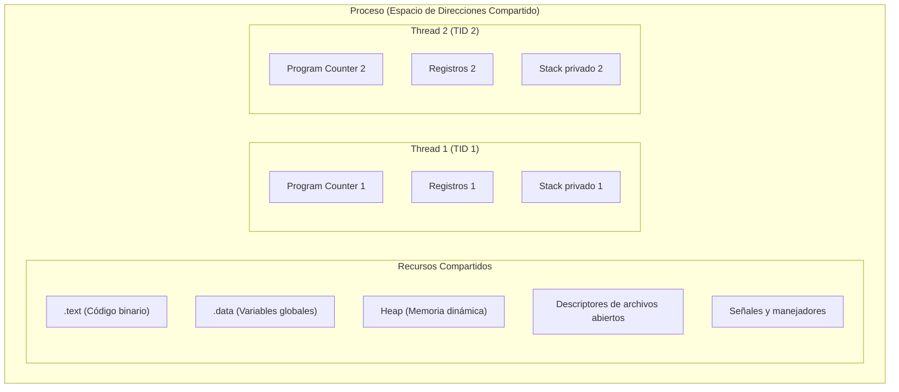

# Concepto de hilo y recursos compartidos versus privados

Un **hilo** (*thread* o proceso liviano, *lightweight process*) es la unidad básica de asignación de CPU dentro de un proceso. Mientras que el proceso encapsula el conjunto de recursos y el espacio de memoria, los hilos representan flujos independientes de ejecución que coexisten dentro del mismo proceso.

---

## CLASE 5: THREADS y SINCRONIZACIÓN (mis apuntes)

> 26/08/24
> Threads nacen para ayudar a paralelizar tareas, o Distribuir
> - Los procesos adentro tienen threads
> - Un proceso, tiene archivos codigos estados, para parelizarlo antes que acabe, existen los threads, porque pueden haber tareas diferentes, y no necesariamente queremos ejecutarlos de manera lineal
> - Si es que hay tareas que se pueden hacer en paralelo → Usar Thread
> 
> Pregunta de prueba: ¿Que comparten los threads?
> 
> | NO COMPARTEN | COMPARTEN |
> | --- | --- |
> | (Estado) | Recursos |
> | Thread ID | Archivos |
> | Program Counter | Codigo |
> | Registros | Procesos hijos |
> | Stack | SEÑALES |
> 
> Pregunta: Los threads no comparten id, pero si comparten recursos como archivos? → VERDADERO
> Al igual que los procesos, los threads tienen id, no lo pueden compartir
> Tampoco pueden compartir PC (program counter) igual, dado que cada uno vive en una linea diferente, ya que cada uno hace cosas distintas
> Como los threads comparten archivos, si por ejemplo qusiera cargar un excel, dos threads van a intentar abrir primero el thread, y eso dará problemas → PROBLEMA DE SINCRONIZACION
> Puede que uno escriba la mitad, el otro la otra, y puede quedar incompleto

> [!warning] Posible error en apuntes
> * *"parelizarlo"*: errata por "paralelizarlo".
> * *"qusiera"*: errata por "quisiera".
> * *"se pueden mezclar las cosas"*: describe de forma informal una **condición de carrera** (*race condition*) y corrupción de datos por falta de mecanismos de sincronización (tema posterior del curso).

---

> [!tip] Complemento: Concurrencia versus Paralelismo
> 1. **Concurrencia:** Dos o más tareas progresan en intervalos solapados de tiempo. En un procesador con un único núcleo (*single-core*), el sistema operativo alterna rápidamente entre hilos mediante [[04 - Planificación Round Robin y sistemas interactivos|intercalado temporal]]; los hilos no ejecutan simultáneamente en el mismo ciclo de reloj, pero dan la ilusión de concurrencia.
> 2. **Paralelismo:** Dos o más tareas ejecutan literalmente al mismo instante físico. Requiere hardware con múltiples núcleos (*multicore*) o múltiples procesadores físicos.
> 3. **División de datos en memoria:**
>    - Cada hilo posee su propia pila (*stack frame*) para almacenar parámetros de funciones, variables locales y direcciones de retorno.
>    - Todos los hilos del proceso comparten la misma sección `.data` y el mismo `heap`; por lo tanto, cualquier variable global o puntero retornado por `malloc()` es directamente accesible y modificable por cualquier hilo del proceso.

---

## Preguntas de repaso

> [!question]- ¿Qué elementos constituyen el contexto privado de un hilo y por qué no se comparten?
> Un hilo posee de forma exclusiva su **Thread ID (TID)**, el **Program Counter (PC)**, el conjunto de **registros de CPU** y su propio **Stack**. No se comparten porque representan el estado instantáneo de ejecución individual; cada hilo puede estar llamando funciones distintas y ejecutando líneas de código diferentes al mismo tiempo.

> [!question]- ¿Cuál es la diferencia fundamental entre concurrencia y paralelismo en el contexto de hilos?
> La **concurrencia** es la capacidad de gestionar múltiples flujos de ejecución alternando su turno en la CPU, lo que puede ocurrir en un procesador de un solo núcleo. El **paralelismo** es la ejecución físicamente simultánea de instrucciones en múltiples núcleos de hardware independientes.

> [!question]- ¿Por qué compartir memoria y archivos abiertos entre hilos genera riesgos de corrupción de datos?
> Porque si dos hilos intentan escribir simultáneamente sobre la misma variable compartida en el *heap* o sobre el mismo descriptor de archivo sin mecanismos de exclusión mutua, las operaciones pueden intercalarse arbitrariamente (condición de carrera), corrompiendo la estructura de los datos.
