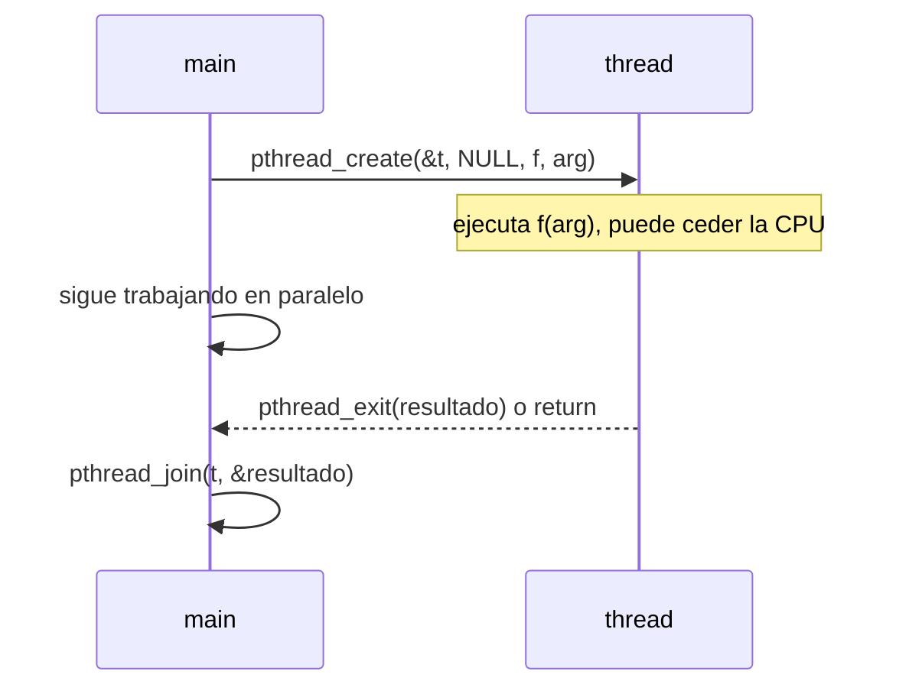

# Programación con POSIX Threads y ciclo de vida

Para crear y coordinar threads en C, los sistemas tipo UNIX ofrecen la biblioteca estándar **POSIX Threads** o **`pthreads`** (estándar IEEE 1003.1c). Sus operaciones son análogas a las de procesos: crear, terminar, esperar y ceder la CPU.

## Las funciones principales

| Función | Qué hace | Análogo en procesos |
|---|---|---|
| `pthread_create` | **Crea** un nuevo thread, que ejecuta la función indicada | `fork()` |
| `pthread_exit` | **Termina** el thread que la llama (solo ese thread) | `exit()` |
| `pthread_join` | **Espera** a que un thread específico termine y recoge su valor de retorno | `wait()` |
| `pthread_yield` | **Cede la CPU** a otro thread: le pasa el turno | — |
| `pthread_attr_init` / `pthread_attr_destroy` | Crea o elimina la estructura de **atributos** de un thread | — |


> [!example]- Transcripción de la imagen
> "POSIX THREADS. Estándar IEEE 1003.1c. Librería pthreads". Tabla *Thread call* / *Description*: `Pthread_create`: *Create a new thread* · `Pthread_exit`: *Terminate the calling thread* · `Pthread_join`: *Wait for a specific thread to exit* · `Pthread_yield`: *Release the CPU to let another thread run* · `Pthread_attr_init`: *Create and initialize a thread's attribute structure* · `Pthread_attr_destroy`: *Remove a thread's attribute structure*.

Para ceder la CPU en código real se usa `sched_yield()` (de `<sched.h>`), porque `pthread_yield` no está disponible en todos los sistemas.

## Ciclo de vida de un thread



La función que ejecuta un thread tiene la firma `void *f(void *arg)`. Se usa `void *` para poder **recibir y devolver cualquier tipo de dato**: se le pasa un puntero a lo que necesite y devuelve un puntero a su resultado, que el creador recibe con `pthread_join`.

## Ejemplo: sumar un arreglo con dos threads

```c
#include <pthread.h>
#include <sched.h>
#include <stdio.h>
#include <stdlib.h>

#define N 1000
int datos[N];

typedef struct { int desde, hasta; } Rango;

void *sumar(void *arg) {
    Rango *r = arg;
    long *total = malloc(sizeof *total);          /* el resultado debe sobrevivir al thread */
    *total = 0;
    for (int i = r->desde; i < r->hasta; i++) {
        *total += datos[i];
        if (i % 100 == 0) sched_yield();          /* ceder la CPU de vez en cuando (opcional) */
    }
    pthread_exit(total);                          /* equivale a: return total; */
}

int main(void) {
    for (int i = 0; i < N; i++) datos[i] = i + 1;
    pthread_t t[2];
    Rango r[2] = { {0, N / 2}, {N / 2, N} };
    for (int k = 0; k < 2; k++)
        pthread_create(&t[k], NULL, sumar, &r[k]);
    long suma = 0;
    for (int k = 0; k < 2; k++) {
        void *res;
        pthread_join(t[k], &res);                 /* espera al thread y recibe su resultado */
        suma += *(long *)res;
        free(res);
    }
    printf("suma = %ld\n", suma);                 /* 500500 */
    return 0;
}
```

Se compila con `gcc -Wall -pthread`. Cada thread suma su mitad del arreglo **sin tocar datos del otro**, así que no hace falta sincronización: los threads solo leen `datos` (compartido) y escriben en su propio `total`.

> [!warning] Errores típicos
> - **No devolver un puntero a una variable local:** vive en el stack del thread y desaparece cuando el thread termina. Por eso el ejemplo usa `malloc`.
> - **`exit()` no es `pthread_exit()`:** `exit()` termina el **proceso completo**, con todos sus threads. Lo mismo pasa si `main` retorna sin hacer `pthread_join`: los demás threads mueren con el proceso.

## Preguntas de repaso

> [!question]- ¿Qué hace `pthread_join` y a qué syscall de procesos se parece?
> Bloquea al llamador hasta que el thread indicado termine y recoge su valor de retorno. Es el análogo de `wait()` para procesos.

> [!question]- ¿Por qué la función de un thread recibe y devuelve `void *`?
> Porque `void *` es un puntero genérico: permite pasarle cualquier estructura como argumento y devolver cualquier resultado, sin que la biblioteca tenga que conocer los tipos.

> [!question]- ¿Qué diferencia hay entre `pthread_exit()` y `exit()`?
> `pthread_exit()` termina solo el thread que la llama y los demás siguen. `exit()` termina el proceso entero, con todos sus threads.

> [!question]- ¿Por qué en el ejemplo el resultado se reserva con `malloc` y no como variable local?
> Porque una variable local está en el stack del thread, que se libera al terminar este. El puntero que recibiría `pthread_join` apuntaría a memoria inválida.
