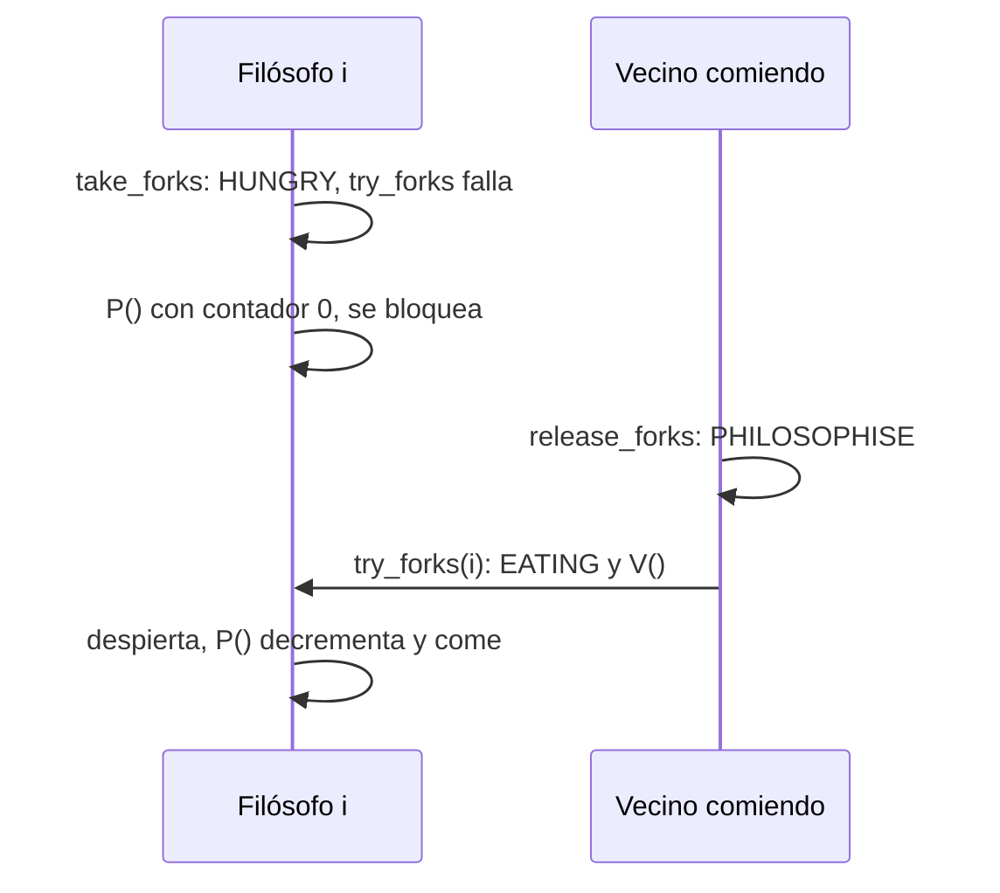

# Coordinación de filósofos y manejo de estados con semáforos

En [[09 - Problema de los filósofos comelones y deadlocks|el problema de los filósofos]] se vio que tomar los palillos uno por uno puede llevar a un deadlock. Esta nota desarrolla la solución que lo evita: en vez de pelear por cada palillo, cada filósofo **declara un estado**, y solo pasa a comer cuando sus dos vecinos no están comiendo. Sirve además como repaso de las herramientas del capítulo de sincronización.

## Herramientas en juego

| Primitiva | Operaciones |
|---|---|
| [[04 - Mutex locks y el dilema de busy waiting versus dormir\|Mutex lock]] | `acquire()`, `release()` |
| [[06 - Semáforos de Dijkstra y tipos de semáforos\|Semáforo]] | `P()`, `V()` |
| [[07 - Variables de condición y monitores\|Variable de condición]] | `wait()`, `signal()` |

Todas son primitivas de software, y toda solución debe cumplir los tres criterios de la sección crítica: exclusión mutua, progreso y espera acotada.

## La idea: estados y un semáforo por filósofo

Cada filósofo tiene un estado:

| Estado | Significado |
|---|---|
| `PHILOSOPHISE` | Pensando (*free*): no tiene palillos |
| `HUNGRY` | Quiere comer (*waiting*): tiene intenciones de usar los palillos |
| `EATING` | Está comiendo (*using*): tiene ambos palillos |

Es la solución clásica de Tanenbaum, que usa los nombres `THINKING`, `test()` y `put_forks()` donde el curso usa `PHILOSOPHISE`, `try_forks()` y `release_forks()`. Además, **cada filósofo tiene su propio semáforo, que empieza en 0**. Un filósofo que no puede comer se bloquea en su semáforo, y un vecino lo despierta cuando le llega el turno. Un lock `l` protege el arreglo de estados.


> [!example]- Transcripción de la imagen
> `int N = 5; enum {PHILOSOPHISE, HUNGRY, EATING} state[N]; /* free / waiting / using */ struct lock l; struct semaphore philosopher[N]; // inicializados en 0`.
> `int left(i) { return (i+N-1)%N; }`, `int right(i) { return (i+1)%N; }`.
> `void philosoph(int i) { while(TRUE) { think(); take_forks(); eat(); release_forks(); } }`.
> `void take_forks(int i) { l.acquire(); state[i] = HUNGRY; try_forks(i); l.release(); philosopher[i].P(); }`.
> `void release_forks(int i) { l.acquire(); state[i] = PHILOSOPHISE; try_forks(left(i)); try_forks(right(i)); l.release(); }`.
> `void try_forks(int i) { if(state[i] == HUNGRY && state[left(i)] != EATING && state[right] != EATING) { state[i] = EATING; philosopher[i].V(); } }`.

## Los dos caminos

**Happy path: los palillos están libres.** El filósofo entra a `take_forks`, se marca `HUNGRY` y llama a `try_forks`, que revisa a los comensales de la izquierda y la derecha. Si ninguno está comiendo, lo pasa a `EATING` y hace `V()` sobre su semáforo, que sube a 1. Al salir, el `P()` decrementa ese 1 de inmediato: pasa a la primera y come.

**Unhappy path: algún vecino está comiendo.** `try_forks` no cumple la condición, así que nunca se ejecutó el `V()` y el contador sigue en 0. El filósofo **se bloquea en `philosopher[i].P()`**, porque no puede decrementar el contador. Mientras tanto, el vecino que comía termina y llama a `release_forks`: se marca `PHILOSOPHISE` y prueba `try_forks` sobre sus dos vecinos. Para nuestro filósofo la condición ahora se cumple, así que lo pasa a `EATING` y hace `V()`. Eso **despierta al que dormía** en `P()`, que decrementa el contador y come. En este caso es **otro thread** el que avisa que se puede continuar.



## En C

```c
#include <pthread.h>
#include <semaphore.h>
#include <stdio.h>

#define N 5
enum { PHILOSOPHISE, HUNGRY, EATING } state[N];   /* libre / esperando / usando */
pthread_mutex_t l = PTHREAD_MUTEX_INITIALIZER;
sem_t philosopher[N];                             /* uno por filósofo, inicializados en 0 */

int left(int i)  { return (i + N - 1) % N; }
int right(int i) { return (i + 1) % N; }

void try_forks(int i) {                           /* se llama con l tomado */
    if (state[i] == HUNGRY && state[left(i)] != EATING && state[right(i)] != EATING) {
        state[i] = EATING;
        sem_post(&philosopher[i]);                /* V: le da permiso a i */
    }
}

void take_forks(int i) {
    pthread_mutex_lock(&l);
    state[i] = HUNGRY;
    try_forks(i);                                 /* ¿puedo comer ya? */
    pthread_mutex_unlock(&l);
    sem_wait(&philosopher[i]);                    /* P: si no pude, duermo aquí */
}

void release_forks(int i) {
    pthread_mutex_lock(&l);
    state[i] = PHILOSOPHISE;
    try_forks(left(i));                           /* ¿mis vecinos pueden comer ahora? */
    try_forks(right(i));
    pthread_mutex_unlock(&l);
}

void *philosoph(void *arg) {
    int i = *(int *)arg;
    for (int k = 0; k < 3; k++) {
        /* think() */
        take_forks(i);
        printf("filósofo %d come\n", i);          /* eat() */
        release_forks(i);
    }
    return NULL;
}

int main(void) {
    pthread_t t[N];
    int id[N];
    for (int i = 0; i < N; i++) sem_init(&philosopher[i], 0, 0);
    for (int i = 0; i < N; i++) { id[i] = i; pthread_create(&t[i], NULL, philosoph, &id[i]); }
    for (int i = 0; i < N; i++) pthread_join(t[i], NULL);
    return 0;
}
```

## Preguntas de repaso

> [!question]- ¿Por qué el semáforo de cada filósofo se inicializa en 0?
> Porque representa el permiso para comer, y al inicio nadie lo tiene. Solo `try_forks` lo concede con `V()` cuando los dos vecinos no están comiendo, y así el `P()` de `take_forks` deja pasar al filósofo o lo bloquea.

> [!question]- ¿Por qué esta solución no produce deadlock?
> Porque un filósofo nunca retiene un palillo mientras espera el otro: solo pasa a `EATING` si ambos vecinos están libres, y toma los dos de una vez. Así se rompe la condición de retención y espera.

> [!question]- ¿Para qué llama `release_forks` a `try_forks` sobre sus vecinos?
> Para despertar a un vecino que esté `HUNGRY` esperando y que ahora sí pueda comer. Si nadie lo hiciera, ese vecino se quedaría bloqueado en su `P()` para siempre.

> [!question]- ¿Por qué el `P()` de `take_forks` se hace después de soltar el lock `l`?
> Porque si el filósofo durmiera con `l` tomado, ningún vecino podría entrar a `release_forks` para despertarlo, y el sistema se trabaría.
