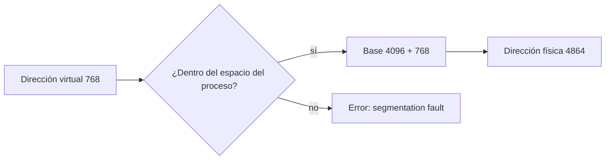

# Relocalización, protección de memoria y registros base y límite

La multiprogramación trae [[02 - Memoria principal y el desafío de la multiprogramación|dos problemas]]: las variables de un proceso no están siempre en la misma ubicación (**relocalización**), y un proceso podría leer o escribir memoria que no le corresponde (**protección**), que es lo que se manifiesta como un *segmentation fault*. Ambos se resuelven con la misma idea: el proceso deja de usar direcciones absolutas y pasa a usar **direcciones virtuales**, que el hardware traduce.

## Dos tipos de direcciones

| Tipo | Qué es |
|---|---|
| **Absoluta** (física) | Una posición real en la memoria RAM o principal |
| **Virtual** (lógica) | La que "ve" el proceso: una dirección dentro de su propio universo, su **espacio de direcciones** |

Con direcciones virtuales, desde el punto de vista del proceso, las instrucciones, el código y las variables **siempre están en el mismo lugar**, aunque en la RAM queden en otra parte cada vez. El espacio de direcciones del proceso se organiza en zonas con su propia interpretación: código, heap (que **crece**) y stack (que **decrece**).

## La traducción: registros base y límite

La solución antigua usaba **dos registros**, **base** y **límite** (*limit*), para saber dónde empieza y dónde termina el espacio del proceso:

- **Relocalización:** a la **base** se le suma la dirección virtual, y el resultado se entrega como dirección física. El código del programa no se modifica.
- **Protección:** antes de acceder, se verifica que la dirección esté dentro del espacio del proceso. Según el material, la MMU verifica que cada dirección sea **mayor que la base y menor que el límite**. Si no lo es, el acceso se rechaza: ese es el típico *segmentation fault*, salirse del espacio asignado al programa.

Quien hace estos cálculos en cada acceso es la **MMU** (*Memory Management Unit*), un componente de hardware. El SO carga los registros base y límite al poner a correr un proceso; como hacerlo es una instrucción privilegiada, el proceso no puede cambiarlos.

$$\text{dirección física} = \text{base} + \text{dirección virtual}$$

## Ejemplo

> [!example]- Transcripción de la imagen
> "Proceso mantiene un **espacio único y secuencial (lineal)** de direcciones. Proceso **A** utiliza 16KB: code en 0-1023; heap empieza en 1024, y crece; stack empieza en 16383, y decrece. Al cargarlo en memoria, el sistema operativo asigna: **Base: 4096, limit: 16384.** Código de A no es modificado. Proceso A pide la dirección virtual: 768. MMU entrega la dirección física: 4864."

La cuenta: $4096 + 768 = 4864$. La dirección virtual 768 cae en el código de A (0-1023), así que es un acceso válido.

> [!warning] Una sola zona contigua
> Con base y límite, cada proceso ocupa **un único bloque contiguo** de memoria. Funciona, pero no es la estrategia más eficiente: obliga a reservar de una vez todo el espacio entre el heap y el stack, aunque no se use, y deja huecos al cargar y descargar procesos. Las mejoras se ven en [[04 - Swapping, fragmentación externa y algoritmos de asignación libre|swapping y fragmentación]] y en [[05 - Segmentación de memoria y prevención de segmentation fault|segmentación]].

## Preguntas de repaso

> [!question]- ¿Qué diferencia hay entre una dirección virtual y una física?
> La virtual es la que usa el proceso dentro de su propio espacio de direcciones, y es siempre la misma en cada ejecución. La física es la posición real en la RAM, que depende de dónde cargó el SO al proceso.

> [!question]- Con base 4096, ¿a qué dirección física corresponde la dirección virtual 768?
> $4096 + 768 = 4864$.

> [!question]- ¿Cómo resuelven los registros base y límite los dos problemas de la multiprogramación?
> La base resuelve la relocalización, porque al sumarla se ubica al proceso donde haya quedado cargado sin modificar su código. El límite resuelve la protección: si la dirección se sale del espacio del proceso, la MMU rechaza el acceso.

> [!question]- ¿Qué es la MMU y por qué el proceso no puede alterar sus registros?
> Es la unidad de hardware que traduce cada dirección virtual a física y verifica el límite. Cargar sus registros es una instrucción privilegiada que solo ejecuta el SO; si el proceso pudiera cambiarlos, podría acceder a cualquier memoria.
