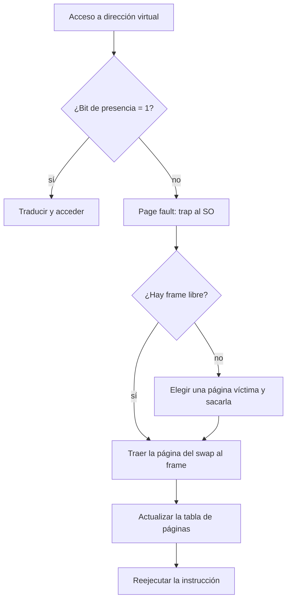

# Introducción al intercambio por demanda y ciclo de fallos de página

Hasta aquí se supuso que todas las páginas de todos los procesos caben en la memoria física. En la realidad no es así. La solución es usar el disco, grande y lento, para dar la **ilusión** de que todo el espacio virtual está en memoria: las páginas se llevan y traen entre la RAM y el disco según se necesiten.

## Swap space y bit de presencia

Una parte del disco se usa como una memoria principal "falsa", el **swap space**. Los procesos siguen creyendo que pueden acceder a todo su rango de direcciones virtuales, y el SO se encarga de cargar las páginas **a medida que se piden** (*on demand*). Así se separa la ilusión de la realidad, y para el proceso es más simple.

- Las páginas que se sacan de la memoria principal van al swap space: siguen siendo parte de la memoria del proceso en ejecución, solo que en disco.
- Cada PTE tiene un **bit de presencia** (*present bit*) que indica si la página está en un frame de la memoria física (1) o solo en el swap (0).
- Si el proceso accede a una página con bit de presencia en 0, ocurre una interrupción: un **page fault**, que activa el mecanismo para traer la página del disco a memoria.

## El page fault, paso a paso

> [!example]- Transcripción de la imagen
> "Mecanismo de rutina page-fault handler": (1) *reference*: la instrucción `load M` consulta la *page table*, cuya entrada está marcada `i` (inválida o no presente); (2) *trap* al *operating system*; (3) *page is on backing store*: la página está en el disco; (4) *bring in missing page*: se copia a un *free frame* de la *physical memory*; (5) *reset page table*; (6) *restart instruction*: se vuelve a ejecutar `load M`.

1. El programa intenta acceder a una dirección y la MMU va a la tabla de páginas.
2. La tabla dice que el **bit de presencia está en 0**: se genera una interrupción (**page fault**) y se le avisa al SO.
3. El SO ejecuta su rutina de atención (*page-fault handler*): busca la página en el disco.
4. La carga en un **frame libre**.
5. Actualiza la tabla de páginas (PFN y bit de presencia en 1).
6. **Vuelve a ejecutar la instrucción** que generó la interrupción, que ahora sí encuentra su página.

A diferencia de una syscall, tras la cual se sigue con la instrucción siguiente, aquí se **repite** la misma instrucción que falló. Mientras el disco entrega la página, el proceso queda en *Waiting* y la CPU atiende a otro.

## ¿Qué página reemplazar?

Si no hay frames libres, hay que **sacar** una página de la memoria principal para hacerle espacio a la nueva. Si la víctima fue modificada mientras estuvo en RAM (su *dirty bit* está en 1), primero hay que escribirla en el disco; si no, basta con descartarla, porque la copia del disco sigue al día. Un page fault es caro, porque significa ir al disco, así que **cualquier algoritmo de reemplazo debe intentar minimizar los page faults**. La idea es que la memoria principal tenga las páginas que se están usando, y que las que no se usan tanto queden en el swap: así se simula tener más memoria de la que realmente hay.

> [!warning] Ejemplo de una mala elección
> Direcciones virtuales de 16 bits, páginas de 4 KB (12 bits de offset, así que el primer dígito hexadecimal es la página):
> 1. Ocurre un page fault al acceder a `0x6300` (página 6).
> 2. Se escoge la página 9 como víctima y se lleva al swap.
> 3. El proceso continúa y pide `0x9204`… la página 9: **otro page fault**.
>
> No fue buena idea sacar la página 9. El mejor candidato es una página que no se vaya a usar en el futuro cercano.

Cómo elegir esa página se ve en [[01 - Fundamentos de memoria virtual y espacio de intercambio (swap)|memoria virtual]] y en los algoritmos de reemplazo, como [[02 - Algoritmos de reemplazo FIFO, Óptimo (Belady) y anomalía de Belady|FIFO y Óptimo]] o [[03 - Algoritmo LRU e implementaciones con hardware y software|LRU]].

## Preguntas de repaso

> [!question]- ¿Qué indica el bit de presencia de una PTE?
> Si la página está cargada en un frame de la memoria física (1) o solo en el swap space del disco (0).

> [!question]- Enumera los pasos que sigue el SO ante un page fault.
> Recibe la interrupción, busca la página en el disco, la carga en un frame libre (sacando una víctima si no hay), actualiza la tabla de páginas y vuelve a ejecutar la instrucción que falló.

> [!question]- ¿Por qué tras un page fault se reejecuta la misma instrucción?
> Porque esa instrucción no alcanzó a completarse: necesitaba la página que faltaba. Una vez cargada, se repite y ahora sí accede al dato.

> [!question]- ¿Por qué un algoritmo de reemplazo debe minimizar los page faults?
> Porque cada page fault implica leer el disco, muchísimo más lento que la RAM. Sacar una página que se volverá a usar pronto, como la página 9 del ejemplo, provoca otro page fault de inmediato.
