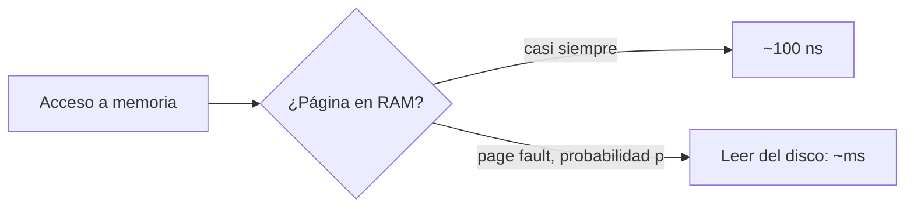

# Fundamentos de memoria virtual y espacio de intercambio (swap)

La **memoria virtual** permite que la suma de los espacios de direcciones de todos los procesos sea mucho mayor que la RAM instalada. La idea es guardar en un espacio del disco, el **swap space**, las páginas que no caben, para simular que hay más memoria principal de la que realmente hay. El precio es que el disco es lento, y todo el diseño gira en torno a pagar ese precio lo menos posible.

## La idea

- Las páginas **más usadas** deben estar en la **memoria principal**.
- Las que no se usan tanto, o que pertenecen a procesos en espera, pueden quedar en el **swap space**.
- Cuando hace falta espacio libre en la memoria principal, un **algoritmo de reemplazo de páginas** decide qué página sacar: idealmente, una que no se vaya a usar pronto.

El mecanismo para traer una página que no está, el *page fault*, se vio en [[07 - Introducción al intercambio por demanda y ciclo de fallos de página|intercambio por demanda]]. Esta sección del curso trata de **qué página reemplazar**.

## Por qué importa tanto: el costo de un page fault

La diferencia de velocidad entre la RAM y el disco es enorme:

| Memoria | Tiempo de acceso aproximado |
|---|---|
| TLB | ~1 ns |
| RAM | ~100 ns (valor usado en el curso) |
| Disco | un SSD, decenas a cientos de microsegundos; un disco magnético, varios milisegundos |

Si $p$ es la probabilidad de page fault en un acceso, el tiempo de acceso efectivo es:

$$EAT = (1 - p) \cdot T_{\text{RAM}} + p \cdot T_{\text{page fault}}$$

Con $T_{\text{RAM}} = 100$ ns y un page fault de 8 ms ($8\,000\,000$ ns), basta con **un page fault cada 1000 accesos** ($p = 0{,}001$) para que el acceso promedio suba a unos **8100 ns**: **81 veces más lento**. Para que el sistema se degrade menos de un 10%, $p$ tendría que ser menor que aproximadamente uno en 800.000.

> [!warning] Conclusión
> Como un page fault cuesta decenas de miles de accesos a RAM, la **calidad del algoritmo de reemplazo** es decisiva: equivocarse al elegir la víctima se paga carísimo.

## Swap en la práctica

En Linux y otros UNIX, el swap puede ser una **partición** dedicada del disco o un **archivo** (*swapfile*) dentro del sistema de archivos. No todas las páginas necesitan ir al swap. Las de **código** ya existen en el archivo ejecutable, así que se pueden descartar y releer desde ahí. Las páginas **anónimas** (heap, stack, datos creados en ejecución) no existen en ningún archivo y, si se sacan de la RAM, deben escribirse en el swap.

## Los algoritmos que vienen

| Algoritmo | Criterio para elegir la víctima |
|---|---|
| [[02 - Algoritmos de reemplazo FIFO, Óptimo (Belady) y anomalía de Belady\|Óptimo (MIN)]] | La que se usará más lejos en el futuro: ideal, pero imposible de implementar |
| [[02 - Algoritmos de reemplazo FIFO, Óptimo (Belady) y anomalía de Belady\|FIFO]] | La que lleva más tiempo en memoria |
| [[03 - Algoritmo LRU e implementaciones con hardware y software\|LRU]] | La que lleva más tiempo sin usarse |
| [[04 - Algoritmo del reloj (Clock) y aproximaciones prácticas de LRU\|Reloj (Clock)]] | Aproximación barata de LRU con un bit de referencia |

## Preguntas de repaso

> [!question]- ¿Qué permite la memoria virtual con swap?
> Ejecutar procesos cuyos espacios de direcciones suman más que la RAM física, guardando en el disco las páginas menos usadas y trayéndolas cuando se necesitan.

> [!question]- Con RAM de 100 ns y page faults de 8 ms, ¿cuánto vale el tiempo de acceso efectivo si $p = 0{,}001$?
> $0{,}999 \cdot 100 + 0{,}001 \cdot 8\,000\,000 \approx 8100$ ns, unas 81 veces más lento que sin page faults.

> [!question]- ¿Por qué las páginas de código no necesitan escribirse en el swap y las del heap sí?
> Porque el código ya está en el archivo ejecutable y se puede volver a leer de ahí. Los datos del heap se crearon durante la ejecución y no existen en ningún otro lugar.

> [!question]- ¿Qué busca un buen algoritmo de reemplazo de páginas?
> Sacar de la RAM la página que no se vaya a usar en el futuro cercano, para minimizar la cantidad de page faults.
