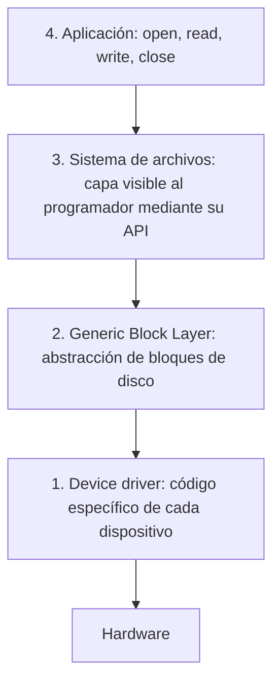

# Capas de abstracción de entrada-salida y mecanismos de buffering

Un programa que guarda un archivo no sabe si escribe en un disco magnético, un SSD o un pendrive, y no le hace falta saberlo. El sistema operativo nos abstrae del hardware apilando **capas** que van de lo más específico (el dispositivo) a lo más general (la aplicación). Encima de esas capas, el SO nos brinda un **sistema de archivos**.

## Las capas de abstracción



| Capa | Qué hace |
|---|---|
| **Device driver** | Código específico para comunicarse con un dispositivo concreto |
| **Generic block layer** | Capa intermedia: presenta cualquier disco como un arreglo de bloques |
| **Sistema de archivos** | Organiza los bloques en archivos y directorios; es lo que ve el programador |
| **Aplicación** | Usa las llamadas al sistema POSIX `open`, `read`, `write`, `close`… |

Todas estas abstracciones persiguen un objetivo de diseño: la **independencia del dispositivo** (*device independence*). La aplicación ejecuta las mismas funciones sea cual sea el hardware de abajo. El costo está en los drivers: cerca del **70% del código de Linux** son drivers, y son una fuente importante de bugs.

## Cómo se transfieren los datos: buffers

Hay cuatro formas de transferir datos entre un dispositivo de I/O y un proceso:

| Esquema | Cómo funciona | Consecuencia |
|---|---|---|
| **Lectura directa** (*unbuffered*) | Se lee directamente, sin buffer intermedio | El proceso queda bloqueado hasta que termina de leer: lento |
| **Buffer en espacio de usuario** | El dispositivo escribe en un buffer del proceso | El proceso puede ceder la CPU mientras tanto, pero la página del buffer podría ser *swapped out* a mitad de la transferencia |
| **Buffer en espacio de kernel** | El dispositivo escribe en un buffer del kernel, que se transfiere al proceso al llenarse | Las páginas del kernel nunca se swapean, así que siempre están disponibles, también para que el hardware escriba directo en ellas por DMA (*direct memory access*) |
| **Double buffer** | Dos buffers: mientras uno se transfiere, se escribe en el otro | Producción y transferencia se solapan; por ejemplo, en pantallas, mientras una imagen se muestra se genera la siguiente |

En la práctica, la transmisión de datos pasa por **varios buffers intermedios**, que pueden quedar reservados mientras dura la transmisión. Si hay muchos dispositivos o clientes conectados, eso se nota en el uso de memoria.

> [!tip] Por qué conviene un buffer grande
> Cada `read` es una syscall, con su cambio a modo kernel. Leer de a un byte implica una syscall por byte; leer de a 4 KB las reduce miles de veces.

```c
#include <fcntl.h>
#include <stdio.h>
#include <time.h>
#include <unistd.h>

/* Lee el archivo completo con un buffer de 'tam' bytes y cuenta las syscalls read(). */
void leer(const char *ruta, size_t tam) {
    char buf[4096];
    int fd = open(ruta, O_RDONLY);
    long llamadas = 0;
    clock_t t0 = clock();
    while (read(fd, buf, tam) > 0)
        llamadas++;
    double ms = 1000.0 * (clock() - t0) / CLOCKS_PER_SEC;
    close(fd);
    printf("buffer de %4zu B: %7ld llamadas a read(), %.1f ms de CPU\n", tam, llamadas, ms);
}

int main(int argc, char *argv[]) {
    leer(argv[1], 1);       /* casi sin buffer: una syscall por byte */
    leer(argv[1], 4096);    /* con buffer de 4 KB */
    return 0;
}
```

Con un archivo de 1 MB: 1.048.576 llamadas y unos 460 ms de CPU con el buffer de 1 byte, contra 256 llamadas y menos de 1 ms con el de 4 KB.

## Preguntas de repaso

> [!question]- ¿Cuáles son las capas de abstracción de I/O, de abajo hacia arriba?
> Device driver (específico del dispositivo), generic block layer (bloques de disco genéricos), sistema de archivos (archivos y directorios visibles por API) y aplicación (`open`, `read`, `write`, `close`).

> [!question]- ¿Qué objetivo de diseño persiguen esas capas?
> La independencia del dispositivo: la aplicación usa las mismas operaciones sin importar qué hardware hay debajo.

> [!question]- ¿Qué riesgo tiene usar un buffer en espacio de usuario y cómo lo evita el buffer de kernel?
> La página del buffer de usuario podría ser llevada al swap mientras el dispositivo está escribiendo en ella. Las páginas del kernel nunca se swapean, así que el dispositivo siempre puede escribir en ellas.

> [!question]- ¿Qué gana el double buffering?
> Solapar el trabajo: mientras uno de los buffers se transfiere, el otro ya se está llenando, y nadie espera ocioso.
