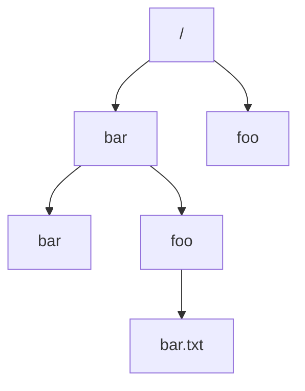

# Estructura de directorios y resolución de rutas

Con miles de archivos, hace falta una forma de organizarlos y de encontrarlos por nombre. Los **directorios** son otra abstracción del sistema de archivos: contenedores de archivos y de otros directorios que forman un árbol. Por dentro son algo muy simple: una tabla de nombres.

## Qué es un directorio

Un directorio también tiene su **nombre de bajo nivel** (su número de inodo), y su contenido es una **lista de pares**:

$$(\text{nombre legible},\ \text{nombre de bajo nivel})$$

Es decir, asocia cada nombre que ve el usuario con el inodo del archivo o subdirectorio correspondiente. El nombre de un archivo no se guarda en el archivo: **se guarda en el directorio que lo contiene**.

Como un directorio puede contener otros directorios, se forma una **jerarquía o árbol de directorios**:

- la jerarquía empieza en una **raíz**, `/`;
- se usa `/` como **separador**;
- las unidades del árbol son **subdirectorios**.

Todo directorio tiene además dos entradas especiales: `.`, que apunta a sí mismo, y `..`, que apunta a su padre. En la raíz, `..` apunta a la misma raíz.

## Rutas

El nombre que incluye los subdirectorios es la **ruta** (*pathname*):

| | Ruta absoluta | Ruta relativa |
|---|---|---|
| Parte desde | La raíz: empieza con `/` | El directorio donde nos encontremos: el directorio de trabajo del proceso (CWD, *current working directory*), que el SO guarda en su PCB |
| Ejemplos | `/foo`, `/bar/bar`, `/bar/foo/bar.txt` | `foo`, `foo/bar.txt` |
| ¿Es única? | **Sí**: una ruta absoluta no puede repetirse | No: el mismo texto apunta a lugares distintos según desde dónde se use |

Desde el directorio `/bar`, la ruta relativa `foo/bar.txt` corresponde a la absoluta `/bar/foo/bar.txt`.

## Cómo se resuelve una ruta

Para abrir `/bar/foo/bar.txt`, el SO recorre el árbol componente por componente:

1. Parte del inodo de la raíz `/` (un número conocido; en ext4, el inodo 2).
2. Lee el contenido de `/`, busca el par con nombre `bar` y obtiene su inodo.
3. Lee ese directorio, busca `foo` y obtiene su inodo.
4. Lee ese directorio, busca `bar.txt` y obtiene, por fin, el inodo del archivo.

En cada paso verifica permisos: para **atravesar** un directorio se necesita el permiso de ejecución (`x`); el de lectura (`r`) solo permite listar sus nombres (por ejemplo, con `ls`). Por eso las rutas largas cuestan varios accesos a disco, y el SO guarda en caché los directorios recién recorridos.

> [!tip] Para recordar
> **Directorio = tabla de (nombre → inodo).** Una ruta absoluta se resuelve desde `/`; una relativa, desde el directorio actual.

## Preguntas de repaso

> [!question]- ¿Qué contiene un directorio?
> Una lista de pares (nombre legible, nombre de bajo nivel), que asocia cada nombre con el inodo de un archivo o subdirectorio. También tiene su propio inodo.

> [!question]- ¿Qué diferencia hay entre una ruta absoluta y una relativa?
> La absoluta empieza en la raíz `/` y es única. La relativa parte del directorio de trabajo actual, así que el mismo texto puede referirse a archivos distintos según dónde se esté.

> [!question]- Desde `/bar`, ¿a qué ruta absoluta corresponde `foo/bar.txt`?
> A `/bar/foo/bar.txt`.

> [!question]- ¿Dónde se guarda el nombre legible de un archivo?
> En el directorio que lo contiene, emparejado con el número de inodo. El inodo del archivo no guarda su nombre.
