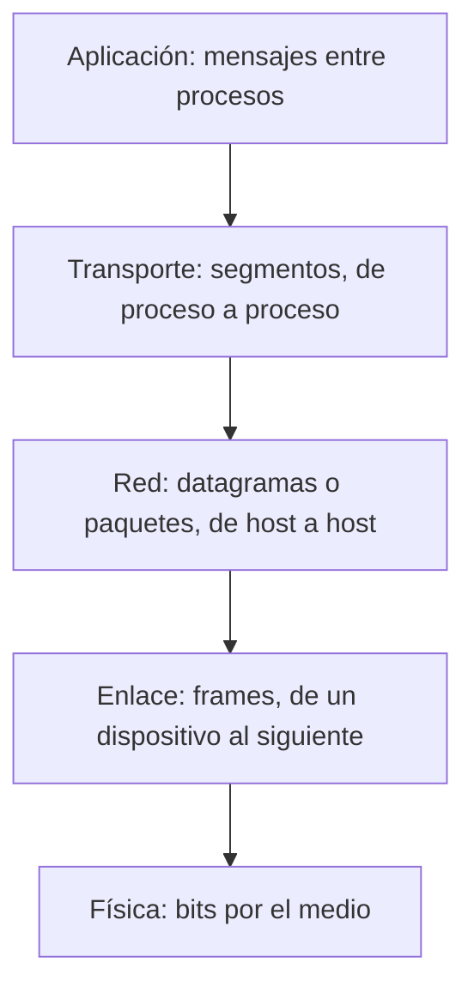

# Capas de transporte, red, enlace y física

Bajo la capa de aplicación hay cuatro capas que, juntas, llevan un mensaje desde un proceso hasta otro proceso en cualquier parte del mundo. Cada una resuelve un tramo distinto del problema: **transporte** conecta procesos, **red** conecta hosts a través de muchos saltos, **enlace** conecta dos dispositivos vecinos y **física** mueve los bits por el medio.

## Capa de transporte

Transporta los mensajes de la aplicación **entre el proceso de origen y el de destino**, divididos en **segmentos**. Distingue los procesos de un mismo host mediante **puertos** (números de 0 a 65535). Ofrece dos servicios:

| | **TCP** | **UDP** (*User Datagram Protocol*) |
|---|---|---|
| Tipo de servicio | **Orientado a conexión** (*connection-oriented*) | **Sin conexión** (*connection-less*) |
| Garantías | **Entrega garantizada** (*reliable*), control de flujo y control de congestión | **No garantiza la entrega** |
| Cabecera | 20 bytes como mínimo | 8 bytes |
| En una palabra | Más seguro | Más rápido |

Ver [[01 - Servicios de la capa de transporte y estructura de segmentos|servicios de la capa de transporte]].

## Capa de red

Transmite los segmentos, empaquetados como **datagramas** (paquetes), **entre un par de hosts**: ofrece la entrega de origen a destino, busca el destino en la red y se preocupa de la **ruta** (el *routing*) por la que viaja cada paquete.

- **IP** (*Internet Protocol*, en sus versiones IPv4 e IPv6): se implementa en el origen, en el destino y en los nodos intermedios. Los intermediarios son los **routers**.
- **ICMP** (*Internet Control Message Protocol*): mensajes de control, como los de `ping`, *echo* y *traceroute*.
- **IGMP** y **OSPF**: el material los agrupa como protocolos entre routers (OSPF calcula rutas dentro de una red; entre redes de distintas organizaciones se usa BGP).

Conviene distinguir el **routing** (calcular la ruta) del **forwarding** (mover cada paquete de la entrada a la salida correcta del router).

Ver [[01 - Servicios de la capa de red: enrutamiento y reenvío|servicios de la capa de red]].

## Capa de enlace

Se preocupa del **salto de un dispositivo al siguiente**: los paquetes se transmiten en cada par de nodos según las características de ese enlace. Sus unidades son los **frames** (tramas), grupos de bytes que se envían por un enlace específico de un dispositivo a otro.

- Puede proveer **transmisión confiable** y **control de errores**.
- Identifica los dispositivos con **direcciones MAC** de 48 bits.
- Hace el **control de acceso al medio** (MAC, *Medium Access Control*): decide quién transmite cuando el medio es compartido.
- Estándares: **Ethernet** (IEEE 802.3, cableado) y **Wi-Fi** (IEEE 802.11, inalámbrico).
- Hardware: **switches** y *hubs*.

Ver [[01 - Servicios de capa de enlace y control de acceso al medio (MAC)|servicios de la capa de enlace]].

## Capa física

La capa más inferior: **transmite los bits** a través de un medio, con protocolos para cada uno: par trenzado de cobre (UTP), cable coaxial, fibra óptica o medio inalámbrico. Define cómo se representa un bit como señal, por ejemplo cómo se emite una señal inalámbrica por una antena. Ver [[02 - Redes de acceso y medios físicos de transmisión|medios físicos]].

> [!tip] Para recordar las unidades de cada capa (sus PDU, *protocol data units*)
> **Mensaje** (aplicación) → **segmento** (transporte) → **datagrama/paquete** (red) → **frame** (enlace) → **bits** (física).

## Preguntas de repaso

> [!question]- ¿Qué diferencia hay entre lo que conecta la capa de transporte y lo que conecta la capa de red?
> La de red lleva datos entre hosts; la de transporte los lleva entre procesos dentro de esos hosts.

> [!question]- ¿Qué ofrece TCP que UDP no ofrece?
> TCP es orientado a conexión y garantiza la entrega, con control de flujo y de congestión. UDP no establece conexión ni garantiza la entrega, pero es más rápido.

> [!question]- ¿Cómo se llama la unidad de datos en cada capa?
> Mensaje en aplicación, segmento en transporte, datagrama o paquete en red, frame en enlace y bits en física.

> [!question]- ¿De qué se preocupa la capa de enlace y qué es el control de acceso al medio?
> Del salto entre dos dispositivos vecinos. El control de acceso al medio (MAC) decide quién puede transmitir cuando varios comparten el mismo medio.
