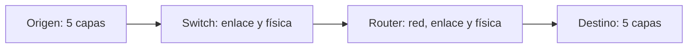

# Proceso de encapsulamiento y flujo de datos en la red

El modelo de capas funciona gracias al **encapsulamiento**: al bajar por la pila, cada capa le **agrega un encabezado** (*header*) al mensaje con la información que ella necesita; al subir en el destino, cada capa **quita** el suyo. Los dispositivos intermedios solo abren las capas que necesitan.

## Bajando por la pila: encapsular

1. La **aplicación** produce el **mensaje** $M$.
2. La **capa de transporte** lo divide en **segmentos** y les agrega su header $H_t$, con la información relevante para el transporte (por ejemplo, los puertos).
3. Se lo pasa a la **capa de red**, que lo convierte en un **paquete de red** o **datagrama** agregando su header $H_n$ (por ejemplo, las direcciones IP).
4. La **capa de enlace** agrega su header $H_l$ (*link header*), normalmente también un *trailer* con un código de detección de errores (CRC), y forma el **frame**.
5. La **capa física** se encarga de transmitir los bits.

| Capa | Unidad | Contenido |
|---|---|---|
| Aplicación | Mensaje | $M$ |
| Transporte | Segmento | $H_t + M$ |
| Red | Datagrama | $H_n + H_t + M$ |
| Enlace | Frame | $H_l + H_n + H_t + M$ |

## El viaje: switch y router

> [!example]- Transcripción de la imagen
> En el *Source*, la pila *Application / Transport / Network / Link / Physical* muestra cómo crece el mensaje: *Message* `M`, *Segment* `Ht M`, *Datagram* `Hn Ht M`, *Frame* `Hl Hn Ht M`. Una línea azul baja por la pila del origen, sube al **Link-layer switch** (que solo tiene *Link* y *Physical* y recibe y entrega `Hl Hn Ht M`), sube al **Router** (que tiene *Network*, *Link* y *Physical*: abre hasta `Hn Ht M` y vuelve a armar `Hl Hn Ht M`) y llega al *Destination*, donde la pila se recorre hacia arriba quitando headers hasta dejar `M` en la aplicación.

- **Switch** (dispositivo de **capa de enlace**): **solo tiene 2 capas**, enlace y física. Recibe el frame, lo procesa en la capa de enlace y lo envía por la física al siguiente dispositivo, sin mirar el datagrama.
- **Router**: tiene **3 capas**, red, enlace y física. Recibe los bits, la capa de enlace **quita su header**, la capa de red **analiza el header de red** y decide qué hacer (por dónde reenviarlo, modificarlo o descartarlo). Luego el paquete vuelve a bajar, con un **nuevo header de enlace**, hacia el siguiente salto.
- En el **destino**, el paquete sube por las 5 capas, cada una quitando su header, hasta entregar $M$ a la aplicación.

> [!tip] Por qué cambia el header de enlace y no el de red
> El header de enlace sirve solo para el salto actual, entre dos dispositivos vecinos, así que cada router pone uno nuevo. El header de red lleva el origen y el destino finales y se mantiene de extremo a extremo; el router solo lo lee (y actualiza campos de control, como el TTL o tiempo de vida del paquete; si llega a 0, lo descarta y avisa al origen con un mensaje ICMP).

## Preguntas de repaso

> [!question]- ¿Qué agrega cada capa al encapsular un mensaje?
> Transporte agrega $H_t$ (segmento), red agrega $H_n$ (datagrama) y enlace agrega $H_l$ (frame). Física transmite los bits.

> [!question]- ¿Qué capas tiene un switch y cuáles un router?
> El switch tiene enlace y física (2 capas). El router tiene red, enlace y física (3 capas).

> [!question]- ¿Qué hace un router con un paquete que recibe?
> Le quita el header de enlace, lee el header de red para decidir por dónde reenviarlo y vuelve a encapsularlo con un nuevo header de enlace para el siguiente salto.

> [!question]- ¿Qué pasa en el host de destino?
> El paquete sube por todas las capas y cada una quita su header, hasta que la aplicación recibe el mensaje original $M$.
